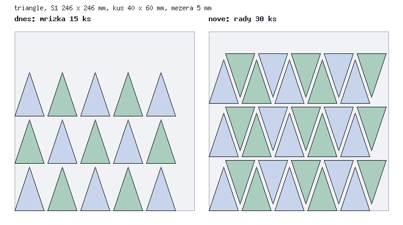
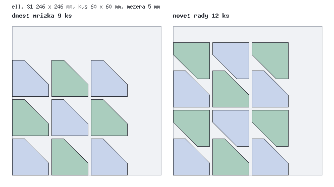

# AE – Víc kusů na desce než mřížka podle kvádru

Session 2, větev `feature/plate-layout` (z `main` 4138678), 17. 10. 2026. Zadání: `docs/prompts/rozlozeni-desky.md`
(TODO #3). Nemergováno, nenasazeno.

## 1. Co se změnilo

Kopie jednoho dílu se dosud kladly do mřížky podle obrysového obdélníku (`PlateLayout::capacity` / `replicate`).
Nově se díl, jehož stín na desce vyplňuje méně než 85 % svého obdélníku, klade **do řad podle skutečného půdorysu**
(konvexního obalu stínu). Kalkulace se ptá stejného kódu, takže slibuje totéž, co farma vytiskne.

| tvar | deska | dnes (mřížka) | nově (řady) | navíc |
|---|---|---|---|---|
| trojúhelníková cedulka 40 × 60 | S1 246 × 246 | 15 | **30** | +100 % |
| trojúhelníková cedulka 40 × 60 | Max 416 × 416 | 54 | **90** | +67 % |
| L 60 × 60, rameno 20 | S1 | 9 | **12** | +33 % |
| L 60 × 60, rameno 20 | Max | 36 | **42** | +17 % |
| kruh Ø 50 | S1 | 16 | **20** | +25 % |
| kruh Ø 50 | Max | 49 | **56** | +14 % |
| obdélník 30 × 80 | S1 / Max | 14 / 48 | 14 / 48 | mřížka (beze změny) |

Obrázky: `docs/img/plate-layout/<tvar>-<deska>.png` (vlevo dnešní mřížka, vpravo nové řady), kreslí je
`php scripts/plate_layout_png.php [výstupní složka] [cesta k připravenému STL]`.

Rozměry desek: usable = deska − 2 × `bed_margin_mm` (2 mm), tedy S1 246, Max 416, Kobra X 256.

## 2. Půdorys dílu (`Footprint`)

- **Python** (`engines/python/farm_tool.py`, `plate_shadow(vertices)`): při přípravě modelu vrátí `prepare` nové pole
  `footprint` = konvexní obal stínu dílu v jeho tiskové orientaci (po otočení a položení na Z = 0), proti směru
  hodinových ručiček, mm, zaokrouhleno na 0,1, nejvýš 64 bodů. Obal s více než 64 rohy (kruh) se nahradí
  64úhelníkem opsaným kolem něj (každá strana se obalu dotýká) – nikdy menší, nejvýš o setiny mm větší.
- `PreparedMesh::footprint` (nové nepovinné pole, do `toArray()` jen když je), tedy i do JSON v keši připravených
  modelů (`CachedPrintPreparer`). Klíč keše obsahuje md5 `farm_tool.py`, takže po nasazení se každý model připraví
  znovu (starý záznam bez půdorysu by jinak dal mřížku – to je i záloha: bez půdorysu = mřížka jako dnes).
- `PhpPrintPreparer` (záloha bez Pythonu, testy) spočítá půdorys v PHP: `Footprint::fromStl` – obal po blocích
  20 000 trojúhelníků (průběžný obal + body bloku → nový obal), paměť nezávislá na velikosti souboru. 1 M
  trojúhelníků (49 MB) za 6,3 s, z toho většinu čtení STL.
- `app/Domain/Farm/Footprint.php` umí jen to, co kladení potřebuje: obal (monotone chain, řazení přes
  `array_multisort` – s `usort` a closure bylo 5× pomalejší), Minkowského součet, růst o r (součet s 16úhelníkem
  opsaným kruhu r – nikde blíž než r, v rozích nejvýš o 2 % r dál), čtvrtotáčky (přesné, bez sin/cos), řezy
  přímkou, separating-axis test překrytí.

## 3. Kladení (`PlateLayout`)

Jeden zdroj pravdy pro farmu i kalkulaci: `PlateLayout::plan(?Footprint, Dimensions díl, Dimensions usable, ?int kopie)`
→ `['method' => 'grid'|'rows', 'max' => N, …]`; `capacityOf(PreparedMesh, usable)` pro `PrepareFarmOrder`,
`capacity(Dimensions, usable)` je dnešní mřížka beze změny.

1. Bez půdorysu, nebo když obal vyplňuje > **85 %** obdélníku (`FILL_GRID`): **mřížka jako dnes**, stejné bajty v STL
   (`StlFileBlocksTest` to drží). Krabičky, stojánky, obdélníkové cedulky se nemění.
2. Jinak **řady** (shelf): obal zvětšený o 2,5 mm na každé straně (polovina mezery 5 mm; dva zvětšené obaly se smějí
   dotýkat, díly jsou pak 5 mm od sebe). Varianty: otočení celé sady 0/90/180/270° × v řadě všechny stejně nebo
   střídavě 0°/180° × liché řady stejné / otočené o 180° / posunuté o 1/8 … 7/8 rozteče (celkem až 4 × 2 × 16 = 128
   variant; půlposun = včelí plást kruhů, otočené liché řady = trojúhelníky a lichoběžníky do sebe).
   - V řadě se každý díl sune doleva, kam ho pustí obaly předchozích dílů (Minkowského rozdíl obalů, řez přímkou y = 0).
   - Řady se sunou dolů na řady pod sebou stejně (rozdíl obalů, řez x = Δx), každá řada proti všem níže, které do ní
     mohou zasahovat.
   - Bere se varianta s nejvíc kusy; pro konkrétní počet kopií ≤ max se zkoušejí i kratší řady a bere se nejkompaktnější
     sada (nejmenší delší strana, pak plocha) – obdoba „co nejčtvercovější mřížky“.
3. Kontrola: žádné dva zvětšené obaly se nepřekrývají (SAT, tolerance 1e-4 mm), vše uvnitř usable. Když neprojde
   nebo vyjde ≤ mřížka, **vrátí se mřížka**.
4. `replicate` zapíše kopie podle `[čtvrtotáčky, x, y]`: díl zůstává ve své tiskové orientaci, jen se otáčí kolem Z
   (0/90/180/270°) a posouvá; sada začíná v počátku jako dnes (slicer ji vycentruje, `--arrange 0` jako dosud).
   `orientation` pak nese `layout: rows, rows, per_row, set_turn, alternate, odd_rows` (mřížka dál `grid`, `grid_rotated`).

**Výkon** (PHP, bez knihoven): cedulka S1 15 ms, L 6 ms, kruh (64 rohů) S1 32 ms, Max 69 ms; 64 kopií kruhu na
Maxu pod 1 s (test). Deterministické: stejný vstup → stejné pole (test porovnává celé `plan`).

**Rozhodnutí**
- Práh 85 % – pod ním by řady vyhrály nejvýš pár procent a plátno by vypadalo jinak než dnes bez užitku.
- Úhly jen násobky 90° – díl se otáčí přesně (bez chyb sin/cos) a bajty STL zůstávají čisté; obecné úhly by
  u cedulek nepřidaly (trojúhelník 180° stačí) a slicer by viděl jinak orientované stěny.
- Jen jeden tvar dílu na desce (zadání §5); kladení různých dílů (zakázka po dílech) jde dál každý díl zvlášť.

## 4. Kalkulace slibuje totéž

- Nový endpoint **`POST /api/calc/plate`** (`PlateController`, throttle 60/min):
  `{file: uuid, scale?, quantity?, bed?}` nebo `{dims: {x,y,z}, footprint?: [[x,y],…], quantity?, bed?}` →
  `{max, perPlate, plates, layout: {method, …placements/size nebo cols/rows/rotated}}`. Deska výchozí
  `pricing.bed_mm` (250), minus `bed_margin_mm` farmy jako dnes v `/api/config`.
- Půdorys uloženého souboru (**jak leží**, farma ho může ještě otočit – pak dá farma obvykle víc, nikdy ne míň než
  mřížka): `engines/python/plate_shadow.py` (trimesh, stejný `plate_shadow` jako ve `farm_tool.py`), bez Pythonu
  `Footprint::fromStl` jen do 15 MB souboru, jinak bez půdorysu = mřížka. Keš `plate:shadow:<uuid>:<sha256>` 7 dní
  (jen nenulový výsledek), odpověď `plate:layout:…` 1 den (soubor, měřítko, deska, počet).
- Cizí/nepřipravený soubor → 404, portfolio bez povoleného stažení → 403 (stejné pravidlo jako `GuardModelFile`).
- `calculator.ts`: `piecesOnBed` (obdélník) zůstává jako pesimistická výchozí hodnota; `askPlate` se po 300 ms zeptá
  endpointu pro `uuid|měřítko` (jednou, odpověď v `Map`), pak `renderSize` ukáže nové číslo. Věta „Na jednu desku
  se vejde N kusů“ a její texty beze změny. `MP_ROUTES.plate` v `calculator/index.blade.php`.

## 5. Testy a ověření

- `tests/Unit/PlateLayoutTest.php` (6 testů, ~50 000 assertů): trojúhelník, L, kruh, obdélník na S1 i Maxu – počet
  ≥ mřížka, trojúhelník a L na S1 ≥ +20 % (L na Maxu +15 %: 20 mm zbylých vpravo a 31 mm vzadu žádný 60mm díl
  nepojmou – viz obrázek), žádné dva kusy blíž než 4,99 mm (vzdálenost polygonů), vše uvnitř, stejný výsledek
  při opakování, obdélník = přesně mřížka, práh 85 %, kompaktní sada pro 2/7/10 kopií, zapsané STL
  (`PhpPrintPreparer` půdorys, `replicate` → objem = N × díl, stíny z trojúhelníků souboru ≥ 5 mm od sebe,
  N + 1 kopií → null), kruh na Maxu pod 1 s, obal ≤ 64 rohů obsahuje všechny body.
- `tests/Feature/PlateEndpointTest.php` (3): cedulka víc než mřížka, keš (po smazání STL stejná odpověď), měřítko
  0,5, krabička = mřížka 25, 404/422/403.
- `tests/Feature/PlateLayoutFarmTest.php` (1): zakázka 20 cedulek přes `/farm/orders` → 1 deska (mřížka by dala 2),
  `check.max_copies` > mřížka, `orientation.layout = rows`, 160 trojúhelníků, status endpoint totéž číslo.
- `StlFileBlocksTest` (mřížka = stejné bajty jako dřív), `FarmOrderFlowTest` kostky beze změny výsledku.
- Python `plate_shadow` ověřen ručně: trojúhelník 3 body, L 5, kruh 64.
- **Neověřeno:** skutečný tisk (žádný) a skutečný slicer nad STL z řad (fake slicer v testech; geometrie je táž jako
  u mřížky, jen jinak otočená a posunutá). Kalkulační stránka v prohlížeči jen přes tsc/build; na produkci po nasazení
  zkontrolovat větu u počtu kusů na nějaké cedulce (`/tools/sign` trojúhelník) – číslo se po ~0,5 s zvýší.

## 6. Nasazení

Žádná migrace, žádný balíček (trimesh už je). `npm run build`, `php artisan view:clear`, `optimize`. Keš připravených
modelů se obnoví sama (klíč = md5 `farm_tool.py`). Po nasazení si první zakázka s kopiemi necedulkového tvaru
nevšimne ničeho; cedulka/přívěsek/klíčenka s více kopiemi dostane řady – doporučuji první takovou zakázku
zkontrolovat v admin G-code (`?plate=1`) a vytisknout.
