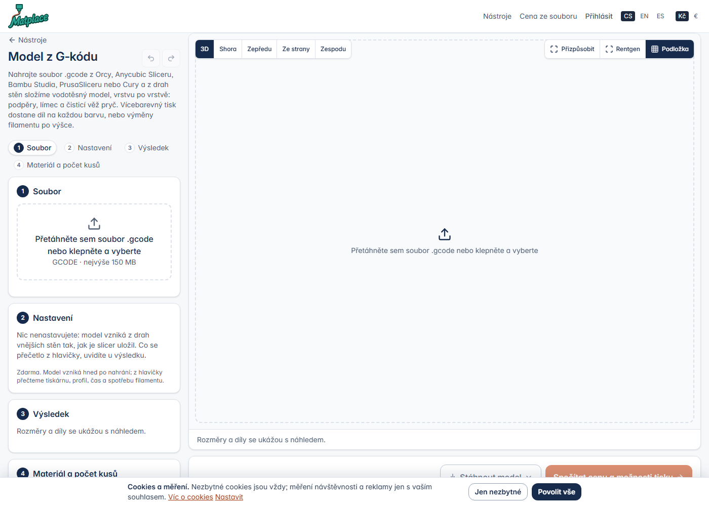

# AL – Nástroj „Model z G‑kódu“ (G‑kód → STL/3MF, i po barvách)

Session 2, větev `feature/gcode-model` (z `main` be7a12f), 18. 10. 2026. Zadání: `docs/prompts/gcode-model.md`
(TODO #19). Nemergováno, nenasazeno.

## 1. Co nástroj dělá

`/tools/gcode-model` (karta v kategorii „úpravy souboru“, `config/tools.php` → `gcode`): nahrajete `.gcode` do
150 MB a hned vzniká nový model – operace `gcode` v rámci nástrojů „soubor dovnitř, model ven“ (stejná stránka
`tools/edit.blade.php`, `edit.ts`, úloha `EditModel` ve frontě, výsledek jako každý jiný upravený model: náhled,
Stáhnout model, Spočítat cenu a možnosti tisku, díly, 3MF projekt). Nahrání samo je operace: `POST /api/tools/gcode`
(`EditApiController::gcode` → `ModelEditor::fromGcode`), G‑kód zůstává u modelu jako `source.gcode`, `EditModel`
volá **`engines/python/gcode_tool.py`** místo `edit_tool.py`. Nastavení žádné; tlačítko „Vytvořit model“ je u této operace skryté (skript stránky ho potřebuje v DOM).

## 2. Jak z drah vzniká model (`gcode_tool.py`)

1. **Čtení** (čistý Python, ~1 M řádků za pár sekund): G0/G1 s X/Y/Z/E, G2/G3 (oblouky po 5°, I/J i R), G90/G91,
   M82/M83, G92, G28, `T<n>` (i `M620 S<n>` u Bambu), `;TYPE:`, `;WIDTH:`, `;HEIGHT:`, `;LAYER_CHANGE`/`;LAYER:`,
   hlavičkové řádky `; klíč = hodnota` (Orca, Bambu, Anycubic, Prusa) a Bambu „model printing time: …; total
   estimated time: …“, Cura `;TIME:`/`;Layer height:`. Čte se do `max_lines` (1 500 000) řádků; delší soubor se
   tam usekne a výsledek to říká (`truncated`).
2. **Smyčky vnějších stěn**: souvislé extruzní tahy (bez cestovního pohybu, retrakce, změny Z nebo nástroje)
   tvoří polyline; ta, která obsahuje typ *Outer wall* / *External perimeter* / *WALL-OUTER* (i s úseky *Overhang
   wall*), je obrys. Slicer kreslí právě jednu takovou smyčku kolem každého obrysu řezu – vnějšku i každé díry –
   půl šířky linky uvnitř skutečného povrchu. Smyčka je uzavřená, když se konce sejdou do max(1,5 w; 0,8 mm);
   otevřené kusy se řetězí konci k sobě; co zůstane otevřené, se vynechá a počítá (`open_loops`). Samotný `G1 F…`
   (jen posuv) smyčku nepřerušuje – na tom zprvu padala klíčenka z Anycubicu (2 613 otevřených smyček → 0).
3. **Strom vnoření** v každé vrstvě (bod v mnohoúhelníku, podle plochy od největší): smyčka bez rodiče = materiál;
   uvnitř materiálu **téhož nástroje** = díra; uvnitř díry = materiál (ostrov); uvnitř materiálu **jiného nástroje** =
   vlastní materiál (písmeno vložené do destičky). Oblast nástroje = sjednocení jeho materiálových smyček minus to,
   co leží přímo v nich, zvětšené o **půl šířky linky** (`CrossSection.offset`, Round, 8 segmentů: vnějšek ven,
   díry dovnitř – přesně tam, kde byl povrch). Kde se při vložce překryjí dva nástroje, vyhrává vyšší. Vnitřní
   stěny, výplň, horní/spodní plochy tvar neovlivňují (leží uvnitř obrysů); podpěry, límec, obrys, prime/wipe
   tower, čisticí linky a cestovní pohyby se nečtou vůbec (typ ≠ stěna → polyline končí, a jen obrysové smyčky
   se berou). Nic se nerozšiřuje nad šířku linky: oblast pod `w²` se zahodí.
4. **Vytažení**: oblast vrstvy od `z − h` do `z` (`;HEIGHT:`, jinak rozdíl Z, jinak `layer_height` z hlavičky);
   stejné po sobě jdoucí vrstvy jako jeden hranol; hranoly nástroje sjednoceny po dávkách 32 (`batch_boolean`),
   celek položen na Z = 0 a vystředěn. Váza (spirála): smyčky se shrnou po výšce vrstvy.
5. **Barvy a výstup**: jeden nástroj → díl `body`. Více nástrojů **v jedné vrstvě** (`colors_mode = parts`) → díl na
   nástroj `color_1…n` + `part_colors` (hex z `filament_colour`/`extruder_colour`, jinak paleta) → kalkulace ukáže
   barvy, farma tiskne po dílech; vedle dílů i **`parts/colors.3mf`** (vlastní zápis: objekt na barvu, barva jako
   `basematerials`) ke stažení z menu. Více nástrojů, ale nikdy dva v jedné vrstvě (`height`) → jeden díl `body`
   a `color_changes` (spodek první vrstvy každého dalšího nástroje), jak je farma a 3MF projekt umějí (`ModelFile::
   colorChanges`, `ColorChange::addAll`). Soubor s jedním filamentem jmenuje svou barvu pro jakékoli číslo nástroje
   (zakázka farmy ze slotu T3).
6. **Hlavička** → `slicer`, `printer` (`printer_model`/`printer_settings_id`), `profile` (`print_settings_id`),
   `layer_height`, `line_width` (`outer_wall_line_width` / `external_perimeter_extrusion_width` / `line_width` /
   `extrusion_width`), `time_s`, `filament_g` (`total filament used [g]` nebo součet), `filament_m`, názvy a druhy
   filamentů, gramy po nástrojích (Anycubic dělí čárkou, Orca/Bambu/Prusa středníkem).

## 3. Ověření

| soubor | řádků | vrstev | smyček | výsledek | čas |
|---|---|---|---|---|---|
| syntetická kostka 20 mm (2 stěny, výplň, límec, podpěra) | 11 k | 100 | 100 | 7 999 mm³, 20×20×20, vodotěsná | < 1 s |
| kostka s dírou 8 mm | | 100 | 200 | 6 719 mm³ (8 000 − 1 280 = 6 720) | |
| písmeno 6 mm druhým nástrojem v horní půlce | | 100 | 200 | `parts`: color_1 7 639 + color_2 360 mm³, colors.3mf | |
| horní půlka druhým nástrojem | | 100 | 100 | `height`: 7 999 mm³, color_changes [z = 10] | |
| `matplace-T26-000030.gcode` (OrcaSlicer 2.4, Kobra S1, zakázka farmy, T3) | 130 k | 106 | 384 | 37 802 mm³, 116 × 34,6 × 21,2, jeden díl #F2754E, 28 min, 15,88 g | 3 s |
| `baby samoyed keychain` (AnycubicSlicerNext 1.3.7, Kobra 3 Max, T0 + T2, prime tower) | 518 k | 128 | 1 263 | 22 219 mm³, 29,6 × 100,4 × 25,6, `parts`: #212721 99,8 % + #FFFFFF 0,2 %, 1 h 37 min, 25,91 g | 9 s |
| **známé STL** 30 × 20 × 10 s dírou Ø 8 a výřezem 6 × 6 (objem 5 138,2 mm³), nařezané místním AnycubicSlicerNext 2.0.0.3 (S1, tryska 0,2, vrstva 0,14, linka 0,22) | 39 k | 72 | 144 | 5 177,4 mm³ (**+0,8 %**), 30,0 × 20,0 × 10,08 (72 × 0,14) | 1 s |

Původní STL obou skutečných souborů nemám (zakázka je na produkci, klíčenka je cizí); rozměry a objem sedí s tím,
co hlavičky říkají (max_z_height 21,20 / 25,80, filament 12,8 / 20,9 cm³ při řídké výplni). Proto ta třetí řádka:
známé těleso → slicer → G‑kód → nástroj → objem o 0,8 % větší (zaoblené rohy a půl linky navíc v drobných místech),
půdorys přesný na setiny, výška zaokrouhlená na vrstvy. Postup je ve `scratchpad` session 2 (slice s profily
`engines/orca/profiles/*_kobras1_n02.json`, `--arrange 1 --slice 0`). Testy
`tests/Feature/GcodeModelTest.php` (7): kostka ± 5 % a vodotěsná, díra zůstává, díl na barvu + 3MF se dvěma objekty,
změna barvy po výšce v 10 mm s hexem druhého filamentu, hlavičky Prusa/Bambu/Anycubic (čas, filament, barvy, šířka
linky), nesmyslný soubor → `not_gcode`, soubor bez stěn → `no_walls` (přeložené v cs/en/es), `.stl` na endpoint →
422, stránka cs/en/es (jen `.gcode`, 150 MB, bez surových klíčů, v katalogu). Dál `ModelEditTest` (rámec edit),
`ToolPageTest` (MODULES má `gcode`), `pint`, `tsc`, `build`.

Přesnost: povrch leží tam, kde byl střed vnější stěny + w/2; rohy jsou zaoblené na w/2 (jako u skutečného
výtisku). Schodky vrstev zůstávají (model je vytažený po vrstvách), detaily pod šířkou linky chybí, vnitřní dutiny
bez vlastní vnější stěny (např. dutý model s jednou stěnou kolem dutiny – ta má svůj *Outer wall*, tedy zůstane;
dutina vzniklá jen z výplně ne).

Stránka: `docs/img/gcode-model.png` (místní server, krok 1 soubor jen `.gcode` do 150 MB, krok 2 bez nastavení,
krok 3 výsledek; po nahrání se objeví report, barvy dílů a menu Stáhnout model s 3MF po barvách).



## 4. Soubory

`engines/python/gcode_tool.py` (nový engine; importuje `Invalid/finish/out/stage` z `edit_tool.py`),
`app/Domain/Tools/ModelEditor.php` (KINDS `gcode`, `GCODE_MAX_MB`, `GCODE_MAX_LINES`, `fromGcode()`, `colors3mf()`,
`make()` odmítá `gcode`), `app/Jobs/EditModel.php` (zdroj = `source.gcode`, skript `gcode_tool.py`, `part_colors`/
`color_changes`/`multi_material` z notes do `tool_params`), `app/Http/Controllers/Api/EditApiController.php`
(`gcode()`, `colors3mf()`), `routes/web.php` (`tools.gcode`, `api.tools.gcode.store`, `api.tools.edit.colors3mf`),
`config/tools.php`, `resources/views/tools/edit.blade.php` (formáty `gcode`, limit 150 MB, upload na nový endpoint,
blok bez nastavení, skryté tlačítko, klíče textů), `resources/views/tools/art.blade.php` (kresba karty),
`resources/js/calc/edit.ts` (nahrání = operace, report, barvy dílů, 3MF po barvách, „jiný soubor“, otevření
z kalkulace), `lang/src/gcode_model.json` → cs/en/es (36 klíčů), `tests/Support/GcodeFixtures.php`,
`tests/Feature/GcodeModelTest.php`, `tests/Feature/ToolPageTest.php` (MODULES).

## 5. Limity a co dál

- Jen FDM G‑kód se smyčkami vnějších stěn; soubor bez nich (jen podpěry, pryskyřice, CNC) → `no_walls`.
- 1 500 000 řádků; víc = oříznuto s varováním. 150 MB.
- Nejsou čteny: `.gcode.3mf` (Bambu balí G‑kód do 3MF), binární G‑kód Prusa (`.bgcode`), G‑kód bez `;TYPE:`
  (starý Cura/Simplify3D zapisuje jinak: Simplify3D `; outer perimeter` – neověřeno, nepodporováno).
- Vložka (jiný nástroj uvnitř) s vlastní dírou: díra ve vložce se pozná (rodič = materiál téhož nástroje) ✓;
  vložka uvnitř díry jiného nástroje je ostrov ✓.
- Co by stálo za to: kontrola proti původnímu STL na produkci (zakázka T26-000030 má svůj model), nahrání
  `.gcode.3mf`, binární G‑kód.

## 6. Nasazení

Bez migrace a bez balíčku (manifold3d, numpy, trimesh už jsou). `npm run build`, `php artisan view:clear`,
`optimize`. Nástroj je `available => true`; v `/admin/tools` jde skrýt. Limit 150 MB vyžaduje `client_max_body_size`
nginx ≥ 150m a `upload_max_filesize`/`post_max_size` PHP ≥ 150M – zkontrolovat na serveru (dnešní modely mají
120 MB).

---

# Svítící druhy jen z přímo vedené cívky (TODO #2)

Session 2, větev `feature/manual-only-kinds` (z `main` dab9592), 18. 10. 2026. Zadání: `docs/prompts/svitive-rucne.md`
(zadání říká „AL.md §5“, ale §5 a §6 už patří G‑kódu, proto §7). Nemergováno, nenasazeno.

## 7. Co a proč

Svítící PLA se v měniči (ACE) láme – F26‑000065 zrušena (Roman, 14. 10. 2026). Druh materiálu má nový příznak
**`farm_materials.manual_only`** („Jen z přímo vedené cívky (ne do měniče)“): jeho barvy jdou založit jen do slotů
**tiskárny v ručním režimu**, kde cívku vede obsluha přímo, nabízejí se jen odtud, a obsluha vidí u zakázky a na
nástěnce odznak „ručně z přímo vedené cívky“. Zákazník nic nového nevidí (ověřeno testem: stránka zakázky ani
`status` JSON takové slovo nenesou). Agent, slicer, profily, kalkulace, nástroje netknuty.

### 7.1 Jak to drží pohromadě

- **Pravidlo na jednom místě**: `FarmPrinterSlot::kindFits(?FarmPrinter, ?FarmColor)` = barva druhu s příznakem smí
  jen do tiskárny, která **není** přes agenta; instanční `kindFitsPrinter()`. `FarmMaterial::isManualOnly()`,
  příznak jde i do `copy()` („založit podle“).
- **Admin, druh** (`/admin/farm/materials`): zaškrtávátko s vysvětlením pod políčky druhu; v záhlaví druhu
  „· jen z přímo vedené cívky“. `FarmCatalogController::saveMaterial` → `manual_only = $request->boolean(…)`.
- **Admin, cívky** (stránka tiskárny i „Založení cívek do všech tiskáren“): skupiny barev v selectu nesou
  u takového druhu příponu „· jen z přímo vedené cívky“; na hromadné stránce je u tiskárny i její režim. Při uložení
  projde řádky slotů `FarmCatalogController::manualOnlyRule()` (jen když tiskárna je/bude přes agenta):
  - barva s příznakem **nově** daná do slotu agentní tiskárny → `ValidationException` u toho slotu („… se láme
    v měniči; dejte ji do tiskárny v ručním režimu (:printer jede přes agenta)“); na hromadné stránce se pravidlo
    vyhodnotí pro všechny stroje **před** zápisem, takže odmítnutí u jednoho slotu nenechá nic napůl uložené;
    nová barva takového druhu psaná rovnou u slotu („+ nová barva“) se u agentní tiskárny ani nezaloží;
  - barva, která ve slotu **už byla** (tiskárna přepnuta z ručního na agenta, nebo příznak přišel až po založení)
    → zůstane ve slotu, ale **`enabled = false`**; byl‑li slot zaškrtnutý, flash (červený řádek pod navigací) říká
    „Slot :n (:color) je vypnutý: :printer teď jede přes agenta …“. Uložení s nezaškrtnutým slotem už nic neříká;
    přepnutí zpět na ruční a zaškrtnutí slot zase nabízí.
- **Nabídka, pojistka** (`OrderService`): `offeredColors` (úvodní stránka), `availableSlots` (→ `availableColors`,
  `machineFor`, platba), `secondSpoolsAcross` **a** `secondSpools` (druhá barva/díly téhož stroje) vynechají slot,
  kde `! kindFitsPrinter()`. Není‑li taková cívka v žádné ruční tiskárně online, barva se nenabízí – jako dnes bez
  cívky. Netknuto: `printerAndMaterialFor`/`loadedMaterials` (druh prvního řezu podle ceny) – svítící druh není
  nejlevnější a jeho barva by se stejně nenabídla; zadání chtělo jen filtry slotů.
- **Odznak**: `FarmOrder::manualOnly()` = kterákoli barva zakázky (první, druhá, změny, díly) je druhu s příznakem.
  `admin/farm/order.blade.php` u řádku Barva, `dashboard.blade.php` u běžící úlohy i u řádků fronty
  (`data-manual-only`, oranžová pilulka). V seznamu cívek pod tiskárnou na nástěnce je cívka, která ve stroji
  nabízet nesmí (stará data), **přeškrtnutá** s titulkem proč – obsluha ji má přendat.
- **Texty**: `lang/{cs,en,es}/farm.php` → `farm.admin.manual_only`, `_hint`, `_short`, `_slots_hint`, `_refused`,
  `_disabled`, `_badge` (7 klíčů × 3 jazyky).

### 7.2 Testy

`tests/Feature/FarmManualOnlyKindsTest.php` (6 testů, 127 tvrzení): příznak z formuláře druhu (i kopie, i zpět);
uložení do slotu agentní tiskárny odmítnuto u správného pole (stránka tiskárny i hromadná stránka; hromadná
neuloží ani ruční stroj z téhož formuláře), do ruční přijato a hned nabízeno; nová barva druhu u agentní se
nezaloží; přepnutí ruční → agent slot vypne, cívku nechá, hláška jmenuje slot, opakované uložení mlčí, zpět na
ruční nabízí; nabídka: barva jen v agentní (stará data) chybí v `status` JSON, v `offeredColors`, v `secondSpools`
i `secondSpoolsAcross`, zatímco černá téhož stroje tam je; v ruční se nabízí s kódem stroje a jako druhá barva
k její bílé; bez příznaku agentní nabízí jako každou jinou; odznak u zakázky a na nástěnce po zaplacení, nic
u zakázky v jiné barvě, nic u zákazníka; sedm klíčů ve třech jazycích. Dál zelené: `FarmCatalogAdminTest`,
`FarmOrderColorsTest`, `FarmPagesTest`, `FarmOrderFlowTest`, `FarmTuningTest`, `StandPartsFarmTest`,
`PlateLayoutFarmTest`; `pint --dirty`.

### 7.3 Nasazení a produkce

Migrace `2026_10_21_100000_farm_materials_manual_only` (sloupec bool, výchozí false – nic se nezmění, dokud druh
příznak nedostane). Bez balíčku, bez buildu JS (jen Blade), `php artisan view:clear`.

**Příkaz pro produkci** (řídící session po nasazení; totéž udělá Roman zaškrtnutím u druhu PLA svítící
v `/admin/farm/materials`). Uložit jako `/tmp/manual_only.php` a spustit
`php artisan tinker --execute "$(cat /tmp/manual_only.php)"` (jako www-data s `HOME=/tmp/wwwhome`):

```php
$kind = App\Models\FarmMaterial::where('code', 'PLA')->where('finish', 'luminous')->firstOrFail();
$kind->update(['manual_only' => true]);
echo $kind->label().' (id '.$kind->id.'): manual_only = 1'.PHP_EOL;
$slots = App\Models\FarmPrinterSlot::with(['color.material', 'printer'])->whereHas('color', fn ($q) => $q->where('farm_material_id', $kind->id))->get();
foreach ($slots as $s) {
    echo $s->code().' '.$s->printer->name.' ['.$s->printer->mode.'] '.$s->color->fullLabel().' '.round($s->remaining_g).' g, '.($s->enabled ? 'zapnutý' : 'vypnutý')
        .' -> '.($s->kindFitsPrinter() ? 'nabízí se dál' : 'NENABÍZÍ SE (tiskárna přes agenta) – přendat do ruční').PHP_EOL;
}
echo count($slots) ? '' : 'žádná svítící cívka není v žádném slotu'.PHP_EOL;
```

Co se stane se sloty, kde svítící barvy dnes leží: v databázi **nic** – příznak sloty nemění. Od té chvíle:
- slot v tiskárně **v ručním režimu** nabízí dál (zákazník barvu vidí s kódem té tiskárny, zakázka dostane odznak,
  obsluha vede cívku přímo);
- slot v tiskárně **přes agenta** z nabídky zmizí hned (pojistka v `OrderService`), na nástěnce je přeškrtnutý; při
  příštím uložení té tiskárny v adminu (její stránka nebo hromadná) se zaškrtnutý slot vypne s hláškou. Cívku je
  třeba přendat do ruční tiskárny a tam ji založit (nebo tiskárnu přepnout na ruční).
- Není‑li žádná svítící cívka v ruční tiskárně online, svítících 9 barev se nenabízí vůbec (jako dnes bez cívky).
Které tiskárny to dnes jsou, vypíše ten příkaz (řídící slíbila výpis z produkce na vyžádání; výpis je součástí
příkazu, zvláštní dotaz není potřeba).

### 7.4 Soubory

`database/migrations/2026_10_21_100000_farm_materials_manual_only.php`, `app/Models/FarmMaterial.php`
(`manual_only`, `isManualOnly()`, `copy()`), `app/Models/FarmPrinterSlot.php` (`kindFits()`, `kindFitsPrinter()`),
`app/Models/FarmOrder.php` (`manualOnly()`), `app/Domain/Farm/OrderService.php` (čtyři filtry),
`app/Http/Controllers/Admin/FarmCatalogController.php` (`saveMaterial`, `saveSlots`, `savePrinter`,
`manualOnlyRule()`), `resources/views/admin/farm/{materials,printer_edit,slots,order,dashboard}.blade.php`,
`lang/{cs,en,es}/farm.php`, `tests/Feature/FarmManualOnlyKindsTest.php`.

---

# Upozornění obsluze: zaplaceno, tiskne se, dotištěno, pokazilo se (TODO #22)

Session 2, větev `feature/admin-notify` (z `main` 4d27dc6), 18. 10. 2026. Zadání: `docs/prompts/admin-upozorneni.md`.
Nemergováno, nenasazeno. Žádný skutečný e‑mail neodešel (testy `Mail::fake`, místní `.env` bez SMTP).

## 8. Co a proč

Roman (18. 10. 2026): „Potřebuji jako admin dostávat info, že někdo něco tiskne, že se něco dotisklo, nebo se něco
pokazilo, než pustím komerční přijímání zakázek.“ Dosud chodily na `admin_email` jen výjimky. Teď chodí i běžný
průběh, **jeden e‑mail = jedna událost**, v češtině, se čtyřmi přepínači v `/admin/farm/settings`.

### 8.1 Události

| událost | kde vzniká | předmět | tělo (řádky) | druh |
|---|---|---|---|---|
| zaplaceno | `OrderFlow::pay()` na konci (po `move(PAID)` a po rozhodnutí, co dál) | „Nová zakázka F26‑000123: zaplaceno“ / „…zaplaceno, čeká na schválení“ / „…zaplaceno, řeže se znovu pro U #2“ | zákazník (jméno (e‑mail)), model (soubor, u nástroje i jeho klíč), materiál a barva s kódem cívky (`spoolText`), tiskárna + režim, kusy (+ podložky), cena, doprava (druh + místo/adresa + země), poznámka, **fronta** („začne hned, hotovo asi za 1 h 47 min“ / „začne asi za X, před ní N“ / „čeká na vaše schválení“ / „čeká, až obsluha potvrdí volnou podložku“ / „tiskárna je offline“ / „řeže se znovu“ / „ruční režim, začne, až tisk spustíte“), u ruční tiskárny navíc „Tisk spustí obsluha: G‑kód stáhněte v adminu…“ | `paid` |
| tiskne se | `OrderFlow::move(PRINTING)` = první hlášení agenta (`AgentService::jobReport` posune zakázku jen z `queued`); jen **tiskárna přes agenta** a jen **první podložka** (`plates_done = 0`) | „F26‑000123 se tiskne na U #1“ | zákazník, model, cívky, tiskárna; u více podložek „Podložka 1 z 2“; „Odhad dotištění: za 1 h 47 min (asi v 14:32)“ – čas v `farm.operator_timezone` (výchozí Europe/Prague; aplikace běží v UTC) | `printing` |
| dotištěno | `OrderFlow::move(DONE)` – u více podložek/dílů až po poslední (`plateFinished`) | „F26‑000123 dotištěno (U #1, 1 h 47 min)“ | doba tisku (změřená, jinak odhad), filament v g, **další krok** (zabalit a vytvořit zásilku s místem / zákazník si vyzvedne / vyhodnotit testovací tisk), „Poslední snímek z kamery je v příloze.“ + **příloha `snimek.jpg`**: poslední `snapshot_path` úlohy; do 300 kB tak, jak je; větší se přes GD zmenší na 1280 px (kvalita 70) do `orders/<token>/snapshot_mail.jpg`; když ani tak nevejde, mail jde bez přílohy a bez té věty | `done` |
| tisk selhal | `OrderFlow::move(FAILED)` (přes `fail()` z agenta nebo z adminu), jen zaplacené zakázky | „F26‑000123: tisk selhal (print_failed)“ | **Co:** důvod česky pro obsluhu (`farm.admin.mail.reason.*`, jinak `farm.error.*`, jinak kód) + detail z tiskárny; **Kde:** tiskárna, podložka, vytištěno N %; **Co dál:** kredit vrácen, zkontrolujte tiskárnu a podložku, zakázku lze vrátit do fronty | `problem` |
| zrušil zákazník | `OrderFlow::move(CANCELLED)` s aktérem `user`, jen zaplacené | „F26‑000123 zrušil zákazník“ | kdy, vráceno zákazníkovi (cena − účtovaná část), účtováno za vytištěnou část (%), tisklo se ano/ne | `problem` |
| start selhal | `AgentService::commandResult` | „F26‑000123: start na U #1 selhal“ | zákazník/model/cívky/tiskárna, Co: odpověď agenta, Co dál: zakázka zůstává ve frontě, potvrďte podložku znovu | `problem` |
| tiskárna offline | `AgentService::watch` (beze změny četnosti: jednou za 6 h, s běžícím tiskem vždy) | „F26‑000123: tiskárna U #1 je offline“ / bez zakázky „Tiskárna U #1 je offline“ | řádky zakázky, kdy se naposledy ozvala | `problem` |
| chyba čeká na potvrzení | `AgentService::jobReport` (Kobra S1 na chvíli hlásí chybu po startu) | „F26‑000123: tiskárna U #1 hlásí chybu, čekám, zda zůstane“ | řádky zakázky + dosavadní vysvětlení | `problem` |
| ruční spuštění | `OrderFlow::onQueued` na ruční tiskárně | „F26‑000123 čeká na ruční spuštění (U #3)“ | řádky zakázky + pokyn | `printing` |
| cizí měna | `CreditController` | beze změny | | `problem` |

Zrušené: samostatný mail „čeká na schválení“ (je to teď předmět a řádek fronty mailu „zaplaceno“). Mail „ruční
spuštění“ se **neposílá v okamžiku placení** (ta informace je v mailu „zaplaceno“: `OrderFlow::$paying`); jde sám
po schválení, po novém řezu nebo po vrácení do fronty – a také při placení, když je druh `paid` vypnutý. Video ke
schválení (`FarmVideos`) posílá `FarmAdminAlert` napřímo jako dřív, přepínače se ho netýkají.

### 8.2 Přepínače a kanál

- `FarmSettings` **`notify_paid`, `notify_printing`, `notify_done`, `notify_problem`** (výchozí `true`,
  `config/farm.php` `settings`; zadání psalo `notify.paid`, ale `FarmSettings::get` čte výchozí hodnotu přes
  `config('farm.settings.<klíč>')` a tečka v klíči by se četla jako vnoření, proto podtržítko). V `/admin/farm/settings`
  vedle „E‑mail obsluhy“ čtyři zaškrtávátka (`#farm-notify`): zaplaceno, tiskne se, dotištěno (se snímkem), problémy.
- `OrderFlow::alertAdmin($subject, $order, $lines, $kind = 'problem', $attachment = null)`: nic bez `admin_email`,
  nic s vypnutým druhem; `Mail::queue` jako dřív, selhání jen do logu. `FarmAdminAlert` nese `kind` a volitelnou
  přílohu (`attachments()`), šablona beze změny.
- Texty **vždy česky** (`Lang::get(…, 'cs')`, i když platí zákazník na `/en/`); klíče `farm.admin.mail.*` (předměty
  s číslem zakázky na začátku, řádky `line_*`, důvody `reason.*`) ve třech jazycích kvůli souměrnosti souborů.
- **Žádné opakování bez nového sloupce**: stavový automat `move()` spustí každý přechod jednou; hlášení agenta
  každých 5 s zakázku znovu neposune (`AgentService` hlídá `status === queued`), zakázka o více podložkách řekne
  „tiskne se“ jen u první (`plates_done = 0`) a „dotištěno“ až po poslední; opakované hlášení `failed` končí na
  uzavřené úloze. Ověřeno testem (3 hlášení „printing“ = 1 mail, 2 hlášení „failed“ = 1 mail).

### 8.3 Testy

`tests/Feature/FarmAdminNotifyTest.php` (6 testů): zaplacení na ruční tiskárně = právě jeden mail s číslem,
odkazem do adminu, zákazníkem, modelem, cívkou, tiskárnou, cenou, dopravou, frontou a pokynem; agentní tisk = „tiskne
se“ jednou po třech hlášeních (s odhadem dotištění) a „dotištěno“ jednou s dobou 1 h 47 min, filamentem, dalším
krokem a přílohou (soubor existuje, `attachments()` má jednu položku); velký snímek (≈ 500 kB) se zmenší na 1280 px
pod 300 kB do `snapshot_mail.jpg`; dvě podložky = „tiskne se“ u první, „dotištěno“ až po druhé; selhání (2× hlášeno)
= jeden problém s Co/Kde/Co dál, neúspěšný start = předmět s číslem, zrušení zákazníkem = vráceno + „tisklo se: ne“;
vypnutý druh `paid` nic (ruční spuštění pak přijde samo), prázdný e‑mail nic; formulář nastavení ukládá čtyři
přepínače. Dál zelené: `FarmOrderFlowTest`, `FarmOfflineAlertTest`, `FarmPagesTest`, `FarmCardPaymentTest`;
`pint --dirty`.

### 8.4 Nasazení

Bez migrace, bez buildu. `php artisan config:clear` (nové výchozí hodnoty), `view:clear`. Fronta: maily jdou přes
`queue` jako dosud – worker musí běžet (dnes běží, zákazníkům chodí). Po nasazení zkontrolovat v
`/admin/farm/settings`, že je vyplněný e‑mail obsluhy a čtyři přepínače zaškrtnuté; první skutečná zakázka ukáže
mail „zaplaceno“ (a u agentní tiskárny „tiskne se“ a „dotištěno“ se snímkem). Pokud by snímky z kamery byly větší než
300 kB i po zmenšení (dnešní snímky S1 mají ~100–200 kB), mail přijde bez přílohy.

### 8.5 Soubory

`app/Domain/Farm/OrderFlow.php` (`pay()` konec, `move()` → `adminEvent`, `fail()`, `onQueued`, `alertAdmin`,
`adminPaid/Printing/Done/Failed/Cancelled`, `orderLines`, `queueLine`, `deliveryText`, `snapshotFor`, `t`, `clock`,
`duration`), `app/Domain/Farm/AgentService.php` (tři volání s číslem zakázky a řádky), `app/Mail/FarmAdminAlert.php`
(`kind`, `attachment`), `config/farm.php` (čtyři `notify_*`), `app/Http/Controllers/Admin/FarmCatalogController.php`
(`saveSettings`), `resources/views/admin/farm/settings.blade.php`, `lang/{cs,en,es}/farm.php` (`admin.mail`),
`tests/Feature/FarmAdminNotifyTest.php`.

---

# Inspirační katalog a vyhledávače: co indexovat, co obohatit (TODO #25)

Session 2, větev `feature/catalog-seo` (z `main` 874ce6c), 18. 10. 2026. Zadání: `docs/prompts/katalog-seo.md`.
Nemergováno, nenasazeno. Gemini bylo voláno jen místně na pět modelů místní kopie katalogu (0,07 Kč), na produkci nic.

## 9. Co a proč

Katalog (`/model/{slug}`) jsou šablonové stránky s cizím anglickým textem; Roman 18. 10.: **indexovat jen modely,
které mají něco navíc; zbytek nechat dostupný s `noindex`; vybrané postupně obohatit.** Návštěvníkům se nic neskrývá
(`shown()` beze změny), mění se jen `robots`, sitemapa a text stránky.

### 9.1 Pravidlo „má něco navíc“ a čísla, na která si dát pozor

`CatalogModel::scopeIndexable()` = `shown()` + vše, co žádá `config('catalog.index_requires')`
(`CATALOG_INDEX_REQUIRES`, výchozí **`enriched,price,file`** přesně podle zadání):

| podmínka | co znamená | jak se pozná |
|---|---|---|
| `enriched` | text napsaný u nás | `enriched_at` (plní `catalog:enrich` nebo tlačítko v adminu) |
| `price` | skutečná cena z kalkulace | karta autora k tisku (`designerModels` `printable()` se `slice_summary`), **nebo** `est_minutes > 0 ∧ est_grams > 0` (čísla sliceru převzatá ze starého webu) – a na farmě musí být založený aspoň jeden druh (`ModelPricing::anyMaterial()`), jinak cenu nejde říct nikomu |
| `file` | soubor máme | `file_available`, `model_file_id`, nebo karta autora k tisku |

`isIndexable()` se ptá téhož dotazu pro jeden model (stránka), `indexGaps()` říká, co chybí (admin). Stránka bez toho
dostane `<meta name="robots" content="noindex, follow">` (nový parametr layoutu `$robots`; `noindex` samotný dál
znamená `noindex, nofollow` pro admin a účty), **bez canonicalu** (canonical + noindex si odporují), jazykové
dvojčata `hreflang` zůstávají (jsou i pro lidi; `CatalogTest` je čeká). Kategorie a seznamy indexované dál.

**Pozor na čísla.** Místní kopie katalogu (2 498 modelů ze stejného importu jako produkce): **0 se souborem,
2 s odhadem minut**, karty autorů k tisku jednotky. Import nikdy `file_available` neplnil
(`CatalogImporter` zapisuje `false`, `matplace:import-catalog` sloupec nebere) a `print_time_min` starého webu
byl vyplněný výjimečně. S výchozím pravidlem by tedy po nasazení **zůstalo v sitemapě 0 katalogových adres a nic by
se tam nevrátilo ani po obohacení 300 modelů**, protože text soubor ani cenu nepřidá. Proto:

- `catalog:enrich` vybírá jen modely, které by se po obohacení daly indexovat (`scopeIndexReady`), a říká, kolik
  z top N vynechal; `--any` bere i ostatní.
- `matplace:sitemap` i `catalog:enrich --dry-run` vypisují: zobrazených / s naším textem / indexovatelných / kolik
  by šlo indexovat po obohacení – **spusťte na produkci `php artisan catalog:enrich --dry-run` a rozhodněte podle
  čísel.** Pravděpodobný závěr: nastavit `CATALOG_INDEX_REQUIRES=enriched` (text náš + cena, když ji lze říct, se
  na stránce ukáže sama) a soubor/cenu nechat jako „navíc“, dokud nebudou data. Přepínač je v `.env`, bez nasazení.

### 9.2 Stránka modelu

`InspirationController::show` předává `quote` (`ModelPricing::quoteCatalog`: cena 1 ks z karty autora, jinak
z `est_*` v nejlevnějším založeném druhu, částka v měně návštěvníka) a `indexable`. `inspiration/show.blade.php`:

- u výzvy k tisku v `<dl>` nové řádky **Největší rozměr** (`max_mm`), **Odhad tisku** (`est_grams`, `est_minutes`
  jako „1 h 30 min“) a **Cena u nás** „od 189 Kč (PLA+, 1 ks)“ + „Přesnou cenu spočítá kalkulace…“ (jen když jsou);
- u obohaceného modelu je **náš text** v jazyce stránky nahoře (`data-our-text`, `lang` = jazyk stránky) a pod ním
  **„Původní popis autora (English)“ sbalený** v `<details data-original-text>` (`description.original`,
  `source_locale`); neobohacený model vypadá jako dřív (zdrojový text jako hlavní, `lang="en"`);
- en/es stránka ukazuje svůj náš text; existuje dál jen tam, kde text je (`locales()` beze změny). Titulky a popisy
  stránek se mezi jazyky neliší jinak než jazykem (beze změny).

### 9.3 `catalog:enrich` (Gemini)

`App\Engines\Ai\GeminiText` – nový malý klient (`generateContent`, `responseMimeType: application/json` +
`responseSchema`, teplota 0,5, bez přemýšlení: `thinkingBudget: 0` u Flash; Lite modely ho odmítají HTTP 400 a
nepřemýšlí samy, proto se jim neposílá a každé 400 se jednou zkusí bez něj); každé volání do `ai_calls` (`kind`
`enrich`, `engine` = `modelVersion`, tokeny odpovědi + případné myšlenkové), ceny v `config/ai.php` `prices`.
Config `ai.gemini` (`GEMINI_API_KEY` už je, `GEMINI_TEXT_MODEL`). **Gemini 2.5 Flash je pro novější účty zavřený**
(HTTP 404 „no longer available to new users“, API radí `gemini-3.8-flash`); na klíči jsou k dispozici
`gemini-3.8-flash`, `gemini-3.5-flash-lite`, `gemini-3.1-flash-lite` aj. Výchozí **`gemini-3.8-flash`**; ceny 3.x
v configu jsou **předpoklad** opsaný z řady 2.5 (0,30/2,50 USD za milion vstup/výstup, Lite 0,10/0,40) –
ověřit v Google AI konzoli a opravit, tokeny v `ai_calls` jsou skutečné.

`App\Domain\Catalog\CatalogEnricher`: materiál pro model = název, autor, zdroj, licence (komerční / jen pro sebe),
kategorie, štítky, největší rozměr, odhad tisku, **druhy založené na farmě teď**, žádané jazyky (`locales()` stránky)
a zdrojový text do 3 000 znaků; pravidla: vlastními slovy, dva krátké odstavce (`p1` co to je a k čemu, `p2` na co
si dát pozor při tisku a jaké provedení z našich druhů doporučit), nic nevymýšlet (rozměry jen z materiálu),
bez superlativů, odkazů, cen a cizích webů, vykání. Zápis: `description.<jazyk>` = `p1\n\np2` pro každý jazyk
stránky, zdrojový text **jednou** do `description.original`, `enriched_at = now()`, `enriched_price_czk` = cena 1 ks
(když ji lze říct). Příkaz:

```
php artisan catalog:enrich --dry-run              # kdo by dostal text, co chybí, odhad ceny; nic nevolá
php artisan catalog:enrich --top=5                # prvních pět naostro, texty vypíše (ukázky pro Romana)
php artisan catalog:enrich                        # top 300 podle view_count, jen ty, co by šly indexovat
php artisan catalog:enrich --any --top=300        # i modely bez souboru/ceny
php artisan catalog:enrich --ids=12,345 --force   # vybrané, i přes existující text (original se nepřepíše)
```

Úloha `EnrichCatalogModel` (fronta `ai`, jako překlady) pro tlačítko v adminu. **Cena**: odhad před během
(`estimate`: znaky prompt/3,5 + 240 tokenů odpovědi na jazyk) a skutečnost z místního běhu na pěti modelech
s `gemini-3.8-flash`: **392 + 198 tokenů, 0,011–0,015 Kč na volání** (při předpokládaných cenách) → **300 modelů
≈ 4–5 Kč**, i kdyby byly ceny 3.8 dvojnásobné, pod 10 Kč. Ukázky níže.

### 9.4 Ukázky (místní kopie katalogu, `gemini-3.8-flash`, 18. 10. 2026) – ke schválení Romanem

Jen česká stránka (místní modely nemají en/es text), bez ceny a souboru (viz 9.1), založený druh jen PLA+ (proto
všude „PLA+“ – na produkci bude z nabídky vybírat).

1. **Tabletop Mouse Player Token** (324 zobrazení) – „Tento model představuje herní žeton s motivem myši, určený pro
   stolní deskové hry. Slouží hráčům jako ukazatel nebo herní figurka při deskovém hraní. Autorem předlohy je Thoren66
   a model je publikován na serveru Printables pod licencí CC BY NC SA pro osobní použití. ¶ Při přípravě tisku
   doporučujeme umístit model naplocho na tiskovou podložku a zvolit nižší výšku vrstvy, aby dobře vynikly veškeré
   detaily žetonu. V závislosti na geometrii zvažte použití podpěr pro převislé části. Z nabídky matplace zvolte
   materiál PLA+, který zajistí dostatečnou pevnost a přesné vykreslení.“
2. **Fuel Tank – Model Science Fiction** (253) – „Tento model představuje sci-fi palivovou nádrž od autora
   RobertusMaximus, zařazenou v kategorii vozidel. Slouží jako tematický doplněk pro modely vědeckofantastické techniky
   nebo jako součást dioramat a herních scenérií. ¶ Při tisku dbejte na správnou orientaci na podložce a podle
   geometrie zvažte použití podpěr pro převislé části. Z materiálů aktuálně dostupných na matplace doporučujeme pro
   zhotovení tohoto modelu filament PLA+.“
3. **Mathematics & Geometry Models – 5-Model STL Bundle** (202) – „Tato sada od autora ForgeFiles obsahuje pět
   různých 3D modelů zaměřených na matematiku a geometrii. Modely z kategorie matematických pomůcek slouží k názorné
   demonstraci geometrických tvarů a prostorových vztahů. Licence umožňuje pouze osobní použití, takže vytištěné
   předměty nelze dále prodávat. ¶ Při přípravě tisku doporučujeme díly umístit na podložku tak, aby vznikla co
   největší styčná plocha, a dle tvaru jednotlivých těles případně zvolit podpěry. Pro zachování přesných
   geometrických hran je vhodné zvolit jemnější výšku vrstvy a dostatečný počet obvodových stěn. Pro zhotovení této
   sady vám v naší nabídce doporučujeme materiál PLA+.“
4. **Miniature traffic cone for remote-controlled vehicles** (200) – „Tento model představuje miniaturní dopravní
   kužel určený pro dálkově ovládaná vozidla. Slouží jako praktická rekvizita a překážka při tvorbě drah nebo nácviku
   jízdy s RC modely. Autorem předlohy je Lucrais a naleznete ji na serveru Printables pod licencí CC BY NC ND pro
   osobní využití. ¶ Při 3D tisku je vhodné umístit kužel základnou přímo na tiskovou podložku, což zajistí stabilitu
   a eliminuje potřebu podpěr. Pro zachování plynulého zúženého tvaru a detailů doporučujeme zvolit jemnější výšku
   vrstvy. Z dostupných materiálů u Matplace doporučujeme pro zhotovení tohoto dílu PLA+.“
5. **Miniature Workshop – Single-Room Building** (189) – „Tento model představuje miniaturu jednorozměrné dílny od
   autora Spiderpiggie, která spadá do kategorie budov. Slouží jako dekorativní stavba pro modeláře, stolní hry nebo
   diorámata. Předloha pochází ze serveru Printables a vztahuje se na ni licence pro osobní použití. ¶ Při přípravě
   tisku doporučujeme umístit model základnou na podložku, aby byla zajištěna stabilita konstrukce a minimalizovala
   se potřeba podpěr. Pro zachování detailů drobných prvků stěn zvolte nižší výšku vrstvy. Z naší aktuální nabídky
   doporučujeme pro zhotovení materiál PLA+.“

Co na nich vidět: čte se to jako čeština, vykání drží, nic si nevymýšlí (bez rozměrů, kde nejsou), ale texty jsou
si **podobné stavbou** („Tento model představuje…“, „Při přípravě tisku doporučujeme…“) a občas sklouznou k obecnosti
(„zvažte použití podpěr“) nebo k chybě („jednorozměrné dílny“ za single-room). Před během na stovky stojí za to
jednou upravit pravidla (zakázat úvod „Tento model představuje“, chtít konkrétnější radu k tisku, nebo nechat
licenci a autora stranou – ty už stránka ukazuje) – to je změna jedné konstanty `CatalogEnricher::RULES`.
Porovnání s Lite modelem viz 9.6.

#### 9.4a Po doladění pravidel (větev `feature/catalog-enrich-rules`, 18. 10. 2026 večer)

`CatalogEnricher::RULES` nově: začít věcí samou (nikdy „Tento model…“ ani názvem), nejmenovat autora, zdroj ani
licenci (stránka je ukazuje), v `p2` konkrétně – která plocha leží na podložce, podpěry ano/ne a kde, výška vrstvy
v mm (0,28 / 0,2 / 0,12), stěny a výplň jen když jde o pevnost, provedení z našich druhů s důvodem, žádné „zvažte
podpěry podle geometrie“; obměňovat začátky vět; číst název podle významu, ne podoby slov („single-room“ = o jedné
místnosti, ne „jednorozměrný“), české tiskařské termíny, neznámé slovo opsat, nehádat. Prompt o ~400 tokenů delší
(≈ 800 + 170 tokenů, 0,015 Kč na volání). Tytéž tři modely znovu (`--ids=687,690,684 --force`):

1. **Tabletop Mouse Player Token** – „Herní žeton s motivem myši poslouží jako figurka nebo počítadlo pro deskové hry.
   Předmět najde uplatnění při sledování tahů i označování pozic hráčů na herním plánu. ¶ Spodní plochou se díl pokládá
   přímo na tiskovou podložku, kde drží bez nutnosti generovat podpěry. Pro ostré vykreslení drobného reliéfu zvolte
   výšku vrstvy 0,12 mm. Z naší nabídky doporučujeme materiál PLA+, který drobným herním prvkům dodá spolehlivou
   odolnost a čisté detaily.“
2. **Miniature traffic cone for remote-controlled vehicles** – „Miniaturní dopravní kužel slouží jako funkční překážka
   nebo vizuální doplněk při stavbě drah pro dálkově ovládaná vozidla. Uplatní se při nácviku přesné jízdy s RC modely
   i při vytyčování slalomových tras. ¶ Předlohu položte rovnou spodní základnou na podložku, díky čemuž kužel
   vytisknete zcela bez podpěr. K zajištění hladkého přechodu zkosených stěn zvolte výšku vrstvy 0,2 mm. Z naší nabídky
   doporučujeme materiál PLA+, který poskytne dostatečnou pevnost a odolnost při drobných nárazech autíček.“
3. **Miniature Workshop – Single-Room Building** – „Miniatura jednopokojové dílny poslouží modelářům jako stavba do
   diorámat, na kolejiště nebo při hraní stolních her. Domek představuje samostatný prvek zázemí a pomáhá dotvořit
   věrné kulisy scény. ¶ Objekt umístěte na podložku celou plochou spodní základny, díky čemuž tisk proběhne bez
   nutnosti podpěr. Pro vykreslení textury zdiva a jemných detailů zvolte výšku vrstvy 0,12 mm. Doporučujeme materiál
   PLA+, který spolehlivě zajistí přesné linie a stabilitu tenkých částí.“

Úvody jsou různé, autor a licence pryč, rada k tisku má plochu, podpěry i výšku vrstvy, „single-room“ je správně.
Co zůstává: PLA+ všude (místně je založený jen on) a rada je z názvu a kategorie, ne z geometrie souboru, kterou
nástroj nevidí – u tvarů, kde to není zřejmé, může být „bez podpěr“ odvážné. Dál ladit až podle produkčních ukázek.

### 9.5 Sitemapy a admin

- `Sitemaps::catalog()` jen `indexable()`, `lastmod` = `enriched_at ?? updated_at`; `catalogCounts()`;
  `matplace:sitemap` tiskne „Inspiration catalogue: X indexable of Y shown pages, Z noindex; the index needs: …“.
- `/admin/catalog`: počty „obohacených N“, „indexovaných N z M“ (s podmínkami v titulku), filtry **Obohaceno**
  (ano/ne), **Indexováno** (ano/ne), řazení podle zobrazení; sloupce **Obohaceno** (datum + cena 1 ks) a **Index**
  („ano“ / „ne – chybí: text, cena, soubor“); zaškrtávátka řádků + **„Obohatit vybrané (Gemini)“** (`POST
  /admin/catalog/enrich`, fronta `ai`, volba „i ty, co text už mají“). Stránka modelu v adminu: původní popis zdroje
  sbalený, „Obohaceno: … · index: …“, tlačítko „Napsat náš text (Gemini)“.

### 9.6 Testy a místní ověření

`tests/Feature/CatalogSeoTest.php` (4 testy, 104 tvrzení): stránka bez našeho textu je 200 pro lidi i v seznamu,
má `noindex, follow`, bez canonicalu, s hreflang, není v sitemapě a `matplace:sitemap` hlásí 0 z 1; obohacený model
se souborem a odhadem je indexovaný (canonical), náš text nahoře, originál sbalený, cena v `<dl>`, v sitemapě cs i en
s `lastmod` = den obohacení; přepínač `index_requires=enriched` stačí text, bez založeného druhu není indexovatelné
nic; `catalog:enrich --dry-run` nic nevolá a nezapisuje, naostro (Gemini přes `Http::fake`) zapíše cs i en, zachová
originál, cenu, `ai_calls` s cenou podle configu, `--any` a `--force` se chovají, jak mají; admin počty, filtry,
fronta (`Queue::fake`, fronta `ai`) a úloha, která obohacený model bez `force` nechá být. Upraven `SeoTest`
(modely v sitemapě mají teď text + soubor + odhad; šablonový model tam není). Zelené dál: `SeoTest`, `CatalogTest`,
`LocaleUrlTest`, `AdminContentTest` (63 testů); `pint --dirty`.

Místní běh naostro: `catalog:enrich --any --top=5` s `gemini-3.8-flash` – 5 textů, 1 977 + 934 tokenů, 0,07 Kč.
**Lite** (`GEMINI_TEXT_MODEL=gemini-3.5-flash-lite`, `--ids=687,684 --force`): 548 + 133 a 534 + 147 tokenů,
**0,003 Kč na volání** (čtvrtina Flashe), texty kratší a o něco obecnější, stejná kostra i stejná chyba
(„jednorozměrné dílny“): „Tento model představuje herní žeton s motivem myši, který je určen pro deskové hry a slouží
jako ukazatel či figurka. Předlohu vytvořil autor Thoren66 a publikoval ji na portálu Printables. ¶ Pro optimální tisk
doporučujeme položit model naplocho na podložku a nastavit menší výšku vrstvy pro zachování detailů. Z aktuální
nabídky materiálu matplace Vám doporučujeme zvolit PLA+.“ Za 300 modelů jde o rozdíl ~4 Kč proti ~1 Kč – volba podle
kvality textu, ne ceny; výchozí zůstává `gemini-3.8-flash`.

### 9.7 Nasazení

Migrace `2026_10_22_100000_catalog_models_enriched` (`enriched_at`, `enriched_price_czk`). `config:clear`,
`view:clear`. **Pořadí na produkci**: (1) `php artisan catalog:enrich --dry-run` → čísla; (2) rozhodnout
`CATALOG_INDEX_REQUIRES` (výchozí `enriched,price,file`; pravděpodobně `enriched`) a `GEMINI_TEXT_MODEL`
(výchozí `gemini-3.8-flash`); (3) `php artisan catalog:enrich --top=5` → ukázky Romanovi; (4) po schválení
`php artisan catalog:enrich` (300) a `php artisan matplace:sitemap`; do té doby sitemapa nese 0 katalogových adres
a všechny stránky katalogu říkají `noindex, follow` – to je záměr (šablonové stránky ven z indexu), ne chyba.
Search Console: po nasazení se v „Pages“ objeví pokles indexovaných stránek katalogu; to je čekané.

### 9.8 Soubory

`database/migrations/2026_10_22_100000_catalog_models_enriched.php`, `config/catalog.php` (`index_requires`,
`enrich`), `config/ai.php` (`gemini`, ceny), `app/Engines/Ai/GeminiText.php`, `app/Domain/Catalog/CatalogEnricher.php`,
`app/Domain/Catalog/ModelPricing.php` (`quoteCatalog`, `anyMaterial`, memo), `app/Models/CatalogModel.php`
(`scopeIndexable`, `scopeIndexReady`, `isIndexable`, `indexGaps`, `isEnriched`, `original`), `app/Console/Commands/
EnrichCatalog.php`, `app/Jobs/EnrichCatalogModel.php`, `app/Http/Controllers/InspirationController.php`,
`resources/views/inspiration/show.blade.php`, `resources/views/layouts/app.blade.php` (`$robots`),
`app/Support/Sitemaps.php`, `app/Console/Commands/BuildSitemap.php`, `app/Http/Controllers/Admin/CatalogController.php`
(`index`, `enrich`), `routes/web.php`, `resources/views/admin/catalog/{index,edit}.blade.php`, `lang/{cs,en,es}/models.php`
(`inspiration.original/size/estimate/price…`), `tests/Feature/CatalogSeoTest.php`, `tests/Feature/SeoTest.php`.

---

# Jedna podložka, dva až čtyři filamenty (TODO #31, část session 2)

Session 2, větev `feature/multi-filament-plate` (z `main` 31b2d8d), 19. 10. 2026. Zadání:
`docs/prompts/vice-filamentu-podlozka.md` §1. Session 4 dělá mapování v ovladači Kobry X (AM.md §8).
Nemergováno, nenasazeno; skutečný řez jen místně (AnycubicSlicerNext 2.0.0.3 CLI s profily farmy), tisk žádný.

## 10. Co a jak

Farma uměla změnu barvy po výšce (`GcodeSlot::colorChanges`) a tisk **po dílech** na samostatných podložkách
(`PrepareFarmOrder::prepareParts`). Teď umí i **díly spolu na jedné podložce, filament na cívku**, stroj mění cívky
sám – vložený motiv ve stejných vrstvách, vícebarevná klíčenka, logo v jiné barvě ve stejné výšce.

### 10.1 Kdy (pojistky)

`PrepareFarmOrder::prepareOnePlate()` běží před `prepareParts()` pro každou zakázku `by_parts` a **vrátí false**
(nic nezměněno, jede se po dílech jako dosud), když: tiskárna není přes agenta (ruční obsluha vede jednu cívku);
`copies > 1` (rozložení více kusů z více dílů na jednu podložku zatím není – limit); cívky dílů nejsou všechny z téže
tiskárny; filamentů (cívek, díly téže cívky sdílejí filament) je < 2 (není co měnit → po dílech v jedné barvě jako
dosud) nebo > `FarmOrder::MAX_COLORS` (4) nebo víc než má stroj pozic; díly, jak je nástroj položil (jako celek,
bez otáčení), se nevejdou na použitelnou plochu; nebo slicer selže (věž se nevejde, filamenty se nerozlišily) – pak
se to zaloguje (`one_plate_failed` v `timings`) a tisk jde po dílech. Víc než 4 barvy odmítá už `spoolsForParts`
(`too_many_colors`) při vzniku zakázky; cívky ze dvou strojů odmítá `machineFor` při platbě (`color_gone`) a na stránce
zakázky je po první volbě nabídka jen z téže tiskárny (`farm.ts`, `main` cívky).

### 10.2 Řez

1. Díly ze stavebnice (`OrderService::partStl`) zvětšené měřítkem zakázky, všechny **posunuté týmž vektorem** na
   střed podložky a na Z = 0 (`StlFile::translate`; vzájemná poloha z návrhu zůstává), slepené do `plate.stl`
   (`StlFile::concat`) pro kontrolu (`ModelValidator::judge` nad výsledkem preparátoru s `keepPose`) a náhled
   (`print.stl`).
2. **`plate.3mf`** (`App\Engines\Mesh\ThreeMfWriter`): plain 3MF, objekt na díl, souřadnice jak jsou, a
   `Metadata/model_settings.config` s `extruder` na objekt – tak Orca a její forky čtou přiřazení filamentu
   (ověřeno CLI; `--load-filament-ids` CLI odmítá kódem -2).
3. `SliceParams::withFilaments()`: pole filamentů (profil + přepisy z `PrintProfile::for(tiskárna, druh cívky, cívka)`
   – teploty po filamentu jsou tedy už v řezu – a objem dílů na filament), `project` = 3MF, do procesu
   `ONE_PLATE_PROCESS` = `enable_prime_tower 1, prime_tower_width 25, flush_into_infill 1, flush_into_objects 0,
   flush_into_support 1` (přepíše tiskárnino `enable_prime_tower 0`). `OrcaSlicer::slice()` při `project`:
   `--load-filaments f1;f2;…` (každý patchnutý o párování se strojem jako dosud), `--arrange 0`, vstup 3MF; po řezu
   kontrola, že hlavička má gramy na tolik filamentů, kolik jich bylo (jinak výjimka → po dílech). Profily farmy
   jsou na to připravené: `machine.json` má `single_extruder_multi_material 1` a `change_filament_gcode` ACE,
   `process_*` věž (`prime_volume 30`, `wiping_volumes_extruders 70`), `flush_volumes_matrix` 280 mm³ mezi cizími.
4. `GcodeStats::fromFile` nově čte `; filament used [g] = 8.57, 3.86` → `filament_grams` a
   `; total filament change = 15` → `changes`; `SliceResult` je nese (`filamentGrams`, `changes`). `FakeSlicer` dělá
   totéž naoko (gramy podle objemů dílů +10 % věž, výměna na vrstvu a filament, +3 min na výměnu, T0/T1 v souboru,
   seznamy `filament_colour`/`filament_type`).
5. Zakázka: `plates 1`, `part_plates[*].extruder` (1 = T0), `gramy` na díl z filamentu, `slice_params.one_plate = true`
   + `filaments` (slot, barva, profil), `slice_result.filament_grams/changes`, `est_grams` = součet filamentů **včetně
   věže a proplachu**, `est_minutes` včetně výměn; cena jako dosud (gramy × cena druhu hlavní cívky, čas × sazba) +
   `price.changes` (počet výměn; řádek „Výměny barvy: nד v rozpisu). `FarmOrder::onePlate()`, `filamentSlots()`
   (index filamentu → číslo slotu).

### 10.3 Pozice cívek: hlavička pro agenta (tvar dohodnutý s řídící a session 4)

`GcodeSlot::retargetMany($gcode, [0 => slotA, 1 => slotB], teploty po filamentu)` / `fileForMany()`:

- hned za první řádek souboru: **`; matplace filaments T0=2 T1=5`** (0‑based sloty, T0..Tn‑1 bez mezer; každé T<n>
  v souboru má položku – T<n> bez položky padá na T0, což testuje `GcodeSlotTest`);
- každý řádek `T<n>` → `T<slot> ; matplace slot for filament n` (Rinkhals bere přímo; i `T[next_extruder]` z makra
  výměny je v souboru jako řádek `T1`, takže se přemapuje také);
- `M104/M109` před prvním `T` (ACE odmítá studenou trysku) na první vrstvu filamentu 0; `G9111` start na teploty
  filamentu 0; `M104/M109` dál podle **právě aktivního filamentu** (cívky mohou po platbě změnit druh), `M140/M190`
  na podložku filamentu 0;
- CONFIG blok Orcy netknutý: `filament_colour = #a;#b`, `filament_type = PLA;PLA`, `filament used [mm]/[g] = a, b`
  (ovladač Kobry X z nich bere spotřebu po extruderech).

`Dispatcher::start` dává do payloadu startu `filaments: {0: slot, 1: slot}` (vedle `slot` = T0), `AgentController::gcode`
i admin stažení dávají tuhle kopii; `PrintProfile::tempsForFilaments()` teploty po filamentu.

### 10.4 Zakázka, nástěnka, mail

- Výběr cívky na díl (`farm.ts`): po první volbě cívky jiného stroje (`second[].main` = slot první barvy na tom
  stroji) zůstávají pro ostatní díly jen cívky téhož stroje; text „Díly se tisknou spolu na jedné podložce; tiskárna
  mění cívky sama (n výměn)“ (`farm.order.parts_one_plate`), upozornění `parts_one_machine`, řádek
  `b_changes` v rozpisu. `status` JSON: `one_plate`, `filament_changes`, díly s `plate 1`.
- **Platba** (`OrderFlow::pay`): změnily‑li se cívky dílů proti řezu (jiná cívka u dílu, nebo po dílech → jedna
  podložka), zakázka se **řeže znovu** (cena zůstává, jak ji zákazník viděl) – dřív se po dílech jen přemapoval slot.
- Admin zakázka: odznak „jedna podložka · Výměny barvy n× · T0→slot 3 T1→slot 1“, díly jako T0/T1 s gramy; nástěnka
  a mail obsluze (`spoolText`, „tiskne se“) jmenují všechny cívky dílů – beze změny kódu, řádky dílů už tam byly.

### 10.5 Skutečný řez místně (náhradní „medaile“)

`inlay` medaile od session 1 v `main` není (zadání: „medal inlay postponed“), proto náhrada se stejnou stavbou: disk
Ø 60 × 3 mm s průchozí kapsou 6 × 20 mm (tělo, filament 1) a trámek, který ji vyplní (vložka, filament 2) – dva
objekty ve **stejných vrstvách**, nejhorší případ (výměna v každé vrstvě). AnycubicSlicerNext 2.0.0.3 CLI, profily
farmy (machine.json S1 250 × 250, process_standard 0,2 mm, 2× filament_pla s jinou barvou), `ONE_PLATE_PROCESS`:

| | |
|---|---|
| výsledek | `plate_1.gcode` 0,54 MB, 15 vrstev, **15 výměn**, věž 25 mm vlevo nahoře (X 15–40, Y 220–233) |
| filament | `8.57, 3.86` g (celkem 12,43 g; objem dílů 8 119 + 360 mm³ ≈ 10,5 g → **věž + proplach ≈ 1,9 g**) |
| čas | **55 min 21 s** (bez výměn by disk trval ~15 min: ACE výměna ≈ 2,7 min, `M400 P2730` + čištění) |
| přiřazení | `model_settings.config` ✓, `--load-filament-ids` ✗ (exit −2) |
| přemapování | `fileForMany([0=>2, 1=>5], teploty 220/230, podložka 60)` → viz soubory na Desktopu |

Soubory pro session 4 (zkouška nasucho): `C:\Users\roman\Desktop\matplace-two-filaments-T0slot2-T1slot5.gcode`
(přemapovaný) a `…-raw.gcode` (surový). **Co z čísel plyne pro Romana:** u vložky přes celou výšku stojí každá vrstva
jednu výměnu (~3 min na S1 + ACE); medaile lícem dolů s motivem jen v prvních vrstvách (0,6 mm = 3 vrstvy) má
3 výměny ≈ +9 min a ~0,5 g proplachu – to je ten případ, pro který se to dělá. Cena to zohlední sama (minuty a gramy
jsou z hlavičky).

### 10.6 Testy

`tests/Unit/GcodeSlotTest.php` (3): `retargetMany` (hlavička na 2. řádku, T→slot, ohřev před prvním T, teploty po
filamentu, CONFIG seznamy netknuté, neznámé T<n> → T0, prázdná mapa nic nemění), `fileForMany` (jednou, znovu při
jiných teplotách), `GcodeStats` (gramy po filamentu, výměny, jeden filament → nic), `ThreeMfWriter` (objekt na díl,
sdílené vrcholy 16/24 u kvádru, `extruder` v configu, escapování), `StlFile::translate/concat`.
`tests/Feature/FarmOnePlateTest.php` (3): dva díly ze dvou cívek agentní S1 → jedna podložka (3MF se dvěma objekty,
extrudery 1/2, díly posunuté spolu na střed, `filament_grams` 2, `changes` > 0, `price.changes`, věž v přepisech,
status `one_plate`, admin kopie s hlavičkou `T0=<w> T1=<r>` a přemapovanými T, admin stránka s odznakem, platba →
start s `filaments`, kopie pro agenta s hlavičkou, mail „tiskne se“ s oběma cívkami, done po jedné podložce); po
dílech, když `copies 2`, ruční tiskárna, nebo obě části z hlavní cívky; jiné cívky při platbě → nový řez na jednu
podložku za původní cenu. Dál zelené (seznam v commitu): FarmOrderFlow, StandPartsFarm, FarmOrderColors,
FarmAdminNotify, FarmPages, FarmLayerTimelapse, FarmPreparedCache, PlateLayoutFarm, CalculationFlow, GcodeStats,
GcodeColorChanges, SupportLines, StlFile, MarketplaceSwitch, FarmManualOnlyKinds; `pint`, `tsc`, `build`.

### 10.7 Limity a co dál

- `copies > 1` → po dílech (rozložit n kusů z více dílů se společným posunem: `PlateLayout::replicate` na slepený
  celek + stejné transformace na díly – příští krok, když bude poptávka).
- Díly se neotáčejí (jen jak je nástroj položil); otočení o 90°, kdyby se tak vešly, není.
- Věž stojí tam, kam ji Orca dá (levý horní roh); u modelu přes celou podložku může kolidovat → slicer selže → po
  dílech. `prime_tower_width 25` a objemy proplachu z profilu (280 mm³ cizí, `wiping_volumes_extruders 70`) nebyly
  laděny na skutečném tisku – první tisk na S1 + ACE ukáže, zda stačí (zbytky barvy ve vložce) nebo je moc.
- `flush_into_infill` posílá proplach do výplně dílů: u vložky v jiné barvě viditelné jen zevnitř; u průsvitných
  materiálů vypnout.
- Zákazník bez zvolené barvy při vzniku zakázky: každý díl svůj filament (profil hlavního druhu); správné druhy a
  seskupení přijdou novým řezem při platbě.
- Session 1 zapne `inlay` u medaile až po sloučení; Kobra X ověří session 4 (ams_box_mapping z hlavičky).

### 10.8 Povinná jedna podložka (`one_plate_required`, TODO #32 §2)

Větev `feature/one-plate-required` (z `main` 844aac9), 19. 10. 2026. Medaile se zarovnaným motivem (motif = flush,
session 1) dá do `tool_params` `one_plate_required: true` (+ `multi_material`): po dílech by motiv vyšel jako volná
jednička, po výšce nejde. Proto:

- `ModelFile::onePlateRequired()`; `OrderService::designParts`: u návrhu s příznakem díly z
  `ParametricGenerator::partsOf` (body + color_n) i mimo `ASSEMBLED` – `medallion` v `ASSEMBLED` není (vystouplá
  varianta jde po výšce jako jeden kus). `OrderController::preselect`: `by_parts` zapnuté od začátku i bez
  `part_colors`, ať zakázka vůbec dojde do `prepareOnePlate()`.
- `PrepareFarmOrder`: vrátí‑li `prepareOnePlate()` false a návrh příznak má, zakázka **nejde po dílech**, ale skončí
  `failed` s důvodem **`one_plate_needed`** a detailem, proč (`one_plate_skipped` v `timings`: `manual`, `copies`,
  `two_machines`, `one_spool`, `filaments`, `fit`, `slicer`, `no_gcode`). Zákazník čte `farm.error.one_plate_needed`
  („dvě barvy v jedné vrstvě… zvolte cívky z jedné tiskárny s měničem a 1 ks, nebo jednobarevné provedení; kredit
  vrácen“), kredit zpět a mail obsluze „problém“ jako u každého selhání po platbě (`OrderFlow::fail`), s důvodem
  `farm.admin.mail.reason.one_plate_needed`.
- Stránka zakázky (`status`): u takového návrhu jen barvy a druhé cívky **strojů přes agenta** (s měničem), `one_plate_required`
  v JSON; `farm.ts` říká, že se tiskne vcelku a po jednom kuse (`farm.order.one_plate_required`), a u `copies > 1`
  varuje předem (`one_plate_copies`, i v poznámce u počtu kusů). **Platba** (`OrderFlow::pay`): ruční stroj nebo
  `copies ≠ 1` → `FarmRefusal('one_plate_needed')` (422, `farm.refuse.one_plate_needed`), nic se nestrhne.
- Test `FarmOnePlateTest::test_a_design_that_must_print_on_one_plate_stops_with_a_reason_instead_of_falling_back`:
  `designParts` podle příznaku (medaile bez něj = []), by_parts od začátku, ruční Max se stejnou bílou mimo nabídku
  (u obyčejného návrhu v ní je), `copies 2` → failed/`copies`, ruční tiskárna → failed/`manual`, platba na ručním
  stroji → 422 a kredit nedotčen, na agentním → queued. `FarmOrderFlowTest` dál zelený.
- Netknuto: `ParametricGenerator` (zápis příznaku z poznámek enginu do `tool_params` dělá session 1 u medaile).

#### 10.8a Kontrola po dílech (větev `feature/one-plate-check`, 19. 10. 2026)

Romanova zarovnaná medaile (kalkulace `hzpad07vvtz6`, C1) padla v kontrole: „Model má díry v povrchu (3 816
otevřených hran)… 3 862 samostatných těles.“ Příčina ověřená na STL té zakázky (`Desktop\one-plate-debug`):
díly jsou samy o sobě v pořádku (`StlTopology`: tělo 147 876 trojúhelníků, 0 otevřených/0 nemanifold; motiv 1 464,
0/0; python preparátor: tělo po opravě vodotěsné, **41 těles** = placka + 40 článků řetězu, motiv 2 tělesa), ale
slepený `plate.stl` má **1 371 nemanifold hran** – motiv sedí v kapse placky a **stěny obou dílů jsou totožné
plochy**; po sloučení vrcholů jsou hrany sdílené čtyřmi trojúhelníky, pymeshfix to „opraví“ na 3 862 těles s 3 816
otevřenými hranami. Kontrola i oprava běžely nad slepeným souborem.

Oprava: `prepareOnePlate()` připraví a posoudí **každý díl zvlášť** (`$preparer->prepare(... keepPose)` +
`ModelValidator::judge`, jako tisk po dílech; opravený díl se vrátí na své místo na podložce posunem o rozdíl středů
bbox před/po, takže vzájemná poloha dílů zůstává; do 3MF jde opravený díl), slepený `plate.stl`/`print.stl` slouží
jen náhledu a rozměrům – `check.mesh` je složený z dílů (vodotěsnost = všechny díly, tělesa = součet, objem = součet,
bbox = celek, `orientation.parts`), `judge` nad celkem jen na velikost. Selhání dílu nese jeho jméno v detailu.
K tomu chybějící překlady na stránce zakázky: JS bere texty z výčtu v `resources/views/farm/order.blade.php`
(ne z celého `farm.order`), doplněno `parts_one_plate`, `parts_one_machine`, `b_changes(_value)`,
`one_plate_required`, `one_plate_copies` a nové `one_plate_single` („tiskne se po jednom kuse“, když je 1 ks).
Test `FarmOnePlateTest::test_parts_that_share_walls_are_checked_one_by_one_and_keep_their_places` (dva bloky +
vložka mezi nimi se společnými stěnami: slepené nemanifold, po dílech vodotěsné, zakázka nařezaná, 2 tělesa, poloha
vložky zachovaná).

#### 10.8b Řez na produkční Orce 2.4.0-beta (větev `feature/one-plate-orca`, 19. 10. 2026)

Zakázky 191–193 (Kobra X, cívky C1/6 + C1/2) skončily `one_plate_needed` s detailem `slicer`: Orca 2.4.0-beta
(AppImage pod xvfb) spadla se Segmentation fault. Ověřeno místně **touž verzí** (Windows portable build z GitHubu,
`orca-slicer.exe` v CLI režimu – na konzoli nic nepíše, vše je v `00000.log` v cwd), na náhradní medaili i na
skutečných dílech zakázky (`Desktop\one-plate-debug\plate-part-{1,2}.stl`):

- **Pád = chybějící `filament_colour`.** Farmní filament profily mají jen `default_filament_colour`; Orca si vektor
  barev nastaví podle toho, co profily říkají (1 položka), a u dílu na extruderu 2 sáhne za jeho konec – na Linuxu
  segfault, na Windows -1073741819 (access violation) uprostřed řezu („Detecting solid surfaces…“). Totéž se dvěma
  STL a `--load-filament-ids 1,2` bez jakéhokoli 3MF, takže 3MF v tom nehraje. S `filament_colour` v každé kopii
  profilu řez projde; odlišná jména / `filament_settings_id` nepomáhají a nejsou potřeba. `OrcaSlicer::filamentColours`:
  barva cívky (`FarmColor::hex`, nově v `filaments[].colour`), bez ní paleta, dvojník posunut o odstín (dvě stejné
  barvy = Orca věž vypne, „only 1 filament colour“).
- **-6 (`CLI_DATA_FILE_ERROR`, „basic_ios::clear: iostream error“)** z ručních pokusů na serveru není z našeho 3MF:
  Orca 2.4 náš plain 3MF čte („found 3mf from other vendor, split as instance“, `Metadata/model_settings.config` s
  `extruder` na objektu bere – `_BBS_3MF_Importer`, bbs_3mf.cpp:2000 a 2158). -6 vrací `catch (std::exception&)`
  kolem načítání modelu (OrcaSlicer.cpp:1876) a `ios_base::failure` s tímto textem hází `save_string_file` zálohy
  modelu (`model.get_backup_path()/origin.txt`, bbs_3mf.cpp:1436) do `$TMPDIR/orcaslicer_model/<den>/<čas>#<pid>#<id>`
  – ruční shell bez zapisovatelného `TMPDIR`/`HOME` (job dává `HOME` = `TMPDIR` = pracovní adresář). Prusa
  `Metadata/Slic3r_PE_model.config` Orca ignoruje (oba díly na T0), Bambu struktura (`project_settings.config`,
  `plate_1.json`) není potřeba.
- **-17 (`CLI_PROCESS_NOT_COMPATIBLE`)** z ručního pokusu se dvěma STL: surové `process_standard.json` má
  `compatible_printers` Kobra S1, s `machine_kobrax.json` bez párování Orca odmítne (OrcaSlicer.cpp:2652: „process not
  compatible with printer“). `OrcaSlicer.php` kopie páruje (`compatible_printers` = jméno stroje) – ověřeno: bez
  párování -17, s ním 0.
- Za barvami druhá zeď: **-101 (`CLI_GCODE_PATH_CONFLICTS`)** „gcode path conflicts found between WipeTower and
  body“. Věž stojí, kde říká profil (`wipe_tower_x/y` = 15/220, vlevo nahoře), a medaile 195 × 176,5 mm na středu
  podložky 260 tam sahá; s `--arrange 0` ji nikdo neumístí (arrange by rozhodil díly). Umisťujeme ji sami:
  `PrepareFarmOrder::towerSpot(size, bed, margin, filaments)` – pruh **pod díly** (věž 25 mm z `ONE_PLATE_PROCESS`,
  lem 5, mezera 3, hloubka 12 mm × (filamenty − 1); změřeno 9 mm při dvou), jinak pruh **vlevo** (38 mm), jinak
  díly **posunout** z pruhu, který lze udělat dost hluboký, jinak `skip('fit')` (= po dílech, u povinné jedné
  podložky `one_plate_needed`/`fit`). `wipe_tower_x/y` jdou do process overrides, záznam v `slice_params.tower`.
  Otočená věž (`wipe_tower_rotation_angle 90` v levém pruhu) vyjela z podložky (-102), nepoužito.
- Ověření přes vlastní třídy (`ThreeMfWriter` + `OrcaSlicer`, scratchpad `mf/e2e.php`), skutečná medaile:
  **Kobra X 3 výměny, 1 h 28 min, 36,4 + 0,5 g**, věž x 117,75–144,6, y 9,1–18,0; **S1 + ACE 1 h 33 min, 39,8 +
  0,5 g**. `flush_volumes_matrix` si Orca spočítá z barev (× `flush_multiplier 0.3`: bílá→červená 78 mm³, zpět 177);
  objemy proplachu zůstávají neladěné (10.7).
- Testy: `tests/Unit/OnePlateTowerTest.php` (místa věže, barvy), `FarmOnePlateTest` (věž pod díly, `wipe_tower_x/y`
  v overrides, barvy cívek ve `slice_params.filaments`); 187 testů farm/agent/G-code zelených.
- Pro řídící: v produkčních profilech není co měnit. Ruční pokusy pouštět s `HOME=$w TMPDIR=$w` (existující
  zapisovatelný adresář) a s kopiemi profilů, jak je dělá `OrcaSlicer.php` (párování + `filament_colour`). Orca 2.4
  `--load-filament-ids` bere (Slicer Next ne); nepoužíváme, extruder říká 3MF.

#### 10.8c Cívky dílů z jiného stroje než hlavní barva (větev `feature/one-plate-slots`, 20. 10. 2026)

Zakázka 198 (medaile kolo 4, kalkulace `1bpysz8rbw08`) na U1 skončila `one_plate_needed`/`two_machines`: tiskárna U1,
ale `part_plates` body: slot 54 (C1/6) a color_1: slot 46 (C1/2). Příčina není v předvýběru (ten mapuje barvy dílů na
cívky stroje hlavní barvy, `spoolsForParts`), ale v **přepočtu**: tlačítko „Přepočítat“ posílalo `slot: picked` bez
cívek dílů a `OrderService::reslice` přepnul tiskárnu/hlavní cívku na stroj nové barvy, `part_plates` nechal staré –
stroj U1, cívky C1. Řez pak musel skončit `two_machines`.

- `OrderService::partPlatesOn(main, plates, wantedSlotIds, carry)`: cívky dílů na stroji hlavní cívky. Díl s cívkou
  jmenovanou stránkou ji dostane, je‑li na tomto stroji, cizí stroj = **`FarmRefusal('one_machine')`** (422,
  `farm.refuse.one_machine`: „Cívky pro díly musí být z jedné tiskárny – té, kde je hlavní barva“), neexistující
  `color_gone`; díl bez jmenované cívky si nechá svou, drží‑li ji tento stroj, jinak **stejnou barvu tohoto stroje**,
  jinak hlavní barvu (při platbě – `carry false` – rovnou hlavní, stránka jmenuje všechny díly). Limit MAX_COLORS jako dřív.
- `reslice(..., partSlotIds)`: při změně cívky (`$chosen`) nebo s jmenovanými cívkami přemapuje `part_plates`
  (`partPlatesOn`); `OrderController::reslice` bere `part_slots`; **`farm.ts`** je s přepočtem posílá
  (`...otherSlots()`). `machineFor` při cívkách dvou strojů vrací `one_machine` místo `color_gone`; `quote` vrací důvod
  odmítnutí, ne vždy `color_gone`; `OrderFlow::pay` používá `partPlatesOn(offer, …, carry false)` – cizí cívka je 422
  `one_machine` před platbou, ne `failed` po řezu.
- Pojistka v jobu (`PrepareFarmOrder::handle`): mají‑li díly cívku jiného stroje než hlavní cívka (stav zakázky 198),
  přemapuje je na stejné barvy stroje hlavní cívky (`timings.part_spools_moved`); nemá‑li stroj jejich barvu, zakázka
  skončí **`parts_machine`** (`farm.error.parts_machine`, i v admin mailu) – tiše vyměnit barvu dílu nechceme (motiv v
  barvě těla = prázdná medaile).
- `farm.ts`: `lastMain` (stroj poslední volby cívky dílu) platí jen dokud ten stroj drží novou hlavní barvu; jinak se
  zapomene, nabídka dílů je stroj hlavní barvy a cívky, které na něm nejsou, se shodí (nikdy se nepošle cizí).
- Test `FarmOnePlateTest::test_the_parts_follow_the_first_colour_to_another_machine_and_a_foreign_spool_is_refused`
  (druhý agentní stroj kobra‑s1‑02 s modrou + stejnou červenou: přepočet na modrou bez cívek dílů → díly na druhém
  stroji, tyč z jeho červené, jedna podložka; S1 červená jmenovaná u dílu → 422 `one_machine` u reslice, quote i pay;
  vnucené cizí cívky → job je přesune, bez barvy → `parts_machine`).
**Doplněk od Romana (táž větev): zákazník vybírá barvy, stroj hledá systém.**

- Stránka zakázky pracuje s **barvami**, ne se sloty. `status` dává u každé hlavní barvy `color_id` a `machines`:
  každý stroj, který ji drží a mohl by zakázku tisknout (`OrderService::firstsAcross`, u povinné jedné podložky jen
  agentní), s jeho slotem hlavní barvy (`main`, `code`, `name`) a jeho ostatními cívkami (`colors`: `slot`,
  `color_id`, …). Díly mají `color_id`. `farm.ts` drží `partColours` (díl → barva, null = hlavní); u každého dílu
  nabízí jen barvy, které **některý stroj drží spolu s hlavní barvou a s barvami ostatních dílů** (`offerFor`, po
  barvách bez duplicit); `machine` = první stroj (pořadí serveru: stroj zakázky, připravený k autostartu), který má
  všechny zvolené; `resolved()` = slot hlavní barvy na něm + slot barvy každého dílu na něm – to jde do `quote`,
  `reslice` i `pay`, **nikdy sloty dvou strojů**. Když zvolenou kombinaci nedrží žádný stroj (stane se jen změnou
  stavu farmy mezi načteními), stránka řekne `farm.order.colors_no_machine` („Tyhle barvy spolu nemáme v jedné
  tiskárně…“) a tlačítko platby je vypnuté (`noMachine()`); `parts_one_machine` přeformulováno (cs/en/es). Díl
  uložený na hlavní cívce zůstává „hlavní barva“ (`partByHand`), ostatní bez barvy dostanou nejbližší k barvě návrhu.
- Vznik zakázky: `OrderService::machineForColors(main, colorIds)` – stroj, který má hlavní barvu i všechny barvy dílů
  (nejdřív stroj hlavní cívky z `offeredColors`, pak další z `firstsAcross`); `create` na něj zakázku rovnou posadí.
  Nemá‑li žádný stroj celou sadu, zůstává stroj hlavní barvy a díl bez své barvy se tiskne v hlavní (`spoolsForParts`).
- Testy: `machines`/`color_id` ve stavu (modrá jen na druhém stroji s jeho červenou, bílá jen na S1 s červenou);
  `test_the_order_starts_on_the_machine_that_holds_every_colour_chosen` (bílá na obou, modrá jen na druhém → zakázka
  na druhém, jedna podložka; zelená nikde → díl v bílé).

### 10.9 Soubory

`app/Jobs/PrepareFarmOrder.php` (`prepareOnePlate`, `ONE_PLATE_PROCESS`, `towerSpot`, `TOWER`, pojistka cívek dílů), `app/Domain/Farm/GcodeSlot.php`
(`retargetMany`, `fileForMany`, `FILAMENTS_LINE`), `app/Domain/Farm/PrintProfile.php` (`tempsForFilaments`),
`app/Domain/Farm/OrderFlow.php` (nový řez při změně cívek dílů, `partPlatesOn` při platbě), `app/Domain/Farm/OrderService.php` (`price.changes`,
`partPlatesOn`, `firstsAcross`, `machineForColors`, `one_machine` v `machineFor`),
`app/Domain/Farm/Dispatcher.php` (payload `filaments`), `app/Models/FarmOrder.php` (`onePlate`, `filamentSlots`),
`app/Engines/DTO/SliceParams.php` (`filaments`, `project`, `withFilaments`), `app/Engines/DTO/SliceResult.php`
(`filamentGrams`, `changes`), `app/Engines/Slicer/{OrcaSlicer,FakeSlicer,GcodeStats}.php`,
`app/Engines/Mesh/ThreeMfWriter.php` (nový), `app/Engines/Mesh/StlFile.php` (`translate`, `concat`),
`app/Http/Controllers/Farm/{AgentController,OrderController}.php`, `app/Http/Controllers/Admin/FarmOrderController.php`,
`resources/views/admin/farm/order.blade.php`, `resources/js/calc/farm.ts`, `lang/{cs,en,es}/farm.php`
(`order.parts_one_plate/parts_one_machine/b_changes/b_changes_value`), `tests/Unit/GcodeSlotTest.php`,
`tests/Unit/OnePlateTowerTest.php`, `tests/Feature/FarmOnePlateTest.php`. K §10.10: `app/Models/ModelFile.php`
(`PROCESS_HINTS`, `processHints`), `app/Engines/DTO/SliceParams.php` (`withProcess`), `app/Engines/Slicer/FakeSlicer.php`
(minuty žehlení), `app/Domain/Calculation/CalculationService.php`, `app/Jobs/SliceCalculation.php`,
`resources/views/farm/order.blade.php` (řádek `farm.advanced.design_ironing`), `tests/Feature/CalculationFlowTest.php`.

### 10.10 Procesní nápovědy návrhu (`tool_params.process`, větev `feature/design-process-hints`, 22. 10. 2026)

Roman chce u medaile žehlení horní plochy placky; dosud mohl process přepisy dát jen profil, řádky druhu/cívky,
tiskárna, zákazník („pokročilé“) a admin – návrh nic. Teď:

- `ModelFile::processHints()`: z `tool_params['process']` návrhu z nástroje (`origin = tool`) jen klíče z whitelistu
  `ModelFile::PROCESS_HINTS` s hodnotami, které Orca zná: `ironing_type` (`no ironing` | `top` | `topmost` | `solid`),
  `ironing_pattern` (`concentric` | `zig-zag`), `ironing_flow` (`1–100%`), `ironing_speed` (1–200), `ironing_spacing`
  (`0.xxx`), `top_surface_pattern` (Orcovy vzory). Cizí klíče a cizí hodnoty se zahodí (`wall_loops: 9` nic neudělá).
- Farma (`PrepareFarmOrder::sliceSetup`, tedy všechny cesty – jedna podložka, po dílech, po výšce, test): pořadí
  **profil < návrh < tiskárna (`process_overrides`) < řádky druhu/cívky (`PrintProfile`) < `layer_height` < zákazník
  (`PrintSettings`) < admin**. Návrh tedy přebije jen soubor profilu (`ironing_type: no ironing`), ne ladění farmy
  (`ironing_spacing` u jiné trysky: blok s `TestPrintService::ironingFor` běží i pro nápovědu návrhu) ani zákazníkovu
  volbu v „pokročilých“ (ta může žehlení přepnout na `top`; vypnout ho zákazník nemůže – přepínač je na stránce nástroje).
- Kalkulace: `CalculationService::create` i `SliceCalculation` dají `SliceParams::withProcess($file->processHints())`
  (uložené `params` nápovědy nesou v `overrides.process` – jiný klíč cache, jiná cena; job je bere znovu ze souboru,
  z uložených params ne, aby klient nemohl podstrčit libovolné přepisy). Orca je zapíše do kopie procesu jako vždy
  (`OrcaSlicer` project i prostá cesta); `FakeSlicer` při žehlení přidá 15 % minut, aby testy viděly cenu. Hrubý odhad
  před řezem žehlení nezná (počítá z objemu).
- Stránka zakázky: řádek „Žehlení horní plochy podle návrhu: …“ u pokročilých nastavení (server‑side, `farm.advanced.design_ironing`).
- Testy: `FarmOnePlateTest` (návrh s `ironing_type topmost` + `wall_loops 9` → v `slice_params.overrides.process` jen
  `ironing_type`), `CalculationFlowTest::test_a_design_s_process_hints_reach_the_slice_and_the_price` (stejná kostka
  bez/s nápovědou: `params.overrides.process` jen povolené klíče, víc minut a vyšší cena).
- Session 1 dá medaili `tool_params.process = {ironing_type: topmost}` (přepínač na stránce nástroje; bez žehlení klíč
  chybí). Její měření: medaile bez žehlení 1 h 44 min, se žehlením 1 h 56 min.

## 10.11 Velké sítě: zjednodušení před řezem (TODO #37, větev `feature/big-mesh-decimate`, 22. 10. 2026)

Drak 89 MB / 1 804 554 trojúhelníků (49 těles, 146 × 163 × 42 mm, kalkulace `hmuvckjcojji`, zakázka 207 na B8 se
scale 1,473 → 240 mm): kalkulace ~5 min, řez zakázky ~10 min (Orca 315 % CPU, 1,8 GB), stránka jen „počítá“.

### 10.11.1 Co se děje

- **`engines/python/decimate_tool.py`** (`in out target max_dev max_peak [samples]` → JSON): quadric edge collapse
  (`fast_simplification` přes trimesh, na serveru je – edit tool ho používá od R.md) **tělo po těle** – na celé síti
  kolaps svařuje tělesa dohromady a nechává stovky nemanifold hran (drak: 169 hran s jednou plochou, 92 se třemi+) a
  pymeshfix na celku zahodí všechno kromě největšího tělesa (49 → 1, objem −80 %). Každé ztenčené těleso se **spraví
  samo**: pryč „ploutve“ (hrany se 3+ plochami), `fill_holes`, pymeshfix jako poslední (jedno těleso = nic nezahodí);
  těleso, které nevyjde vodotěsné, v jednom kuse a s objemem do 1 %, zůstane původní. Celek musí být vodotěsný, mít
  stejný počet těles a objem do 0,5 %.
- **Odchylka se měří, ne předpokládá**: body navzorkované na obou površích proti druhému (10 000 + 10 000); přijato,
  když **99. percentil ≤ `max_deviation_mm` (0,05)** a **nejhorší bod ≤ `max_deviation_peak_mm` (0,15 = pod vrstvu)**;
  nevyjde‑li cíl, zkusí se jednou dvojnásobek cíle. Vzdálenost bez `rtree` (na serveru není): síť se pro hledání
  rozdělí na trojúhelníky ≤ 1 mm (`subdivide_to_size`, jen index), nejbližší středy vždy drží skutečný trojúhelník pod
  bodem, vzdálenost přesně na skutečných trojúhelnících, body nad limitem ještě koulí (přesné). Předchozí pokusy:
  nejbližší vrcholy (k‑NN) selhávaly na velkých trojúhelnících draka (self‑test ukazoval 1,6 mm na vlastní síti),
  koule poloměru nejdelší hrany (21,9 mm) dělala 276 M dvojic.
- **`App\Engines\Mesh\MeshDecimator`** (`wants(path)` podle počtu trojúhelníků z hlavičky STL – `StlFile::triangleCount`;
  `decimate(in, out)` nikdy nevyhodí, vrací `applied` + čísla/důvod), config **`engines.mesh`**: `decimate_above`
  400 000, `decimate_target` 350 000, `max_deviation_mm` 0,05, `max_deviation_peak_mm` 0,15, `decimate_timeout` 240 s,
  `max_triangles` 6 000 000 (env `MESH_*`).
- Kde: **`OrcaSlicer::prepareMesh`** (kalkulace i farma – jedna podložka s STL, po dílech, po výšce, test; před
  scale, ztenčená kopie `thin.stl` v pracovním adresáři, originál se nemění) a **`PrepareFarmOrder::prepareOnePlate`**
  (každý díl zvlášť do `.thin`, 3MF bere ztenčené, pak smazat). `timings`: `decimate_s`, `triangles_in`,
  `triangles_sliced`, `decimate_deviation_mm`, `decimate_peak_mm`, při přeskočení `decimate_skipped` (důvod:
  `not_watertight`, `deviation`, `shape`, `small_enough`, `missing_fast_simplification`, `error`). Kontrola/oprava
  farmy běží na plné síti (správnost), ztenčení až pro řez.
- **Text pro zákazníka**: `/api/uploads` i kalkulace dávají `file.big_model` (+ `triangles`); kalkulátor při „Počítám
  přesně…“ přidá `calc.status.big_model` („Velký model (1,8 mil. trojúhelníků), řez trvá několik minut.“, cs/en/es),
  stránka zakázky `big_model` ve stavu (`farm.order.big_model`, „kontrola a řez trvají několik minut“) za textem fáze.
- **Pojistka**: `ProcessModelFile` nad `max_triangles` soubor odmítne (`error = too_many_triangles`, status failed,
  `stl_path` se neuloží); kalkulátor `calc.status.too_many_triangles`, farma `FarmRefusal('too_many_triangles')`
  (422, `farm.refuse.too_many_triangles`: „Zmenšete počet trojúhelníků v programu (Blender: Decimate, Meshmixer:
  Reduce)“). Upload je stejně omezen 120 MB (≈ 2,4 M trojúhelníků binárního STL), limit 6 M je pro jiné formáty.

### 10.11.2 Měření na drakovi (místně, Orca 2.4.0‑beta Windows, profil S1, stromové podpěry, scale 1,473)

| síť | trojúhelníků | zjednodušení | řez Orca (místně) | výsledek |
|---|---|---|---|---|
| originál | 1 804 554 | – | **5 min 51 s** | 15 h 21 min, 210,0 g |
| tělo po těle, agg 7/4 (dřívější pokus) | 625 506 | 20 s | **4 min 41 s** (z toho stromové podpěry 46 s, export G‑kódu 16 h tisku ~1 min, 3,4 GB) | 15 h 56 min, 214,0 g |
| tělo po těle + oprava, cíl 350 k (dřívější pokus) | 352 682 | 20 s | **4 min 32 s** | 16 h 30 min, 220,6 g (špička odchylky 0,43 mm – proto nástroj 350 k zamítne) |
| tělo po těle 625 k **bez podpěr** | 625 506 | – | **1 min 22 s** | 14 h 17 min, 198,8 g (Orca jen varuje „floating regions“, G‑kód dá) |
| **nástroj, cíl 350 k → druhý pokus 700 k** | **702 240** | **24,5 s** (načtení 6,6, rozdělení 4,7, ztenčení 3,1, kontrola 2,8) | **4 min 33 s** | 15 h 32 min, 209,9 g (originál 15 h 21 min, 210,0 g); p99 0,023 mm, špička 0,0499 mm, objem −0,05 %, 49 těles |

Cíl 350 k na drakovi neprošel (nejhorší bod 0,29–0,43 mm – jemné šupiny jsou na úrovni trojúhelníků), 700 k ano i
pod Romanovo 0,05 mm jako maximum. **Čas Orcy ale trojúhelníky neurčují**: 1,8 M → 350 k ušetřilo 23 %, zatímco
**stromové podpěry stojí ~3 min 20 s ze 4 min 41 s** (625 k s podpěrami 4:41, bez podpěr 1:22; Orca log: „organic tree
support 46 s“ + rozhraní podpěr, delší G‑kód, export 3,4 GB RAM). Farma řeže **jednou** – tiskárny mají v
`process_overrides` `enable_support 1` + `tree(auto)`, takže `$wantSupports` je od začátku true a „auto → použité“
znamená, že Orca podpěry opravdu postavila; kalkulace řeže jednou bez podpěr (Orca při plovoucích tělesech jen
varuje). Dvojí řez (`timings.double`) nastává jen tehdy, když Orca bez podpěr nevrátí G‑kód vůbec – u draka ne.
Pod minutu takový model nejde dostat zjednodušením sítě; viz §10.11.3.

### 10.11.3 Co z toho plyne a co dál (k rozhodnutí)

1. **Stromové podpěry** u 240 mm draka jsou ~70 % času řezu na farmě. Páka je v profilu, ne v síti: `support_type
   normal(auto)` nebo jiné parametry stromu (`tree_support_branch_distance`, `support_interface_*`) pro velké modely –
   rozhodnutí Romana / session F, ne této větve. Kalkulace (bez podpěr) je po zjednodušení řádově 1–2 min i s nahráním
   90 MB a opravou sítě.
2. **Export a parsování G‑kódu 16hodinového tisku** (3,4 GB RAM při exportu v Orce; `GcodeStats::fromFile` pak soubor
   čte): nezávislé na síti.
3. `timings` **se ukládají** (migrace `2026_10_12_100000_perf_timings`: sloupec `timings` JSON u `farm_orders` i
   `calculations`), ne do `slice_params`/`result`: klíče `mesh_s`, `slice1_s`, `slice2_s`, `double`, `slice1_error`,
   `orca_wait_s`, `parse_s`, `gcode_mb`, `prepare_s`, nově `decimate_s`, `triangles_in`, `triangles_sliced`,
   `decimate_deviation_mm`, `decimate_peak_mm`, `decimate_skipped`. Export G‑kódu uvnitř Orcy zvlášť měřit nejde
   (je součástí `slice1_s`).
4. Kalkulace a zakázka řežou tentýž model dvakrát (jiný stroj/profil/scale) – cache řezů (`CachedSlicer`) pomůže jen
   při shodných parametrech.
5. Ztenčení samo: 25 s u draka (z toho 11 s načtení + rozdělení těles v trimesh); u sítí do ~1 M trojúhelníků řádově
   10 s. Při `decimate_above` 400 k se netýká běžných modelů (typicky 50–300 k).

## 10.12 Úloha bez čísel z tiskárny: doba a filament odhadem (větev `feature/job-stats-fallback`, 23. 10. 2026)

Úloha 154 (drak na Kobře X, 15 h přes noc) skončila `done` s `print_duration_s 0` a `filament_used_mm 0` (agent po
dlouhém tisku čísla nedostal; ovladač ladí session 4). Server má pojistku:

- **`AgentService::ensureStats(job, order, durationOnly)`** při `done` (a `failed`/`cancelled` jen doba): nulová doba →
  `started_at → finished_at` minus pauzy (`paused_at`/`paused_s` se nově počítají při přechodech printing ↔ paused;
  starší úlohy pauzy neznají); když úloha nikdy neřekla „printing“ (bez `started_at`), podíl odhadu zakázky pro tu
  podložku; nulová spotřeba → gramy z řezu zakázky pro tu podložku (díl u tisku po dílech – `part_plates[].grams`,
  jinak podíl kopií podložky z `est_grams`) přepočtené na mm (hustota druhu). Úloha dostane **`stats_estimated`**,
  zakázka přes `recordOrderActuals` → `recordActuals(..., estimated)` také (`farm_orders.stats_estimated`).
- Mail „dotištěno“ přidá „(odhad)“ i k odhadnutým skutečným hodnotám; admin stránka zakázky u úlohy „≈ 110 min · ≈ 12,3 m
  · odhad – tiskárna čísla nedodala…“ a u skutečných hodnot „(agent, odhad …)“; **kalibrační statistika**
  (`FarmCatalogController::calibration`) odhadnuté zakázky vynechává (opisovaly by odhad).
- Migrace `2026_10_23_100000_farm_job_stats_estimated` (`farm_print_jobs.paused_at/paused_s/stats_estimated`,
  `farm_orders.stats_estimated`).
- **Dopočet úlohy 154** (a všech dalších s nulami): `php artisan farm:job-stats --job=154`, nebo
  `php artisan farm:job-stats --missing` (každá done/failed/cancelled úloha s 0 s nebo 0 mm); vypíše před → po. Úloha
  154 nemá pauzy zaznamenané (sloupce jsou nové), doba = started → finished.
- Test `FarmAdminNotifyTest::test_a_print_the_printer_gave_no_numbers_for_gets_them_estimated_and_marked` (2 h na
  hodinách, 10 min pauza → 110 min, filament z řezu, mail i admin stránka s odhadem, příkaz na znovu vynulovanou úlohu,
  selhaný tisk s 20 min bez spotřeby); u skutečného hlášení `stats_estimated` false.

### 10.11.4 Testy a soubory

`tests/Unit/MeshDecimatorTest.php` (počet trojúhelníků binární/ASCII STL; `MeshDecimator` se zástupným
`ScriptRunner`: práh, volání s cíli a limity, přijetí/odmítnutí/pád; **skutečné ztenčení koule 327 680 → 40 000
přes `decimate_tool.py`**, p99 i špička v limitu, přeskočeno bez Pythonu s `fast_simplification`),
`tests/Feature/BigMeshTest.php` (`big_model` v `/api/uploads`, v kalkulaci a ve stavu zakázky; odmítnutí nad
`max_triangles` v kalkulátoru i na farmě s radou). Soubory: `engines/python/decimate_tool.py` (nový),
`app/Engines/Mesh/{MeshDecimator,StlFile}.php` (`triangleCount`), `app/Engines/Repair/{ScriptRunner,PythonTool}.php`
(rozhraní pro testy), `app/Engines/Slicer/OrcaSlicer.php` (`prepareMesh`), `app/Jobs/{PrepareFarmOrder,ProcessModelFile}.php`,
`app/Domain/Farm/OrderService.php`, `app/Http/Controllers/{Api/UploadController,Farm/OrderController}.php`,
`app/Providers/EngineServiceProvider.php`, `config/engines.php` (`mesh`), `resources/js/calc/{api,calculator,farm}.ts`,
`lang/{cs,en,es}/farm.php` (`order.big_model`, `refuse.too_many_triangles`), `lang/{cs,en,es}.json`
(`calc.status.big_model`, `calc.status.too_many_triangles`). Nasazení: nic nového v `.env` (volitelně `MESH_*`),
Python na serveru musí mít `fast_simplification` a `pymeshfix` v `/opt/matplace-py` (bez nich nástroj odpoví
`missing_…` a řeže se originál), `npm run build`.
- **Žehlení jen placky** (poznámka session 1: `topmost` žehlí i vršek motivu/lemu v 0,6 mm, ~2 min navíc, a ten povrch
  hned překryje další vrstva těla): na jedné podložce dostane každý díl kromě prvního v `Metadata/model_settings.config`
  vlastní `<metadata key="ironing_type" value="no ironing"/>` (`ThreeMfWriter` bere `process` per objekt; Orca per‑object
  config čte i z cizího 3MF – ověřeno místně Orcou 2.4.0‑beta: vložka s per‑object `wall_loops 1` ztratila vnitřní
  stěny, tělo si nechalo 28). Nápověda žehlení tedy platí prvnímu dílu (tělo/placka); po dílech (každý díl svou
  podložkou) by žehlil každý díl – u medaile s `one_plate_required` to nenastane. Skutečná medaile místně (Orca 2.4,
  Kobra X): bez žehlení 1 h 28 min, s `topmost` **1 h 38 min 45 s**, žehlení jen v Z 4,4 (vršek placky) – motiv v kapse
  Orca 2.4 nežehlí ani bez per‑object vypnutí (rozdíl 1 s), takže ta pojistka je pro návrhy s odkrytým vrškem vložky.

# Zakázka velkého modelu: řez až po volbách a potvrzení barvy (TODO #41, session 2)

Větev `feature/order-flow-big` (z `main` b74f733), 25. 10. 2026. Zadání `docs/prompts/flow-objednavky.md`; první stránku
kalkulace dělá session 3 (`feature/calc-estimate-range`). Nemergováno, nenasazeno.

## 11. Co se děje

### 11.1 Malý a velký model

Práh je na jednom místě pro první stránku i farmu, **`App\Domain\Calculation\BigModel`** (`is`, `reason`,
`lastSliceSeconds`; po sloučení se session 3 jeden pomocník místo dvou, 25. 10.): model je velký, když má přes
`engines.mesh.decimate_above` trojúhelníků (400 000), **nebo** když přesný řez téhož souboru na první stránce trval přes
`engines.mesh.big_slice_s` (60 s; `calculations.timings.slice_s` kalkulace, ze které zakázka vznikla, jinak poslední
dokončené kalkulace téhož souboru – kalkulace obsloužená z cache kalkulací `slice_s` nemá a přeskočí se).
**`App\Domain\Farm\BigModel::judge(file, calculation)`** k tomu přidá důvod a odhad doby řezu. Verdikt se zapíše na
zakázku (`farm_orders.big_model`), aby se později nepřeklápěl.

- **Malý model**: beze změny – `uploaded` hned při založení, `PrepareFarmOrder` ihned, přeřez po změně tlačítkem.
- **Velký model**: zakázka vznikne ve **stavu `awaiting_choices`** (nový stav, `FarmOrder::STATUS_AWAITING_CHOICES`;
  sloupec `status` rozšířen na 20 znaků), nic se nespustí. Událost v historii: `∅ → awaiting_choices` s poznámkou
  „big model (1.8 M triangles): the slice waits for the choices“ nebo „calculation sliced in 230 s“. Mail obsluze
  žádný (`OrderFlow::NOTIFY` i `adminEvent` stav neznají), zákazníkovi také ne.
- Stránka zakázky ve stavu `awaiting_choices` ukazuje volby (barvy a druhy podle strojů, kvalita, pevnost, podpěry, kusy,
  jednotky, rozměr, pokročilé), **orientační cenu** a jedno tlačítko **„Spočítat přesnou cenu“** (`#farm-slice-start`).
  Barvy jsou v nabídce, i když zakázka ještě není připravená: `OrderService::availableSlots` vezme místo `check.dims`
  box souboru v jednotce a měřítku zakázky; „dost materiálu“ platí pro všechny cívky (odhad gramů není), skutečná kontrola
  přijde po řezu jako dnes.
- **Orientační cena** se počítá **v prohlížeči** (`farm.ts estimateNow`): stejný odhad jako první stránka
  (`rough.ts estimate` – objem a povrch souboru, kvalita, výplň podle pevnosti nebo pokročilé pole, měřítko × jednotka,
  podpěry se nezapočítávají stejně jako na první stránce) a stejný výpočet ceny jako farma (`PriceCalculator`: hodiny ×
  faktor stroje × sazba + gramy × faktor × cena druhu + poplatek, minimum, DPH, zaokrouhlení nahoru, odměna designéra
  s čepicí), jako **rozpětí** `range_low`–`range_high` (0,85–1,25) jako na první stránce, účet v eurech kurzem farmy.
  Konstanty posílá server ve stavu zakázky: `estimate` (objem, povrch, `pricing.rough`, výplně pevností, poplatky, odměna,
  kurz) a u každé barvy `colors[].rates` (cena za gram a hustota druhu, sazba a faktory stroje); `colors[].price` je před
  řezem `null`. Pod cenou „doba tisku asi 1 h 40 min“ a věta „Přesnou cenu spočítáme po potvrzení barvy, trvá to asi
  N min“ – N = `slice_minutes` ze `slice_estimate_s` (`BigModel::estimateSeconds`: `slice_s` kalkulace × 1,2 + 15 s,
  bez kalkulace `seconds_per_million` × miliony trojúhelníků, nejméně `min_seconds` 120 s).
- **Tlačítko** pošle totéž co „Přepočítat“ (`POST …/reslice` s volbami a slotem barvy): `OrderService::reslice` z
  `awaiting_choices` zakázku přesune do `uploaded` (událost „slice started by the customer“), `slice_run` = 1, a spustí
  `PrepareFarmOrder(orderId, run)`. Denní limit se nepřičte podruhé (`slicesToday` zakázku započítal při založení).
  Zavřená farma (`FarmGate::open`) řez zákazníkovi odmítne (`closed`), admin projde. Objednat a zaplatit jde až po
  `sliced` jako dnes.

### 11.2 Změna voleb během řezu

Během řezu velkého modelu zůstávají volby i barvy na stránce (`choosing` ve stavu je true pro `sliced`,
`awaiting_choices` a `uploaded` nezaplacené velké zakázky). Změna volby nebo barvy ukáže tlačítko **„Přepočítat (výpočet
začne znovu)“**; stisk pošle `reslice`, server (`FarmOrder::sliceRestartable`) zvýší **`slice_run`**, zapíše událost
„choices changed while slicing: run 2 replaces run 1“ a spustí další `PrepareFarmOrder` s novým číslem běhu. Běžící
úloha se zastavit nedá (Orca je proces), ale **její výsledek je neplatný**: `PrepareFarmOrder::overtaken()` porovná
`slice_run` na začátku, po přípravě sítě, po řezu a před oceněním, a předběhnutý běh zakázku nepřesune (ani do `sliced`,
ani do `failed` – `fail()` je obalené), G-kód smaže, `timings` nezapíše. Nový běh čeká na zámku `WithoutOverlapping`
(releaseAfter 5 s) – proto `$tries` 40 → 400, jinak by po 200 s čekání spadl na MaxAttempts a zakázka zůstala
v `uploaded`. Malý model se během řezu dál chová jako dosud (tlačítko až po doběhnutí, `locked`).

### 11.3 Nový stav všude, kde na stavu záleží

`TRANSITIONS`: `awaiting_choices → uploaded | failed | cancelled`. `cancellableByCustomer` ano (zrušení = `cancelled`,
nic nebylo drženo). „Moje tisky“ filtr „Rozpracované“, `AccountEraser` (smazaný účet zakázku zruší), admin stránka
zakázky a seznamy přes `farm.status.awaiting_choices` („Čeká na vaše volby“, en „Waiting for your choices“, es
„Esperando sus opciones“), admin ruční změna stavu (`max:14` → `max:20`). `ProcessModelFile`: selhaný soubor
zakázku ve stavu `awaiting_choices` rovnou převede na `failed` (`file_unreadable`), protože ji žádná úloha nevezme.
**Úklid**: `matplace:prune` zruší zakázky `awaiting_choices` starší než `farm.big_model.waiting_days` (7) jako
`cancelled` od systému s poznámkou „no choices within 7 days“ (nezaplacené `sliced` zakázky se dál neuklízejí, jako dosud).

### 11.4 Tolerance zjednodušení podle vrstvy (§6 zadání)

`MeshDecimator::decimate(path, out, layerMm)` dostane výšku vrstvy a `limits(layer)` vrátí **p99 = vrstva / 4, nejhorší
bod = vrstva** (0,2 → 0,05 / 0,2; 0,28 → 0,07 / 0,28; 0,12 → 0,03 / 0,12); bez vrstvy platí pevné `max_deviation_mm` /
`max_deviation_peak_mm` z configu. Limity jsou v klíči cache (`<hash>-<target>-<p99>-<peak>`), takže se zjednodušení pro
jemnou a hrubou kvalitu nepomíchají. Vrstvu dodává `OrcaSlicer::prepareMesh` (farma: `overrides.process.layer_height`,
kalkulace: `pricing.rough.quality_layer_mm` podle kvality) a `PrepareFarmOrder::prepareOnePlate` (`$setup['layer']`);
do `timings` přibylo `decimate_limits`.

Měřeno místně na drakovi (1 804 554 trojúhelníků, `decimate_tool.py`, cíl 350 000, 25. 10. 2026, stroj zároveň
běžel testy – časy jsou orientační):

| limity (p99 / špička) | výsledek | p99 | špička | objem | čas |
|---|---|---|---|---|---|
| 0,05 / 0,15 (dosud) | 350 k neprošlo → **702 240** | 0,023 | 0,041 | −0,05 % | 141 s |
| 0,05 / 0,20 (běžná, 0,2 mm) | **352 682** | 0,047 | 0,151 | −0,16 % | 61 s |
| 0,07 / 0,28 (hrubá, 0,28 mm) | 350 k neprošlo → 702 240 | 0,024 | 0,066 | −0,05 % | 77 s |
| 0,03 / 0,12 (jemná, 0,12 mm) | 350 k neprošlo → 702 240 | 0,024 | 0,046 | −0,05 % | 94 s |

Co z toho plyne: u běžné kvality 350 k prošlo, u hrubé (volnější limit!) ve stejném běhu ne. Kontrola nejhoršího bodu
stojí na **10 000 náhodných vzorcích** na každém povrchu: skutečná špička 350k sítě draka leží kolem 0,3 mm (dřívější
nález „jediný bod 0,32 mm“), takže zda ji vzorek trefí, je náhoda – jednou vyjde 0,151, jindy přes limit. Jde o vlastnost
`decimate_tool.py` (vzorkování), ne limitů; chceme‑li 350 k spolehlivě, musí špičku měřit deterministicky (všechny vrcholy
ztenčené sítě proti originálu) nebo víc vzorků. Druhý pokus 2× cíl (700 k) je vždy záchrana, jako dosud.
Řez Orcou místně (2.4.0‑beta Windows, profil S1, stromové podpěry, 146 mm bez měřítka, stroj zároveň běžel testy):
**352 682 trojúhelníků 1 min 51 s, 702 240 trojúhelníků 2 min 00 s** (oba 208 vrstev, 80,1 g, 7 h 06 min); polovina
trojúhelníků ušetří ~8 % času Orcy, ne polovinu – jak už ukázalo §10.11.2, čas drží podpěry a export G‑kódu. Přínos
tolerance podle vrstvy je tedy hlavně to, že se zjednodušení pro každou kvalitu pamatuje zvlášť a správně; na čase
řezu draka to znát skoro není.

### 11.5 Zpracování po nahrání (§7 zadání)

Co trvalo u kalkulace 554 (`wait_s` 23 s, 2,7 M trojúhelníků), měřeno místně na drakovi (1,8 M, 90 MB):

| krok `ProcessModelFile` | dosud | nyní |
|---|---|---|
| `convert`: binární STL přepsané trojúhelník po trojúhelníku v PHP (`StlFile::scale(1.0)`) | **7,6 s** | **0,2 s** – zdravý binární soubor (velikost = hlavička + 50 B × počet, `StlFile::binaryCount`, hlavička nezačíná „solid“) se **zkopíruje**; ASCII nebo binární soubor s hlavičkou „solid“ se přepíše jako dosud (`timings.convert = copy`) |
| `analyse`: `mesh_tool.py check` přes trimesh (načtení se svařením vrcholů 38 s + rozdělení na tělesa 34 s + zbytek) | **85 s** | **16 s** – binární STL od `engines.mesh.fast_check_above` trojúhelníků (400 000) měří **numpy** (`mesh_tool.py fast_report`): box, povrch, objem (součet čtyřstěnů), vodotěsnost (každá hrana ve dvou stěnách, jednou v každém směru, vrcholy bit po bitu – tak je binární STL zapsané, −0,0 se srovná na 0,0), tělesa (komponenty grafu vrcholů přes scipy); výsledek na drakovi do posledního místa stejný jako trimesh (74 878,37 mm³, 83 807,34 mm², 49 těles, vodotěsný) |

**Produkce, drak 1,8 M (řídící session, 25. 10. 2026, `model_files.timings`):** před nasazením soubor 619 `convert_s`
3,06 + `analyse_s` 14,19 = **17,3 s** (kalkulace `wait_s` 23 s); po nasazení soubor 620 `convert = copy` 0,08 s +
`analyse_s` 2,98 = **3,1 s** (kalkulace `wait_s` 3,3 s). Řídící při slučování přidala `Calculation\BigModel::triangles()`:
hned po nahrání soubor ještě nikdo nezměřil (`triangles` null), odpověď uploadu říkala „není velký“ a drak se na první
stránce spočítal celý (150 s); u binárního STL se teď počet bere z hlavičky (`StlFile::triangleCount`).
Profil numpy cesty: nejvíc stojí řazení 5,4 M vrcholů (`lexsort` sbalených bitů) a tři `np.sort` hran; strukturované
`np.unique` bylo ~10× pomalejší.

### 11.6 Čísla před → po (drak, zakázka B8 z 24. 10.)

| | před | po |
|---|---|---|
| příchod na stránku zakázky → cena | **4 min 15 s** (řez začal sám: ztenčení 52 s + Orca 3 min 16 s + 7 s) | **orientační cena hned** (v prohlížeči, bez řezu); přesná **po stisku tlačítka** = jeden řez, stejné 4 min 15 s (s trefou do cache ztenčení ~3 min 25 s); stránka říká „asi 5 min“ (`slice_s` kalkulace 230 s × 1,2 + 15) |
| změna volby před potvrzením barvy | další řez, 4+ min každá | **nic** – jen se přepočítá orientační cena |
| změna volby během řezu | čekala na tlačítko po doběhnutí, pak další řez | řez se zruší (výsledek zahozen) a spustí znovu: zákazník čeká jen na poslední |
| řezů na zakázku | 1 + počet změn | **1** + počet změn učiněných až během řezu |
| po nahrání (drak 1,8 M, produkce) | 17,3 s zpracování, kalkulace čekala `wait_s` 23 s (přepis PHP + trimesh) | **3,1 s** zpracování, `wait_s` **3,3 s** (kopie + numpy; změřeno řídící 25. 10. po nasazení) |

Nasazeno 25. 10. 2026 (main ea9c7a6, sjednocený práh 2f8e293). Čísla po nahrání jsou z produkce; čísla řezu zakázky
jsou z B8 a z místního měření – průchod draka přes novou stránku zakázky (čekání → tlačítko → jeden řez) ještě nikdo
neprošel, řídící měří první stránku (`rough_only`).

### 11.7 Testy a soubory

`tests/Feature/FarmBigModelFlowTest.php` (velký model čeká a nic neřeže; stav, texty, admin a „moje tisky“; tlačítko
spustí řez a platba jde dál; kalkulace přes 60 s dělá model velkým i bez tokenu kalkulace; změna během řezu předběhne
běžící úlohu – předběhnutý běh zakázku nepřesune, ani když dořeže; malý model jako dosud; úklid po týdnu, zavřená farma,
zrušení zákazníkem), `tests/Unit/MeshDecimatorTest.php` (limity podle vrstvy, v argumentech skriptu i v klíči cache),
`tests/Unit/MeshToolFastCheckTest.php` (numpy kontrola = trimesh na kostce, dvou tělesech s dírou; ASCII jde starou
cestou; přeskočí se bez Pythonu s numpy/scipy/trimesh), `tests/Feature/BigMeshTest.php` (binární STL zkopírované,
ASCII přepsané). Soubory: `app/Domain/Farm/{BigModel (nový),OrderService}.php`, `app/Models/FarmOrder.php`,
`app/Jobs/{PrepareFarmOrder,ProcessModelFile}.php`, `app/Http/Controllers/Farm/OrderController.php` (`describe`:
`big`, `choosing`, `slice_minutes`, `slice_run`, `estimate`, `colors[].rates`), `app/Http/Controllers/Admin/FarmOrderController.php`,
`app/Console/Commands/PruneData.php`, `app/Domain/Account/AccountEraser.php`, `app/Engines/Mesh/{MeshDecimator,StlFile}.php`,
`app/Engines/Slicer/OrcaSlicer.php`, `app/Engines/Repair/TrimeshRepair.php`, `engines/python/mesh_tool.py`,
`config/{farm,engines}.php` (`farm.big_model`, `engines.mesh.fast_check_above`), migrace
`2026_10_25_100000_farm_orders_deferred_slice`, `resources/js/calc/farm.ts`, `resources/views/farm/order.blade.php`,
`lang/{cs,en,es}/farm.php` (`status.awaiting_choices`, `order.estimate_*`, `order.slice_start*`, `order.restart_slice`,
`order.while_slicing_big`).

### 11.8 Nasazení a co zbývá

- Nasazení: `php artisan migrate` (rozšíření `status` + tři sloupce), `npm run build` (farm.ts), nic nového v `.env`
  (volitelně `MESH_BIG_SLICE_S`, `FARM_BIG_MODEL_S_PER_M`, `FARM_BIG_MODEL_MIN_S`, `FARM_BIG_MODEL_WAITING_DAYS`,
  `MESH_FAST_CHECK_ABOVE`). Nasazeno řídící session 25. 10. 2026 ~15:35 UTC (main ea9c7a6) spolu se session 3. Python na serveru potřebuje numpy a scipy (má – `decimate_tool.py` je používá); bez scipy
  numpy cesta nepočítá tělesa (vrátí 1).
- Se session 3: zakázka z kalkulace bez přesného řezu funguje už teď (`store` bere z kalkulace jen parametry; `slice_s`
  pak chybí a práh rozhodnou trojúhelníky). Až první stránka velký model neřeže, bude `slice_s` pro velké modely vždy
  chybět a N minut půjde z trojúhelníků (`seconds_per_million` 150 → drak 1,8 M = 270 s ≈ 5 min; kalibrovat podle
  `farm_orders.timings` velkých zakázek).
- §8 zadání (zjednodušit zdrojový model jednou při nahrání a odvozovat z něj print.stl) neděláno.
- Spolehlivé 350 k: deterministická kontrola špičky v `decimate_tool.py` (§11.4). Čas Orcy u draka drží podpěry
  (§10.11.2), ne trojúhelníky – viz měření v §11.4.

# Prodejní cesta, část farma: platba bez povinného kreditu, celek s dopravou hned, čísla farmy, měření (session 2)

Větev `feature/sales-path-farm` (z `main` bf112cb), 25. 10. 2026. Zadání `docs/prompts/prodejni-cesta-farma.md`
(Roman 25. 10. večer, body 2, 3, 6, 7 a 13 celého zadání). Nemergováno, nenasazeno; merguje řídící.

## 12. Co se změnilo

### 12.1 Platba: karta platí zakázku, kredit není podmínka (úkol 1)

Mechanismus zůstal (Payment na chybějící částku, hold, Wallet, `expected_total`, „Cena se mezitím změnila“). Změnila se
slova a jedna hrana:

- **Tlačítko** podle stavu: kredit stačí „Zaplatit z kreditu a spustit tisk“ (`farm.order.pay`), nula „Zaplatit kartou
  :amount a spustit tisk“, část „Doplatit kartou :amount (:balance máte v kreditu) a spustit tisk“ (bylo). Pod tlačítkem
  `#farm-pay-note`: „Kartou platíte přesně :amount; pár haléřů navíc zůstane jako kredit.“ jen když zaokrouhlení nahoru
  něco nechá; „Nejmenší platba kartou je :amount; co přesahuje cenu, zůstane jako kredit na další tisk.“ když zasáhne
  minimum brány.
- **Minimum brány**: Stripe nevezme méně než zhruba 0,50 USD, dosud by doplatek 4 Kč (zákazník má 95 Kč kreditu na
  zakázku za 99 Kč) skončil chybou brány. `config/farm.php` `payments.min_charge` CZK 15, EUR 0,5 (env
  `FARM_MIN_CHARGE_CZK/EUR`); `OrderController::checkout` účtuje `max(ceil(chybí), minimum)`, stav zakázky nese
  `min_charge`, stránka s ním počítá tlačítko i větu pod ním. Zbytek zůstává jako kredit (jako dosud u zaokrouhlení).
  V eurech se účtují celá eura nahoru (bylo), minimum 0,50 €.
- **Texty** (`lang/{cs,en,es}/farm.php`): `farm.lead` („zaplatíte kartou nebo z kreditu“), `order.pay_short` (už ne „dobít
  kartou“; klíč stránka neužívá, zůstal pro jistotu), `order.card_kept` („dokončete platbu tlačítkem níže“),
  `credit.lead` (kredit = účet, dobíjet předem nemusíte), `terms.items[3]` = jednotné dlouhé znění ze zadání,
  `refuse.credit` („Na účtu je o :missing méně, než zakázka stojí. Rozdíl zaplatíte kartou tlačítkem…“). E‑maily
  zákazníkovi „Kredit jsme vám vrátili“ zůstaly: vracíme opravdu na kredit. Nikde už není „musíte dobít“ ani „dobít
  kartou“ (test to hlídá regulárním výrazem ve třech jazycích).

### 12.2 Celek s dopravou hned na stránce zakázky (úkol 2)

- **Předvýběr doručení** (`OrderController::preselectedDelivery`, ve stavu `delivery` u nezaplacené zakázky): způsob
  poslední zaplacené zakázky zákazníka, pokud je ještě v nabídce; jinak osobní odběr, je‑li zapnutý (zdarma); jinak
  levnější druh zásilky do země profilu podle `Shipping::price` (CZ: výdejní místo 99 Kč před domů 149 Kč; AT jen domů).
  Zaplacená zakázka ukazuje, co bylo zvoleno. Výpočet ceny dopravy (`Shipping::price`, `offer`, quote) beze změny.
- **Řádek celku pod cenou** (`#farm-total-line`, hned pod řádkem dopravy v první kartě): „Celkem k zaplacení 259 Kč“ po
  příchodu nabídky dopravce, do té doby „Celkem asi 259 Kč, dopravu upřesní dopravce“ z ceníku v `shipping.countries`
  (tisk + ceníková cena pro zemi a druh); u odběru „Celkem k zaplacení 160 Kč“. Čistá funkce `totalText` v
  `resources/js/calc/order_price.ts`, `scripts/check_order_timeline.mjs` ji kontroluje v 6 případech při každém
  `npm run build` (celkem 16 cenových řádků, 12 stavů časové osy). Blok platby říká celek jako dosud.
- Ověření na 390 a 1280 px v prohlížeči **neproběhlo** (stránka zakázky chce přihlášení admina, headless průchod
  řídící nedělá; testy ověřují, že prvky a texty jsou ve stránce ve 3 jazycích). Rozložení: řádek je v téže kartě jako
  cena, nad blokem Tisk/Odeslání/Doručení, takže na 390 px je vidět bez rolování k tlačítku platby – prosím o pohled
  Romana při nasazení.

### 12.3 `App\Domain\Farm\PublicStats` (úkol 3, commit 56461b0, session 3 informována)

`PublicStats::summary(): array{printed, handed_over_days_median, last_30_days_printed, videos_published}`, keš 1 h
(`forget()`, `compute()` mimo keš): printed = zakázky s `paid_at` ve stavu done nebo handed_over; medián dní od `paid_at`
k události přechodu do handed_over za posledních 50 předaných (null bez předání); printed s `finished_at` za 30 dní;
`FarmVideo` published. Factories `FarmOrder` (stavy `paid()`, `done()`, `handedOver()`), `FarmOrderEvent`, `FarmVideo`
(`published()`), `ModelFile` (+ `HasFactory` na modelech). Test `PublicStatsTest` (co se počítá a co ne, posledních 50
a sudý počet, nuly a keš).

### 12.4 Měření dobití a platby (úkol 4)

- `topup_started` při `POST /account/credit` (`value`, `currency`, `event_id` = `topup-<payment>`), `topup` při připsání
  (`Track::toppedUp` z webhooku po úspěšném `Wallet::topUp`; stejné `event_id`, `kind` topup nebo order podle toho, zda
  kredit šel ze stránky zakázky; zapsáno do návštěvy, která dobití začala; webhook podruhé nic nepřidá). Oba typy
  v `Track::ACTIONS` (trychtýř je vidí jako činy člověka). Do `Track::SHARED` (GA, Meta) jsem je nepřidal – posílá se
  dál jen `upload … order_paid` s poli `kind, tool, value, currency, order, results, event_id`, bez osobních údajů a bez
  názvů souborů (ověřeno pohledem na `SHARED_META`).
- `failed` se `step: pay` u odmítnuté platby kreditem (`OrderController::pay`, FarmRefusal: `price_changed`,
  `color_gone`, `filament_low`…); nedostatek kreditu (402 → karta) chybou není. Platba kartou nechává `step: checkout`.
  **Pozor pro session 3:** `App\Domain\Stats\Funnel` má krok `checkout => ['checkout_started', 'failed:checkout']`;
  odmítnutí platby kreditem teď padá do `failed:pay`, trychtýř ať počítá obojí.
- `order_paid` nese `value` a `currency` u obou cest (kredit v `OrderController::payFromRequest`, karta v
  `Track::paidByCard`), test to kontroluje.

### 12.5 Texty kroků zakázky (úkol 5)

Pod nadpisem kroku 2 „Materiál a způsob tisku“: „Vyberte barvu a nastavení tisku. Zatím nic neplatíte; cena se přepočítá
podle vaší volby.“ Pod krokem 3 „Objednávka“: „Zvolte doručení a zaplaťte kartou nebo z kreditu. Tisk začne po
zaplacení.“ (`farm.order.step_material_hint`, `step_order_hint`, cs/en/es přes `lang/src/sales_path_farm.json`).
Slovník AH.md §9.4 dodržen (tisk/výtisk, zaplatit). Opakování „zaplatíte kreditem“ v `farm.lead` nahrazeno.

### 12.6 Testy a soubory

`tests/Feature/FarmSalesPathTest.php` (minimum brány 15 Kč a zbytek jako kredit, celá eura a 0,50 €, změna ceny, předvýběr
doručení ve všech větvích, slova ve 3 jazycích + prvky stránky, události topup_started/topup/failed:pay/order_paid),
`PublicStatsTest`, `scripts/check_order_timeline.mjs` (+6 případů). Spuštěno: `FarmSalesPathTest|FarmCardPaymentTest|AuditRestTest|FarmOrderFlowTest|FarmBigModelFlowTest|PublicStatsTest|ShippingCurrencyTest|FarmPagesTest|FarmWalletTest|FarmStatusColumnsTest|FarmAdminNotifyTest|AuditEventsTest` = 99 testů, 2 904 asercí, zelené (5 min); pint `--dirty` prošel. Build: `npm run build` prošel (tsc, vite, `check_bundle`, `check_order_timeline` 12 stavů + 16 cenových řádků, `ShapeRangeTest` 8 vektorů).
Soubory: `app/Domain/Farm/PublicStats.php` (nový), `app/Http/Controllers/Farm/{OrderController,CreditController}.php`,
`app/Support/Track.php`, `app/Models/{FarmOrder,FarmOrderEvent,FarmVideo,ModelFile}.php` (HasFactory),
`database/factories/{FarmOrder,FarmOrderEvent,FarmVideo,ModelFile}Factory.php`, `config/farm.php`
(`payments.min_charge`), `resources/js/calc/{farm,order_price}.ts`, `resources/views/farm/order.blade.php`,
`scripts/check_order_timeline.mjs`, `lang/{cs,en,es}/farm.php`, `lang/src/sales_path_farm.json` → `lang/{cs,en,es}.json`.

### 12.7 Nevyřešené a doporučení

- Pohled na stránku zakázky na 390/1280 px po nasazení (viz 12.2).
- `Funnel` krok checkout a `failed:pay` (session 3).
- Doporučení, ne změna: stránka kreditu (`/account/credit`) dál nabízí dobití 100 až 20 000 Kč; pro cestu „zaplatit
  kartou“ ji zákazník nepotřebuje, mohla by ustoupit do účtu jako „historie plateb“. Zakázky pod 15 Kč doplatku se
  nyní účtují 15 Kč; kdyby to vadilo, lze doplatek pod minimem odpustit (dar ~10 Kč) místo účtování víc.

# YouTube kanál a fotky z fotoboxu (TODO #48, session 2)

Větev `feature/youtube-shorts` (z `main` 48fcf13), od 27. 10. 2026. Zadání `docs/prompts/youtube-kanal.md`, podklady
`audit-youtube-2026-10-27.md` a `priority-navstevnost-2026-10-27.md` bod 6. Nemergováno, nenasazeno; merguje řídící
(conceprt19092026-91). Žádné volání YouTube API naostro.

## 13. Dávka 1: fotky výtisků bez pozadí a na pozadí

### 13.1 Co se děje

- **Fotková část ze `feature/tools-sell`** (jen ona, bez studia s Gemini a Claude): `app/Engines/Photo/{BackgroundRemover,
  RembgBackgroundRemover,FakeBackgroundRemover,NoBackgroundRemover}.php`, `engines/python/photo_cut.py` (rembg u2net, výřez
  RGBA PNG oříznutý na kus s 2 % okrajem, `--probe`), `engines/python/photo_backgrounds.py` + nakreslené textury
  `public/img/backgrounds/{wood,paper,marble,concrete,linen}.jpg`. Config `engines.photo` (`ENGINE_PHOTO` rembg | fake |
  none, výchozí rembg) a `engines.photo_home` (`U2NET_HOME`, výchozí `/opt/matplace-py/u2net`); vazba v
  `EngineServiceProvider`; testy mají `ENGINE_PHOTO=fake` (elipsa uprostřed fotky).
- **Nový `engines/python/photo_compose.py`**: výřez (nebo celá fotka, když rembg není) na podklad ve velikosti podle místa,
  s měkkým vrženým stínem a tmavším kontaktním stínem pod kusem, kus stojí na „podlaze“ (3:2 na 78 % výšky, 9:16 na 58 %).
  Podklady: `studio` (světle šedá vinětace, výchozí), `white`, `gradient` (chladný světlý přechod), textury podle jména.
  JPEG q88 + volitelně WebP q82.
- **`App\Domain\Farm\PrintPhotos`**: `render(source, outDir, stem, bg)` → `<stem>-cutout.png`, `-web.jpg` (1200×800) +
  `-web.webp`, `-short.jpg` (1080×1920), `-square.jpg` (1080×1080); `attach(order, source, bg)` totéž do
  `storage/app/public/prints/<token>/` a na zakázku (`farm_orders.photo_path` = web JPEG, `photo_meta` = všechny soubory,
  podklad, `cut`, `coverage`, čas; migrace `2026_10_27_100000_farm_orders_print_photo`, žádný stavový sloupec);
  `remove(order)`; `PrintPhotos::file(order, variant)`. Bez rembg (server dnes) se fotka jen napasuje a ořízne a `cut`
  je false, takže nic nečeká na instalaci.
- **`FarmOrder::photoUrl(variant = web|webp|short|square|cutout)`**, `photoFile()`, `hasPhoto()`: veřejná adresa přes disk
  `public` (`/storage/prints/<token>/photo-web.jpg`).
- **Příkaz `php artisan farm:photo`**: `--probe` (funguje rembg?), `<fotka> --order=F26-000123 [--bg=wood]` (fotka zakázky,
  pak `AddFinishPhotoToVideo`, když má zakázka časosběr), `<složka> --match=20261010 [--out=…] [--bg=…]` (dávka pro Romana
  místně: výstup do `--out`, výchozí `storage/app/photos-out/<den>`; nejstarší soubor první; u složky s `--order` se bere
  nejnovější).
- **Admin**: na stránce zakázky blok „Fotka výtisku“ s náhledem, podkladem a odkazy na 9:16 a výřez, formulář „Nahrát fotku
  výtisku“ (soubor + podklad) → `POST /admin/farm/orders/{order}/print-photo` → zdroj na farm disk
  `orders/<token>/photos/print-source.<ext>` → úloha `ComposePrintPhoto` ve workeru (`PrintPhotos::attach`, pak
  `AddFinishPhotoToVideo` u zakázky s časosběrem). Stávající fotobox (`TestPhotos`, tři kamery) zůstal beze změny.
- **Videa**: `TimelapseCutter::finishPhoto(order, variant)` bere nejdřív složenou fotku (čtvercový Short → `square`, 16:9 a
  zákaznické → `web`), teprve pak fotku z fotoboxu jako dosud.
- **Zákazník**: stav zakázky nese `photo_url`, stránka ukáže fotku pod náhledem modelu (`#farm-photo-box`, text
  `farm.order.photo_of_print` cs/en/es).
- **Blok důvěry (session 3)**: `PublicStats::latestPhotos(limit = 8)` → `[{url, webp, short, tool, number, at}]`
  (zaplacené vytištěné zakázky s fotkou, nejnovější první, keš 1 h, `PublicStats::forget()` ji smaže), nebo
  `FarmOrder::photoUrl()`. `config/site.php` `example_items.photo` zůstává null: až Roman vybere, stačí tam dát adresu
  z `photoUrl()` nebo cestu `prints/<token>/photo-web.jpg` na disku `public` (čte session 3).

### 13.2 Ověření

- `tests/Feature/PrintPhotosTest.php` (5 testů): výřez + všechny velikosti + rozměry + WebP/PNG + nahrazení a smazání; bez
  odstraňovače se fotka napasuje; příkaz pro zakázku (probe, bg, neznámá zakázka, neznámý podklad) i dávka se `--match`
  (10 souborů ze dvou fotek); admin upload → worker → `photo_url` u zákazníka, stránka ve 3 jazycích, admin náhled, střihy
  berou složenou fotku (square u Shortu, web u 16:9 a zákaznického), špatný soubor odmítnut; `latestPhotos`. Sada
  `PrintPhotosTest|FarmVideosCutTest|YouTubeVideosTest|FarmTestPhotosTest|FarmPagesTest|PublicStatsTest|FarmOrderFlowTest|FarmStatusColumnsTest` = 93 testů,
  2 493 asercí, zelené (2 přeskočené = skutečné renderování bez `FFMPEG_BIN`); pint, tsc i `npm run build` prošly.
- **Skutečný rembg místně** (Store Python 3.11, `pip install --user rembg onnxruntime` → rembg s onnxruntime 1.31.1):
  `farm:photo "C:\Users\roman\Pictures\Camera Roll" --match=20261022` = 2 fotky (spojovací článek řetězu z medaile),
  výřez 52 % kusu, 34 s včetně stažení modelu u2net; výsledky
  `C:\Users\roman\AppData\Local\Temp\claude\c--Users-roman-Documents-MatPlace-conceprt19092026\18e3d80f-ba4e-42a8-b6d7-75b3417a895b\scratchpad\photos-out\`
  (`WIN_20261022_16_53_58_Pro-web.jpg`, `-short.jpg`, `-square.jpg`, `-cutout.png`). Kus je ostře vyříznutý, stín sedí,
  vinětace studia je neutrální; u lesklých a bílých kusů bude třeba zkusit podklad `paper` nebo `gradient`.

### 13.3 Instalace rembg na serveru (pro řídící)

Předpoklad: Python prostředí enginů `/opt/matplace-py` (`PYTHON_BIN` v `.env`), uživatel workerů a php-fpm `www-data`.

```
# 1) balíčky do prostředí enginů (rembg 2.0.x + onnxruntime CPU; ~150 MB)
sudo /opt/matplace-py/bin/pip install "rembg>=2.0.50,<3" onnxruntime
/opt/matplace-py/bin/python -c "import rembg, onnxruntime; print(onnxruntime.__version__)"

# 2) model u2net (~176 MB) do složky, kterou www-data čte; rembg si ho stáhne při prvním použití z GitHubu
sudo mkdir -p /opt/matplace-py/u2net && sudo chown www-data:www-data /opt/matplace-py/u2net
sudo -u www-data U2NET_HOME=/opt/matplace-py/u2net /opt/matplace-py/bin/python -c "from rembg import new_session; new_session('u2net')"
ls -la /opt/matplace-py/u2net        # u2net.onnx (když tam není, rembg ho dal do ~/.u2net uživatele; přesunout sem)

# 3) .env a config
ENGINE_PHOTO=rembg
U2NET_HOME=/opt/matplace-py/u2net
php artisan config:cache && php artisan cache:forget photo_engine:rembg:<md5 PYTHON_BIN>   # nebo cache:clear; výsledek probe se pamatuje hodinu

# 4) zkouška
sudo -u www-data U2NET_HOME=/opt/matplace-py/u2net /opt/matplace-py/bin/python engines/python/photo_cut.py --probe
    → {"ok": true, "rembg": "...", "model_present": true, "home": "/opt/matplace-py/u2net"}
php artisan farm:photo --probe                                             → background remover: available
php artisan farm:photo /tmp/foto.jpg --order=F26-000222 --bg=studio          → prints/<token>/photo-web.jpg
```

Bez kroku 1 a 2 vše dál funguje: `--probe` řekne „not available“, fotky se jen napasují (`photo_meta.cut = false`) a po
instalaci stačí fotku nahrát znovu. Pozor na paměť: onnxruntime drží model (~0,3 GB) po dobu běhu skriptu; skript končí po
každé fotce. Nasazení dávky: `php artisan migrate` (dva nullable sloupce), `npm run build` (farm.ts), `storage:link` už je.

## 13.4 Dávka 2: šablona Shorts, tituly, popisy, UTM, připnutý komentář

### 13.4.1 Nová šablona Shorts (`TimelapseCutter::short`, od příštího videa)

Svislé 1080×1920 (dřív čtverec 1080×1080), `config/youtube.php` `cut.short`: `growth` 15 až 25 s, `hook` 1 s, `hold`
1,5 s, `end` 3 s, 24 fps.

1. **Háček (první sekunda):** první snímek ztmavený (`drawbox black@0.55`) a přes něj věta podle nástroje zakázky
   (`FarmVideos::hook`, texty `youtube.hook.*` cs/en/es: „Z jedné fotky → busta“, „Zákazník poslal rozměr → krabička“,
   „Jméno → medaile s řetízkem“…; vlastní soubor zákazníka „Z modelu → výtisk za 1 h 33 min“), zalomená na šířku
   (`wrap`). Fotku zákazníka u modelů z fotky **neukazujeme**: souhlas `video_consent` se týká časosběru, ne zdrojové
   fotky obličeje; ukáže se jen háček.
2. **Tělo:** čtverec podložky (`crop` tiskárny) přes celou šířku, za ním tentýž snímek rozmazaný a ztmavený
   (`boxblur=20:4`, `eq=brightness=-0.15`); poslední snímek drží 1,5 s.
3. **Konec (3 s):** složená fotka výtisku z dávky 1 (`PrintPhotos`, varianta `short` 9:16) prolnutá 0,4 s; bez fotky
   zůstane hotový výtisk na podložce (nikdy prázdná podložka). Přes obraz „Cena: 99 Kč“ (`FarmVideos::priceLine`,
   `price_total` zaokrouhlená na celé koruny nebo eura; u tisku zdarma nic), adresa nástroje `matplace.com/tools/figure`
   (`address`), dole otázka „Co vytisknout příště?“ (`youtube.video.ask_short`). Logo v rohu po celou dobu, hudba z
   Audio Library jako dosud.
4. **16:9 duplikát** se už nenahrává: `FarmVideos::queueFor` řadí k YouTube jen Short; 16:9 se dál staví (zákaznické
   video, týdenní sestřih) a nahrává jen s `YOUTUBE_WIDE_UPLOADS=true` (`youtube.wide_uploads`).

Místní render skutečným ffmpeg 9 (`FFMPEG_BIN`, test `test_real_videos_from_numbered_frames…`): Short 1080×1920,
25,1 s při 200 snímcích (háček 1 + růst 20 + držení 1,5 + konec 3; s fotkou o 0,4 s kratší kvůli prolnutí), zvuk ano.
Ukázka: `C:\Users\roman\AppData\Local\Temp\claude\c--Users-roman-Documents-MatPlace-conceprt19092026\18e3d80f-ba4e-42a8-b6d7-75b3417a895b\scratchpad\video-samples\short-sample.mp4`
(syntetické snímky testu: šedá podložka, oranžový kvádr) a snímky `short-at-0.5.jpg` (háček), `short-at-12.jpg` (tělo),
`short-at-end.jpg` (konec s cenou 120 Kč, adresou, otázkou). Skutečný časosběr s fotkou vznikne první zakázkou po
nasazení (frames + fotka z fotoboxu).

### 13.4.2 Tituly, popisy, hashtagy, UTM, komentář (`FarmVideos`)

- **Titul** (`defaultTitle`): „[co vzniklo] – [doba] tisku“ bez „za 29 s“: nástroj → `youtube.title.<kind>` („Busta
  z jedné fotky – 1 h 33 min tisku“, „Organizér přesně do šuplíku – 2 h 27 min tisku“), vlastní soubor → očištěný název
  modelu („Louskacek – 6 h 10 min tisku“), bez čitelného názvu „Co vyroste za 13 min 3D tisku“. Unikátní na kanálu:
  stejný titul u jiné zakázky dostane barvu „(Bílá)“, třetí číslo zakázky.
- **Popis** (`defaultDescription`): první řádek odkaz na konkrétní nástroj s UTM; „hotový kus a cenu vidíte na konci“;
  materiál, tiskárna, doba; hudba; hashtagy Shortu `#Shorts #3dtisk #3dtiskarna #dárek` + jeden k tématu
  (`youtube.hashtag.<kind>`: `#figurka`, `#qrkod`, `#krabička`, `#váza`, `#medaile`, `#vánoce`…, vlastní soubor
  `#3dprinting`). 16:9 a týdenní sestřih beze změny hashtagů.
- **`utm_content=<videoId>`**: `link(order, kind, source, target, content)` a `linkOf(video)` přidají obsah, jakmile má
  video `youtube_id`; popis napsaný před uploadem se po uploadu přepíše (`withVideoId`: za `utm_campaign=video_<kind>`
  doplní `&utm_content=<id>`, kde chybí) a při zveřejnění (`publish`) projde týmž, takže i adminem upravený popis odkaz
  s id má. Facebook a Instagram texty (`forChannel`) id nesou také.
- **Připnutý komentář** (`commentText`): „Udělejte si vlastní: <url s utm_content> Cena tohoto výtisku: 99 Kč.“
  (`youtube.video.comment`); mechanismus beze změny (`YOUTUBE_PIN_COMMENT`, scope force‑ssl, připnutí ručně v Studiu).

### 13.4.3 rembg na produkci (řídící 27. 10.: numba cache, chybějící model)

- `RembgBackgroundRemover` předává skriptu `NUMBA_CACHE_DIR` (`engines.photo_numba_cache`, výchozí
  `storage/app/numba`, složku vytvoří) vedle `U2NET_HOME`; `available()` = rembg nainstalován **a** model
  `u2net.onnx` v `U2NET_HOME` (`probe()` si sondu pamatuje hodinu, klíč podle interpretu i domova modelu).
- `photo_cut.py` bez modelu končí `model_missing` místo stahování z workeru; `PrintPhotos::attach` chybu výřezu
  chytí a fotku jen napasuje (`cut=false`), úloha nespadne.
- `farm:photo --probe` říká zvlášť „rembg: yes (2.0.85)“, „model u2net.onnx: no (looked in …)“ a výsledek.
- Test `tests/Unit/RembgBackgroundRemoverTest` (sonda bez modelu = nedostupný, proměnné prostředí skriptu, složka
  cache, chyba bez rembg).

### 13.4.4 Ověření dávky 2

`YouTubeVideosTest|FarmVideosCutTest|PrintPhotosTest|RembgBackgroundRemoverTest|SocialVideosTest|FarmHowtoVideoTest|FarmAdminNotifyTest|FarmPagesTest` = 58 testů, 1 825 asercí, zelené (2 přeskočené bez `FFMPEG_BIN`); `FarmVideosCutTest` s `FFMPEG_BIN` = 7 testů včetně skutečného renderu; pint prošel. Upravené testy: rozsah Shortu 15 až 25 s, délka a rozměry 1080×1920, háček, adresa a otázka v textech, fotka o 0,4 s kratší; hashtagy, komentář s cenou a `utm_content` ve Facebook/Instagram odkazech; 16:9 pár jen s `youtube.wide_uploads`.

## 13.5 Dávka 3: tabulka titulků, přejmenování, playlisty, texty pro Studio, e‑mail zákazníkovi

### 13.5.1 Tabulka titulků a `youtube:retitle` (úkol 4)

- **`App\Domain\YouTube\ChannelCurator`** (nic nevolá YouTube, dokud se neřekne `--apply`): `rows()` = každé naše video
  na YouTube (sloupce `id; druh; zakazka; nastroj; zverejneno; dnesni_titulek; zhlednuti; novy_titulek; novy_popis;
  playlist; duplikat; navrh`), nejsledovanější první; `novy_titulek`/`novy_popis` z šablon dávky 2 (s `utm_content`
  videa), `playlist` podle nástroje, `duplikat` = `ano` u 16:9 dvojčete Shortu (`navrh` = unlisted) nebo `stejný titul`
  u shodných názvů; s `--api` přibudou i videa nahraná ručně (uploads playlist kanálu, 2–3 jednotky kvóty) s prázdnými
  návrhy. `writeCsv`/`readCsv` středníkový CSS jako ostatní tabulky v `docs/data` (víceřádkový popis v uvozovkách, BOM
  z tabulkového editoru se ořízne).
- **`php artisan youtube:titles [--out=…] [--api]`** → `docs/data/youtube-titles-<rok>-<měsíc>.csv`.
- **`php artisan youtube:retitle <csv> [--apply] [--unlist]`**: bez `--apply` jen vypíše plán („1 to rename, 1 to
  unlist“); s `--apply` `videos.update part=snippet` (50 jednotek na video; `YouTubeClient::retitle`), popis se posílá
  s `utm_content` a uloží se i k našemu řádku; `--unlist` přepne řádky s `navrh = unlisted` na unlisted
  (`setPrivacy`, `meta.unlisted_at`). Idempotentní: druhý běh téže tabulky nic nemění.
- **`docs/data/youtube-titles-2026-10.csv`** je předvyplněná pro 13 videí známých z auditu (návrhy titulků a playlistů,
  bez `id`); zbylých 20 řádků a `id` doplní `youtube:titles --api` na produkci (řídící), pak schválí Roman, pak
  `--apply`. Sedm horizontálních duplikátů najde tabulka sama (`duplikat = ano`); o `unlisted` rozhodne Roman.

### 13.5.2 Playlisty přes API (úkol 5)

`config/youtube.php` `playlists`: „Figurky z fotky“ (figure, pet, relief, papel), „Dárky se jménem“ (sign, nameplate,
medallion, ornament, topper, name_cup, name_letter, charm, text, logo, stamp, gifts, personalize), „Pro domácnost“ (box,
organizer, vase, phone_stand, cap, holder, cable_holder, tray, hair_tie, candle_stand, modular, gingerbread, cookie,
qr, map, beads, notes, lightbox, stencil, cutter), „Jak to funguje“ (druhy howto a weekly). Vlastní soubor zákazníka do
žádné (Roman ručně). `php artisan youtube:playlists` = plán z DB a z uložených id (`storage/app/youtube/playlists.json`,
žádné volání); `--apply` = `playlists.list` (co už na kanálu je), `playlists.insert` pro chybějící, `playlistItems.insert`
pro každé veřejné video, které v seznamu ještě není (`meta.playlist`); 50 jednotek na zápis.

### 13.5.3 Texty pro Studio (úkol 6)

`docs/data/youtube-kanal-texty.md`: popis kanálu česky s klíčovými slovy (anglický řádek na konci), odkazy do „O kanálu“
(web a nástroje s UTM `channel`, Instagram, Facebook, e‑mail pro firmy – adresy k ověření Romanem), banner (text do
bezpečné oblasti + tři složené fotky z fotoboxu), trailer (zkrácené video fotka → model → výtisk, 30–40 s, sestřih
připravím po schválení přes `farm:howto-video`), doporučené video, pořadí sekcí, komunita.

### 13.5.4 E‑mail zákazníkovi „vaše video“ (úkol 7)

`App\Mail\FarmVideoPublished` (`mail.farm_video_published`, texty `youtube.mail.*` cs/en/es): předmět „Video vašeho
tisku F26‑000123 je na YouTube“, tlačítko Přehrát, prosba o sdílení, odkaz na nástroj s `utm_source=email`,
`utm_campaign=video_short`, `utm_content=<videoId>` (měření kliknutí v GA/statistice jako u videí). Posílá
`FarmVideos::tellCustomer` po zveřejnění (`publish` naostro i `refreshStats`, když video zveřejní YouTube v naplánovaný
čas nebo ručně Studio): jen Short/16:9 zakázky se souhlasem `video_consent`, účet s e‑mailem a `notify_email`, jednou na
zakázku (`meta.customer_mailed_at`; dvojče 16:9 už nepíše), týdenní sestřih a návody nikomu.

### 13.5.5 Ověření dávky 3

`tests/Feature/YouTubeChannelTest.php` (4 testy: tabulka s návrhy, dvojčaty, stejnými tituly a ručními uploady + CSV tam a zpět; retitle jako dry run, pak `--apply` a `--unlist` proti falešnému Googlu; playlisty plán → `--apply` → znovu nic; e‑mail zákazníkovi jednou, s odkazy, ne bez souhlasu, ne při vypnutých mailech). Sada `YouTubeVideosTest|FarmVideosCutTest|YouTubeChannelTest|SocialVideosTest|FarmHowtoVideoTest|FarmAdminNotifyTest|PrintPhotosTest|AuditRestTest|RembgBackgroundRemoverTest` = 54 testů, 1 054 asercí, zelené (2 přeskočené bez `FFMPEG_BIN`); pint prošel. Žádné volání YouTube API naostro; žádná migrace, žádný build.

## 13.6 Dávka 4: fotka z foto‑boxu u videa, zpětné zpracování, zbytky z auditu

Roman: „fotky nahrávám k videím, je potřeba je upravit a dát jim pozadí, fotím jen ve fotoboxu.“ Cesta, kterou používá,
je `/admin/youtube` → „foto‑box“ (`/admin/farm/photobox?order=…`) → `POST /admin/farm/orders/{order}/photos`
(`FarmTestPhotoController::store`, `TestPhotos::add`), která dosud jen přestavěla videa s neupravenou fotkou
(`AddFinishPhotoToVideo`). Model u2net je od 27. 10. na serveru (`/opt/matplace-py/u2net/…`, symlink na
`U2NET_HOME/u2net.onnx`), takže výřez už jde i tam.

### 13.6.1 Fotka z foto‑boxu u zakázky zákazníka jde přes `ComposePrintPhoto`

- `FarmTestPhotoController::store`: u zakázky, která není test, se po uložení fotek vybere ta, kterou video končí
  (`TestPhotos::finishFile` = zleva, jinak zprava, z mobilu, shora; nejnovější daného druhu), a zařadí se `ComposePrintPhoto($order, <soubor na
  farm disku>)` – stejná práce jako u nahrání na stránce zakázky (§13.1): výřez rembg, podklad `studio`, varianty
  `web`/`short`/`square` + WebP na public disku `prints/<token>/`, `photo_path` + `photo_meta` u zakázky, pak
  `AddFinishPhotoToVideo` (když má zakázka časosběr). Hláška „Uloženo N fotek. Fotka do videa se připravuje (pozadí,
  podklad); videa se pak přestaví.“; JSON navíc `composing`.
- **Kdy se nic nedělá:** přibude‑li další pohled stejného kusu (shora k už hotovému bočnímu), fotka do videa se nemění
  a videa se nepřestavují (dřív se přestavěla po každém nahrání, i se stejnou fotkou). Rozhoduje `photo_meta.source`
  (nové pole, soubor na farm disku, ze kterého složená fotka vznikla – `PrintPhotos::attach(..., $sourceRel)`,
  `ComposePrintPhoto` ho předává) a `photo_meta.cut`: složená fotka z jiného souboru nebo s pozadím (model chyběl)
  → složit znovu; z téhož souboru a vyříznutá → nic.
- **Smazání fotky** (`destroy`): byla‑li zdrojem složené fotky, složí se znovu z další v pořadí; není‑li žádná, složená
  fotka se odstraní (`PrintPhotos::remove`) a videa se přestaví bez ní. Složená fotka z jiného souboru (nahrání na
  stránce zakázky, starší bez `source`) zůstává, videa se nemění.
- `/admin/youtube` u čekajících videí říká „Na konci videí: upravená fotka výtisku (pozadí odstraněno, podklad studio)“
  s náhledem složené fotky; bez ní jako dřív „fotka N (zleva) z foto‑boxu, zatím s pozadím“. Foto‑box má větu navíc, co
  se s fotkou zákazníkovy zakázky stane.

### 13.6.2 `farm:photo --redo-videos` – zpětné zpracování už nahraných fotek

```
php artisan farm:photo --redo-videos            # plán, nic nemění
php artisan farm:photo --redo-videos --apply    # složí a přestaví videa
php artisan farm:photo --redo-videos --all      # i zakázky, které už vyříznutou fotku mají (jiný podklad, novější rembg)
```

Projde zakázky zákazníků (ne testy) s fotkou z foto‑boxu; sloupce `order · photo · today (none/fitted/cut) · videos to
replace · plan/result`. Výchozí výběr = bez složené fotky (`none`) nebo složené s pozadím (`fitted`, model chyběl);
`cut` zůstává (`kept`), s `--all` se bere taky. Zdroj = `photo_meta.source`, když ještě existuje, jinak dnešní fotka do
videa. `--apply` skládá synchronně (rembg pár sekund na fotku, výpis `cut (73 % piece)`), videa přes
`AddFinishPhotoToVideo` ve frontě: nahrané a naplánované kopie na YouTube se nahradí, **zveřejněná videa zůstávají**
(nahradí je tlačítko v `/admin/youtube`). Bez dostupného rembg `--apply` odmítne („a redo would only fit the photos
again“). `--bg=` platí i tady.

### 13.6.3 Zbytky z auditu

- `farm.slices_left` je `trans_choice` (cs `{0}|{1}|[2,4]|[5,*]`, en/es `{0}|{1}|[2,*]`): „Dnes můžete spočítat ještě
  1 model / 3 modely / 7 modelů.“, nula = „Dnes už další model spočítat nemůžete.“ (`farm/start.blade.php`).
- `farm/order.blade.php`: `#farm-short` má `href` na `farm.orders.short` zakázky a `#farm-topup` na `account.credit`
  s `back=<token>` už ze serveru (skript je dál přepisuje: `short_url`, `&need=`); na stránce zakázky žádné `href="#"`.

### 13.6.4 Popis videa bez řádku „Tiskárna“ (doplněk Romana 27. 10.)

`youtube.video.description` cs/en/es: zůstává Materiál a Doba tisku, řádek s tiskárnou pryč; `FarmVideos::facts` už
tiskárnu nenačítá. Platí pro nová videa i pro `youtube:titles` (tabulka); u už zapsané tabulky
`docs/data/youtube-titles-2026-10.csv` řádek odebere řídící před `retitle`. E‑mail zákazníkovi tiskárnu neuváděl.

### 13.6.5 Ověření dávky 4

`PrintPhotosTest` 6 testů / 118 asercí (nový `test_the_photo_box_photo_of_a_customer_print_is_composed_for_its_videos_and_older_ones_can_be_redone`: foto‑box → složená fotka se `source`, další pohled nic, smazání → další v pořadí / bez fotky, `--redo-videos` plán, `--all`, `--apply`), `FarmTestPhotosTest` (testovací tisky beze změny), `FarmSalesPathTest` (odkazy bez `href="#"`, plurál ve třech jazycích + stránka `/farm`), `YouTubeChannelTest` (popis bez „Tiskárna“), `YouTubeVideosTest` – vše zelené 27. 10. 2026, pint čistý; bez změny TS žádný build (`scripts/check_order_timeline.mjs` ok). S pravým rembg na serveru nic z toho vyzkoušeno nebylo: řídící spustí `farm:photo --redo-videos` (plán), pak `--apply`, a Roman nahraje další fotku ve foto‑boxu.

### 13.6.6 Po prvním ostrém běhu: prázdný výřez a stín pod kusem

`farm:photo --redo-videos --apply` na produkci 27. 10. (řídící, skutečný rembg): 13 složených fotek, podíl kusu
46–86 %, QR cedulka F26‑000064 výborná. Dvě chyby:

- **F26‑000097 „cut (0 % piece)“** – rembg v záběru shora nic nenašel, výřez byl prázdný a u zakázky i na konci videa
  skončil holý podklad se stínem. Práh: podíl kusu pod **3 %** (`PrintPhotos::MIN_COVERAGE`) nebo nad **98 %**
  (`MAX_COVERAGE`, rembg nechal celou fotku) = selhání výřezu → fotka se jen napasuje (`cut=false`), důvod jde do
  `photo_meta.cut_error` („empty: the remover found no piece (0.4 % of the photo)“), změřený podíl zůstává v
  `coverage`. `PrintPhotos::cutState(meta)` = `cut` / `empty` (vyříznuto před prahem, prázdné) / `fitted` (rembg
  nebyl) / `uncut` (rembg to zkusil a nenašel). Foto‑box pro `uncut` další pohled nezkouší znovu; `--redo-videos`
  bere `none`, `fitted` a `empty`, `cut` i `uncut` nechává (`--all` bere vše). Nové **`--ids=F26-000097[,…]`** vezme
  jen jmenované zakázky bez ohledu na stav (neznámé číslo ohlásí). Stránka zakázky píše „výřez prázdný – přepočítat
  (farm:photo --redo-videos --apply --ids=…)“ resp. „pozadí ponecháno (výřez nic nenašel: …)“.
- **F26‑000079 pes „levituje“ ~40 px** nad stínem. Příčina v `photo_compose.py`: rembg nechává pod kusem vlastní stín
  fotky jako slabý lem (alpha 10–60); ořez podle alpha > 8 ho bral za součást kusu, takže „noha“ (spodek masky)
  a dotykový stín ležely o lem níž. Teď: `solid_box` = maska s alpha > 128, kus stojí spodní hranou **pevné** masky
  na stojné čáře, lem pod ní se odřízne (náš stín ho nahradí), dotyková elipsa má střed těsně pod touto hranou
  (−0,6/+1,4 ry, ry = 4 % výšky) a šířku 1,16× pevné masky, žádný pevný offset. Ověřeno na syntetickém výřezu se
  40px lemem (`scratchpad/halo-before.jpg` – levituje, `halo-after.jpg`/`halo-after-short.jpg` – stojí); skutečné
  výřezy z fotoboxu, co mám lokálně, lem nemají (pevná = slabá maska), takže psa potvrdí až přepočet na produkci:
  `farm:photo --redo-videos --apply --ids=F26-000097,F26-000079`.

Testy: `PrintPhotosTest` 7 / 146 (nový `test_a_cut_that_keeps_nothing_or_everything_is_a_failed_cut_and_the_photo_is_fitted`:
prázdná a „celá“ maska → napasováno + `cut_error`, foto‑box to nezkouší znovu, legacy `empty` → redo plán → `--apply
--ids` → `uncut` → dál `kept`, neznámé id), `FarmTestPhotosTest` – zelené; `FakeBackgroundRemover::$coverage` pro
prázdnou masku.

### 13.6.7 Po `youtube:retitle --apply --unlist` na produkci: smazaná videa a playlisty jen pro veřejná

Roman řekl „spusť“; řídící 27. 10.: přejmenováno 31, unlisted 5, selhaly 3 – dvě z nich (0JeE3tnyJ9M, i3nD7iyqjRA,
F26‑000086, 0 zhlédnutí) YouTube nezná („video cannot be found“), nejspíš smazaná v Studiu. Playlisty nespuštěny: plán
dál zařazoval tři právě skryté duplikáty.

- **Stav `missing`** (`FarmVideo::STATUS_MISSING`, 7 znaků do `status` varchar(12)): `YouTubeError::isMissing()`
  (`videoNotFound`/`notFound`/404) → `ChannelCurator::apply` označí řádek `missing` s důvodem v `error` místo
  „failed“; výpis příkazu „renamed N, unlisted N, failed N, missing on YouTube N“ + řádek za každé. `rows()`
  (`youtube:titles`), `plan()`, `refreshStats` i playlisty takové video vynechávají; `/admin/youtube` ho ukáže mezi
  vyřízenými jako „Na YouTube už není (smazané video)“. `refreshStats` navíc označí `missing` veřejné video, které
  `videos.list` vynechá (soukromé ne – to může být jen neviditelné jinému účtu; prázdná odpověď pro všechny se nebere).
- **Unlist jen jednou:** `plan()` nedává do `unlist` video, které má `meta.unlisted_at`; `--unlist` ukládá i
  `meta.privacy = unlisted`; tabulka u takového dvojčete píše `duplikat = ano (unlisted)` a `navrh` prázdný.
- **Playlisty jen pro veřejná videa:** `playlistPlan` bere z DB jen `published` bez `meta.unlisted_at` a s
  `meta.privacy` public/neznámé; s `--apply` navíc jeden `videos.list` (1 jednotka na 50) pro všechny kandidáty –
  neveřejné (Roman ručně v Studiu) vynechá a uloží `meta.privacy`, neznámé označí `missing`. `refreshStats` ukládá
  `meta.privacy` při každém běhu. Nové **`--skip=id1,id2`** vynechá jmenovaná videa ručně (plán i `--apply`).
- Třetí selhání z běhu řídící neznám (nebylo jmenováno); jiný důvod než 404 zůstává „failed“ a vypíše se.

Testy: `YouTubeChannelTest` (retitle: smazané video → `missing`, mimo tabulku, na admin stránce; druhý běh téže tabulky
nic neposílá; playlisty: skrytý duplikát, unlisted podle YouTube a smazané video mimo, `--skip`, jeden `videos.list`),
`FarmStatusColumnsTest` (nový stav se vejde) – zelené.

### 13.6.8 Po přepočtu 097/079: černá fotka a stín přes pásmo dotyku

Řídící po `--ids=F26-000097,F26-000079` (27. 10.): zdroj 097 je **celá černá fotka** 3840×2160 (kamera nezachytila;
`photo_tool.py stats` → mean 0,0, std 0,0), takže výřez byl právem prázdný a „napasování“ dalo černý obrázek. Pes 079
levitoval dál, ačkoli výřez je čistý (572×653, pevná maska 14–638, lem žádný).

- **Černá / jednobarevná fotka není fotka** (`PrintPhotos::DARK_MEAN` 8, `DARK_STD` 2 z 255; `isDark`):
  `photo_tool.py normalize` vrací `mean`/`std`, nový `photo_tool.py stats <in> -` totéž pro libovolný soubor.
  - Příjem foto‑boxu (`TestPhotos::add`): černá fotka se smaže a odmítne (`farm.refuse.photo_dark` cs/en/es „Fotka je
    černá nebo jednobarevná (kamera nezachytila). Vyfoťte ji znovu.“), zakázka si zapíše `test_params.dark_photo_at`;
    další dobrá fotka záznam smaže. Ostatní kamery téhož záběru projdou normálně (každá fotka zvlášť).
  - `PrintPhotos::render` (stránka zakázky, `farm:photo`, redo): před výřezem `stats`, černá → `EngineException
    dark: …`; `ComposePrintPhoto` u zakázky bez fotky uloží `photo_meta.error` a stránka zakázky píše „Poslední fotka
    se nepoužila: …“.
  - `farm:photo --redo-videos --apply` (i s `--ids`): černý zdroj → složená fotka pryč (`photo_path` null), černá
    fotka z foto‑boxu pryč (`TestPhotos::dropDark`, `dark_photo_at`), videa se přestaví bez ní; řádek „removed – black
    photo (the camera did not capture): shoot it again“. `/admin/youtube` u takové zakázky: „Fotka z foto‑boxu byla
    černá (kamera nezachytila), vyfoťte ji znovu ve foto‑boxu.“
- **Stín přes pásmo dotyku** (`photo_compose.py ground_band`): příčina levitace nebyl lem ani offset – kus je focen
  šikmo, takže vzdálenější tlapka končí v obraze o ~20 px výš než bližší; stín kreslený jen od nejnižšího bodu nechal
  vzdálenější tlapku viset. Teď se pro každý sloupec vezme nejnižší pevný řádek masky; sloupce, jejichž dno leží do 8 %
  výšky nad nejnižším bodem, jsou „pásmo dotyku“ (tlapky, ne břicho); elipsa má výšku poloviny hloubky pásma + 2,5 %
  výšky kusu, střed uprostřed pásma (o 0,2 ry níž), šířku 1,2× rozpětí dotykových sloupců (min. 60 % šířky kusu),
  rozostření 2 % šířky. Horní okraj tak překrývá vzdálenější tlapku, spodní leží pod bližší. Plochý kus (stojánek):
  pásmo = i tam šikmý spodek, výsledek sedí. Ověřeno na výřezu psa ze serveru (`scratchpad/dog-final.jpg`, 3:2 i 9:16)
  a na stojánku; sloupcový průchod maskou je ~450 ořezů, milisekundy.
- Po nasazení: `php artisan farm:photo --redo-videos --apply --ids=F26-000097,F26-000079` (097 se vyčistí, 079 se
  složí znovu).

Testy: `PrintPhotosTest` (nový test: černá fotka → `dark:` výjimka, odmítnutí ve foto‑boxu + `dark_photo_at` + smazání
po dobré fotce, nahrání na stránce zakázky → `photo_meta.error` + text, legacy 097 → redo vyčistí složenou i foto‑box,
video se přestaví), `FarmTestPhotosTest` – zelené.

## 13.7 Seriál „Kolik stojí 3D tisk?“ a měsíční video o farmě (audit B7, priority bod 6)

Dvě videa z toho, co farma už má – nic se netočí znovu: vyrenderované časosběry tisků (Short, 16:9, zákaznické video
na farm disku) a složené fotky kusů (PrintPhotos). Větev `feature/youtube-series` z main 0974844, 28. 10. 2026. Nová
třída `App\Domain\YouTube\SeriesCutter` (plán bez ffmpeg jako `VideoCut`, renderuje `TimelapseCutter::render`), dva
příkazy, dva nové druhy videa `price` a `monthly` (`FarmVideo::OF_MANY` = weekly + price + monthly: bez vlastní
zakázky, `meta.orders`, každý zákazník musí dál souhlasit), obě čekají v `/admin/youtube` jako „Ke schválení“
(Roman zveřejní). Žádné volání YouTube API.

### 13.7.1 `youtube:price-short --n=5 [--dry-run] [--seed=]`

- **Výběr** (`priceCandidates`): zakázky zákazníků a ukázky se souhlasem, složenou fotkou (`photo_path` + render
  `short`), cenou > 0, časosběrem na disku, bez odmítnutého videa, nic z fotek lidí (`PRIVATE_KINDS`); seskupené
  podle nástroje (vlastní soubor = jedna skupina). `pickForPrice`: z každého nástroje jeden, náhodně; napřed
  nástroje a kusy, které žádný dosavadní price‑Short neukázal (`meta.orders`); stejný nástroj dvakrát jen když je
  nástrojů málo. `--seed` pro opakovatelné losování (testy). Min. 2 kusy, max. 8.
- **Střih** (`priceShort`, `config youtube.cut.price`): úvodní karta 1,2 s („Kolik stojí 3D tisk?“ + „5 věcí s cenou“),
  každý kus = 1 s rostoucího tisku vystřižená z jeho hotového Shortu (`-sseof -5.7`, tj. před drženou deskou a
  závěrem; ze zákaznického videa `-9.5`, kdyby Short chyběl; jakýkoli tvar zdroje přes rozostřené pozadí) →
  prolínačka 0,3 s → složená fotka 9:16 na 4 s s cenou „Cena: 320 Kč“ (72 % výšky); název kusu (titulek nástroje,
  jinak jméno modelu) nahoře celou dobu; závěr 3,5 s logo + `matplace.com/tools` + „Co by stálo za vytištění vám?
  Napište do komentáře.“ Pět kusů = 1,2 + 5 × 4,7 + 3,5 = **28,2 s**. Hudba podle dne v roce z knihovny.
- **Texty** (`priceTexts`, `youtube.price.*` cs/en/es): titulek „Kolik stojí 3D tisk? 5 věcí s cenou“ (trans_choice),
  popis = CTA na `/tools` s `utm_campaign=video_price`, věta o tom, z čeho se cena počítá, seznam „název – cena –
  odkaz nástroje“ (každý s `video_price`), hudba, `#Shorts #3dtisk #3dtiskarna #kolikstoji #cena`.
- Soubor `series/price-<datum>-<n>.mp4` na farm disku; `FarmVideos::queueCollection(kind, meta{key, orders}, …)`
  (jeden řádek na klíč, přestavba vezme nový soubor, dokud není na YouTube). `VideoSharer` bere `price` jako
  vertikální (Facebook/Instagram), `linkOf` míří na `/tools`, `pathOf`/`allowed`/`consented`/odvolání souhlasu
  (`withdraw` hlásí „sestavte video znovu“) umí všechny `OF_MANY`.

### 13.7.2 `farm:monthly-video [--month=2026-10] [--dry-run]`

- **Výběr** (`monthCandidates`): tisky dokončené v měsíci se souhlasem, bez odmítnutých, bez fotek lidí, s 16:9 nebo
  zákaznickým videem na disku; `fitMonth` nechá tolik, kolik se vejde do 300 s při nejkratším kusu (12 s) po odečtení
  karet, čísel, závěru a až 6 fotek – přednost mají pravděpodobné hity (`FarmVideos::score`), pořadí podle dokončení.
  Min. 4 tisky (`min_prints`).
- **Střih** (`monthly`, `config youtube.cut.monthly`, 1920×1080, 30 fps): intro 4 s (logo, „Jak funguje naše 3D tisková
  farma“, „říjen 2026“) → 5 karet kroků po 3 s (`youtube.monthly.steps`: 1. Nahrajete model nebo fotku · 2. Cena hned ·
  3. Tisk na farmě · 4. Fotka hotového kusu · 5. Odeslání, každá s podtitulkem) → tisky rozdělené na tři skupiny pod
  kroky 1–3 (segment z 16:9 od 1,5 s za titulní kartou, ze zákaznického videa od 7 s; jméno v rohu jako v týdenním
  sestřihu), pod krokem 4 složené fotky po 3 s, pod krokem 5 karta čísel z `PublicStats::summary()` („Za posledních 30
  dní: 37 výtisků · Celkem vytištěno: 412 kusů · Od zaplacení k předání: 3 dny · 31 videí na našem kanálu“, 6 s) →
  závěr 4 s (logo, matplace.com, „Co byste si nechali vytisknout?“). **Délka 3–5 min:** kusy mají 12–20 s a natahují
  se, aby video došlo ke 180 s (8 tisků → 16,6 s/kus = přesně 3:00; 3 tisky → 20 s a 98 s s varováním „quiet month“,
  přesto se postaví); strop 300 s drží `fitMonth`. Kapitoly: 0:00 Úvod, 0:04 1. …, atd.
- **Texty** (`monthlyTexts`): titulek „Jak funguje 3D tisková farma: od modelu k zásilce (říjen 2026)“, popis začíná CTA
  na úvodní stránku (`video_monthly`), pak odstavec na hledané dotazy („Jak funguje 3D tisková farma a jak zjistit cenu
  3D tisku? …“), „Naše čísla: …“, kapitoly s časy, hudba, `#3dtisk #3dtiskarna #3dtiskovafarma #jakfunguje3dtisk
  #cena3dtisku`. Soubor `series/month-YYYY-MM.mp4`, klíč = měsíc. Plán (`routes/console.php`): 1. den v měsíci 19:00
  pro měsíc, který skončil.
- Admin: `/admin/youtube` ukazuje oba druhy mezi čekajícími („Seriál „Kolik stojí 3D tisk?“ · 5 kusů s cenou“,
  „Měsíc 2026-10 · 8 tisků“), `_video` bere `path` a Short jako svislý.

### 13.7.3 Oprava při tom: `only()` na Eloquent kolekci

`TimelapseCutter::fitWeek` (a první verze `fitMonth`) vybíraly hity přes `$orders->only($keys)` – na Eloquent kolekci
`only()` filtruje podle **id modelů**, ne podle pozic: z 30 tisků měsíce zůstalo 17 místo 22 (ty, jejichž id náhodou
odpovídalo pozicím 0–21). Týden nikdy neměl víc tisků, než se vejde (23), takže se to neprojevilo; obě místa teď
filtrují podle pozic.

### 13.7.4 Ověření a ukázky

`tests/Feature/YouTubeSeriesTest.php`: (1) výběr podle nástrojů s `--seed`, plán Shortu (28,2 s, 12 vstupů, texty, graf
s xfade/concat), titulek a popis, dry‑run příkazu, fronta přes `queueCollection` (pending, cesta, souhlas, odkaz na
`/tools`, admin stránka), příští Short bere nejdřív neukázané kusy, odvolání souhlasu označí video; (2) měsíc: 8 tisků
+ mimo (září, figurka, odmítnuté, bez souboru) → 180 s, 16 vstupů, kapitoly, karta čísel, texty, dry‑run, prázdný
měsíc, chybný parametr, 30 tisků → 21 se vejde do 300 s; (3) **skutečný render** (FFMPEG_BIN): tři tisky → Shorty, 16:9
a zákaznická videa ze syntetických snímků, fotky přes falešný odstraňovač → `youtube:price-short --n=3` = 18,8 s
1080×1920 se zvukem, `farm:monthly-video` = 98 s 1920×1080 se zvukem. Dále `FarmVideosCutTest`, `YouTubeChannelTest`,
`YouTubeVideosTest`, `FarmStatusColumnsTest` (nové druhy se vejdou do `kind` varchar(8)) – zelené; pint čistý.

Ukázky (syntetický materiál – barevné sloupce místo tisků, elipsy místo kusů; rozvržení, časování a texty jsou skutečné):
`C:\Users\roman\AppData\Local\Temp\claude\c--Users-roman-Documents-MatPlace-conceprt19092026\18e3d80f-ba4e-42a8-b6d7-75b3417a895b\scratchpad\video-samples\series\`
`price-short.mp4`, `monthly.mp4` a stills `price-open/clip/piece/end.jpg`, `monthly-intro/card/print/photo/numbers.jpg`.
Na produkci stačí `php artisan youtube:price-short --n=5 --dry-run` (plán) a pak bez `--dry-run`; měsíční
`php artisan farm:monthly-video --month=2026-10 --dry-run`. Nic z toho nebylo zkoušeno se skutečnými videi z farmy –
první ostrý běh ukáže, jak sedí `-sseof -5.7` u starších čtvercových Shortů (jiné časování závěru; vteřina pak může
padnout do držené desky, ne do růstu).

### 13.7.5 Po nasazení: bez názvů souborů na kartě ceny

Řídící 28. 10.: sloučeno (main 61c48774) a nasazeno (server cb0cd4f7); dry‑run na produkci: 9 kusů s fotkou a cenou ze
4 nástrojů, vybráno 5 (váza 419, QR 199, Cat 779, stojánek 289, drak 499), 28,2 s; měsíc 22 vstupů, 3:35, kapitoly
sedí; ostrý render obou běžel na serveru. Připomínka: u kusů z vlastních souborů šel na kartu ceny surový název
(„Cat“, „Mystical Chine Dragon V EYE“).

`SeriesCutter::pieceName`: nástroj → titulek nástroje jako dřív; **vlastní soubor → titulek, který admin dal videu**
(nejnovější Short/16:9 zakázky, zveřejněný přednostně, bez odvolaných/odmítnutých/chybějících; část před
„ – 1 h 33 min tisku“, tedy po `youtube:retitle` to, co Roman schválil), **jinak „Vlastní model zákazníka · PLA Silk
měděná“** – název souboru se na kartu nedostane nikdy. Totéž jméno jde do seznamu v popisu. Texty
`youtube.price.own_file` cs/en/es. Větev `feature/youtube-series-names` z main 528ef812; test v `YouTubeSeriesTest`
(video s titulkem „Kočka z vlastního souboru – 6 h 33 min tisku“ → karta „Kočka z vlastního souboru“; bez videa →
„Vlastní model zákazníka“, nikde „Cat“). Měsíční video a týdenní sestřih nechávají jméno v rohu jako dosud
(`cardFacts`), to je jméno modelu, ne karta ceny; změnit lze stejně, řekne‑li Roman.

### 13.7.6 Ostrý render na produkci padal bez stopy: graf přes soubor, chyba do hlášky, `--check-inputs`, `--keep`

Řídící 28. 10.: `youtube:price-short --n=5` (jako www-data) vybere správně a skončí „ffmpeg failed (see the log)“, v
`storage/logs` nic, `series/` prázdná (mezivýsledky se smažou). Dvě příčiny pohromadě:

- **`-/filter_complex`**: dlouhý graf (nad 6 000 znaků – price Short s pěti kusy, měsíční video, instruktážní video)
  šel přes soubor volbou, kterou zná až ffmpeg 7; na serveru se dosud nikdy nepoužila (týdenní sestřih je kratší,
  instruktážní videa se stavěla lokálně) a serverový ffmpeg ji odmítl. Limit 8 191 znaků příkazové řádky má jen
  cmd.exe; Linux vezme graf libovolné délky přímo. `TimelapseCutter::render` teď bere soubor **jen na Windows**.
- **Warning pod LOG_LEVEL**: `render` logoval `Log::warning` a produkce ho zahodila. Teď `Log::error` („Farm video
  failed“ s koncem stderr a začátkem příkazu), `TimelapseCutter::lastError()` drží konec stderr a všechny čtyři
  příkazy (`youtube:price-short`, `farm:monthly-video`, `farm:weekly-video`, `farm:howto-video`) vypíší posledních
  15 řádků do hlášky; výjimka procesu (chybějící binárka, timeout) se chytá a hlásí stejně.
- **`--keep`** (price, monthly): seznamy, texty a graf zůstanou vedle videa v `series/`, aby šel ffmpeg pustit ručně.
- **`--check-inputs`** (price, monthly; s `--dry-run` nic nestaví): tabulka každého vstupu – soubor, existuje, kB,
  délka podle `ffmpeg -i` (`TimelapseCutter::duration`), okno, které plán bere (`from the end -5.7 s = 14.4 s, 1.3 s`
  / `from 1.5 s, 16.6 s` / `picture × 4.5 s` / `track, looped`), problém (`missing`, `shorter than the seek`, `window
  past the end`). `TimelapseCutter::checkInputs(VideoCut)` je obecný: projde `-i` vstupy s jejich `-ss`/`-sseof`/`-t`.

Testy: `YouTubeSeriesTest` (tabulka vstupů čtená přes `Artisan::output()` – mock výstupu testovacího běžce řádky
tabulky nevidí; zdroj bez Shortu = zákaznické video `-9.5`; chybějící soubor označen; render s neexistující binárkou
→ „ffmpeg failed:“ + text, `--keep` nechá `_open.txt`, nic ve frontě), `FarmVideosCutTest` – zelené. Pro řídící:
`youtube:price-short --n=5 --dry-run --check-inputs` ukáže délky a okna (u starších čtvercových Shortů je vidět, kam
`-5.7` padne), pak `youtube:price-short --n=5 --keep`; selže‑li, hláška řekne proč.

### 13.7.7 Po prvním ostrém renderu: okno segmentu podle skutečné délky videa

Řídící 28. 10. (ffmpeg 6.1.1 na serveru, oprava 13.7.6 nasazena): `--check-inputs` u price Shortu „every input is there“
(starší Shorty 30,1 s → −5,7 s = 24,4 s; QR 16,3 s → 10,6 s), `series/price-2026-10-28-1.mp4` čeká ke schválení (drak,
QR, váza, podstavec, socha bohyně). Měsíční `series/month-2026-10.mp4` (3:35) čeká také, ale kontrola ukázala u jednoho
vstupu „window past the end“: zákaznické video 18,8 s, okno od 7 s na 12,5 s – `segmentSource` předpokládal nejkratší
růst z configu (12 s), jenže `paced` krátký tisk zrychlí (`slowest_frame`), takže v tom videu je růstu jen pár sekund a
okno bralo i drženou desku, fotku a **černou kartu „Děkujeme“** ze závěru zákaznického videa.

Teď `segmentSource` změří soubor (`TimelapseCutter::duration`, jednou na soubor) a vezme jen rostoucí část: délka minus
začátek (16:9 titulní karta 1,5 s; zákaznické logo + odpočet 7 s) minus konec (16:9: držení 2 + závěr 3 + fotka 3, má‑li
zakázka fotku; zákaznické: držení 3 + díky 5 + fotka 3). Pod `SEGMENT_MIN` 4 s se tisk do měsíce nebere; bez ffmpeg
(testy) platí dřívější odhad. Zakázka IGfFn9dQ… (18,8 s) tím z měsíce vypadne (0,8 s růstu), video bude o ten kus kratší.
Test v `YouTubeSeriesTest` s částečným mockem `duration` (18,8 s → mimo; 30 s 16:9 → 20,5 s růstu; 15 s 16:9 → okno
„from 1.5 s, 6 s“; žádný „window past the end“). Po nasazení stačí `farm:monthly-video --month=2026-10 --check-inputs
--dry-run` a pak sestavit znovu (přestavba vezme nový soubor, dokud video není na YouTube).

## 14. Import 3MF s namalovanými barvami (TODO #50, 28. 10. 2026)

Zadání `docs/prompts/import-3mf-barvy.md`, větev `feature/import-3mf-colors` z main 78f4e203. Roman: želva
`turtlescutieone2.3mf` (Anycubic Slicer Next) je ve slicerech dvoubarevná, u nás celá modrá. Session 3 dělá náhled a
kalkulaci (`feature/calc-3mf-colors`), tvar dat dohodnutý zprávou před kódem.

### 14.1 Rozbor při nahrání

`ProcessModelFile` u každého `.3mf` po převodu spustí `App\Domain\Files\PaintedColors::analyse` →
`colors_tool.py upload <3mf> <model.stl> {merge_below, max_colors}` (fáze `colors_s` v `timings`; chyba rozboru
nahrání nikdy neshodí, uloží `status: failed`). Výsledek ve sloupci `model_files.colors` (migrace
`2026_10_28_200000`), null u souboru bez barev nebo s jedinou:

```
{v, status: done|failed, count, merged, too_many, colors: [{hex, share 0..1, merged, into?, extruder, sources}],
 groups: [{hex, from, to}]|null, layers: {"2": n, …}, height, split_triangles, ms, parts?: {ok, ms, warnings, error}}
```

- **Sloučení drobných barev** (`plan_merge`, společné pro rozbor i díly): barva pod `engines.colors.merge_below`
  (1 % plochy; zadání říkalo 0,5 %, ale pak by želvě zůstala bílá 0,8 % a přejímka chce „2 barvy a 2 drobné“) a za
  4 největšími (`max`, `too_many`) přejde na barvu svého tělesa (největší ponechaná barva na tom tělese), `into` =
  kam šla většina její plochy.
- **Náhled bez druhého souboru**: má‑li soubor ≥ 2 tištěné barvy a STL z našeho převodníku je tatáž síť (počet a bbox),
  `model.stl` se přepíše stejnými trojúhelníky seřazenými po tištěné barvě a `groups` jsou souvislé rozsahy od 0
  (sloučená barva je ve skupině barvy svého tělesa: náhled = tisk). Jinak `groups` null.
- `layers`: v kolika 0,2mm vrstvách se potkávají 2, 3, 4 barvy (pro odhad výměn).
- API `GET /api/files/{uuid}` a `calculation.file`: `colors` (hex, share, merged, into), `groups`, `colors_info`
  {count, merged, too_many, status}; null bez barev.

Želva: 4 barvy (zelená 77,7 %, žlutá 21,4 %, bílá 0,8 % a černá 0,1 % sloučené do zelené), `groups` zelená
0–242 911, žlutá 242 911–317 686, 71 ze 106 vrstev se dvěma barvami; rozbor 6,1 s, celé nahrání 12,7 s.

### 14.2 Chyba sloučení žluté

Nástroj barev dělal vložku (malovaná plocha zahloubená 1,2 mm) z **celé** barvy jednoho tělesa najednou. Žlutá na
krunýři je 19 ostrůvků, tři z nich mají „motýlkový“ vrchol (okraj ostrůvku se dotkne sám sebe), vložka pak není
uzavřená ani po `solidify` a celá žlutá zůstala v zelené základně (`inlay_failed`). Teď `_patches`: vložka po
ostrůvcích, trojúhelníky u motýlkového vrcholu zůstanou barvě tělesa (pár trojúhelníků). Želva: 4 díly, žádné
varování, 10 s. Fixture `tests/fixtures/painted-two-bodies.3mf` (2 400 trojúhelníků, generátor
`painted-two-bodies.py` vedle): zelená kostka s žlutým háčkem, který se sám dotkne rohem, bílá tečka 0,1 %, červená
kostka; starý kód žlutou ztratí, nový ji má.

### 14.3 Zakázka

- `OrderService::designParts`: namalovaný upload → `color_1…n` po tištěných barvách (`PaintedColors::partNames`);
  výsledek `/tools/colors` už také po dílech (vynechání z 8. 10., ba70ae81, pocházelo z doby bez jedné podložky).
  `partLabel` „Barva 2“ (`edit.colors.part.color`).
- `partStl`: díly namalovaného uploadu se udělají jednou při přípravě zakázky (`PaintedColors::ensureParts` =
  rozdělovač barev se stejným sloučením a `in_place`, ~10 s želva) do `files/<uuid>/parts`; díly `/tools/colors`
  (rozdělovač je klade do počátku kvůli stažení) se při tisku vrátí na místo podle `tool_params.pieces[].bbox`.
- `OrderController::preselect`: barva dílu z `PaintedColors::partHex` → stávající logika zapne tisk po dílech a ke
  každému dílu vybere nejbližší cívku téhož stroje (Lab, `nearestSet`). POST `colors: painted|one` (`one` = jednobarevně),
  nese ho i start stránka (`CARRIED`); kalkulace posílá `data-colors` z `#cta-farm` (farm.ts).

### 14.4 Jak farma řeže: čísla (místní Orca 2.4 beta, profily farmy, S1)

| | výsledek |
|---|---|
| (a) naše díly jako samostatné objekty (`ThreeMfWriter`) | **řez odmítnut** („found slicing or export error“): Orca řeže každý objekt zvlášť a žlutá vložka na zakřiveném krunýři sama visí ve vzduchu, kontrola podpor řez zastaví; `--no-check` nepomůže; s podporami projde (74 výměn, 3 h 32 min), ale žlutá dostane 2,5 g vlastních podpor, které by rostly skrz zelené tělo → nepoužitelné |
| (a') díly jako části jednoho objektu (Bambu projekt) | Orca 2.4 při načtení spadne (0xC0000005) |
| (b) původní namalovaný 3MF, 4 filamenty | projde: 6,3 s, 100 výměn, 4 h 17 min, 16,2 g |
| **(b) přebarvený na 2 filamenty** (`colors_tool.py repaint`) | **projde: 4,5 s, 69 výměn, 3 h 10 min, 15,0 g, T0/T1** |

Rozhodnutí podle čísel: **namalovaný soubor jde Orce jako on sám** (`PaintedColors::project` v `prepareOnePlate`
místo 3MF z dílů; `timings.one_plate_project = painted`), díly zůstávají pro kontrolu, náhled podložky a záznam.
`repaint`: strom `paint_color` přečten a zapsán znovu (zpáteční kódování ověřeno na všech 317 686 trojúhelnících),
stavy přemapované na filamenty zakázky (sloučené na barvu tělesa), extrudery v `model_settings.config` také, build
item zvětšen a posunut jako díly na podložce; z projektu pryč vlastní G‑code, výšky vrstev, nastavení filamentů a
matice proplachu (Orca ji spočítá z barev cívek: 166/477 mm³), per‑filament pole oříznuta na naše filamenty.
`project_settings.config` zůstat musí, bez něj Orca 2.4 spadne. Barva z `basematerials` (bez extruderu) nebo
neúspěch → 3MF z dílů jako dosud. Otevřené hrany dílů (2 u žluté po zápisu do STL) u namalovaného souboru zakázku
nezastaví (řeže se originál).

**Přejímka na skutečné Orce** (`ThreeMfColorsTest::test_the_turtle_slices_on_one_plate_with_the_real_orca`, běží jen
s `ORCA_LOCAL` a `TURTLE_3MF`): nahrání 12,7 s → zakázka po barvách, cívky zelená + žlutá z jednoho stroje (S1 s
agentem), řez na jednu podložku 25–28 s celkem (díly ~10 s, repaint 3,3 s, Orca 7,2 s), `filament_grams` 7,5 + 4,3 g,
69 výměn, 181 min, cena 200 Kč, hlavička `; matplace filaments T0=0 T1=3`. Prusa `mmu_segmentation` Orca nečte
(nezkoušeno, Prusa soubor nemáme): ten půjde přes díly (a) a u vložek na zakřiveném povrchu skončí jako želva v (a).

### 14.5 Cena v kalkulaci

`calculation.colors: {one, multi, count, changes}` (done i rough): `one` = první cena jak je, `multi` = cena za gramy
a minuty + výměny (`PaintedColors::extra`: výměn = Σ (barev ve vrstvě − 1) z `layers`, přepočteno na výšku vrstvy
kvality a měřítko; `engines.colors.change_minutes` 2,2 min, `flush_mm3` 30, `tower_g` 0,5 – změřeno na želvě: 69
výměn přidalo 155 min a 2,9 g, proplach jde do výplně). Kusy na jedné podložce si výměny dělí. Želva: jednobarevně
79 Kč (26 min, 8,9 g), barevně 210 Kč (odhad 71 výměn), skutečný řez zakázky 200 Kč.

### 14.6 Omezení a co zůstává

- Víc než 4 barvy: 4 největší, zbytek na barvu tělesa (`too_many`). Soubor bez barev, s jednou, s nečitelným
  `paint_color` (= barva tělesa): beze změny, žádná 500 (test).
- Bez měniče cívek (ruční tiskárna, kusy > 1, díly se nevejdou) jde zakázka po dílech: u vložek na zakřiveném povrchu
  (želva) Orca žlutý díl sám neodřeže (viz 14.4 a; ověřen jen řez samotného dílu, ne celá zakázka po dílech) → zakázka nejspíš selže s důvodem řezu.
  Lepší by bylo v tom případě nabídnout jen „jednobarevně“ – rozhodne Roman.
- Kusy > 1 namalovaného souboru: po dílech (limit `prepareOnePlate`, AL.md §10.7).
- Nic nevytištěno; první tisk ukáže skutečné výměny ACE (Orca počítá ~2,2 min na výměnu).

Testy: `ThreeMfColorsTest` (rozbor, seřazené STL a `groups`, sloučení, soubory bez barev a s nečitelnou barvou, dvě
ceny, zakázka po barvách s nejbližšími cívkami na jedné podložce a díly na místě, `colors=one`; skutečná Orca volitelně),
`ModelEditTest`, `FarmOnePlateTest`, `FarmOrderColorsTest`, `FarmOrderFlowTest`, `StickyLayoutTest`, `ToolPageTest`,
`CalculationFlowTest`, `ToolsFlowTest`, `StandPartsFarmTest`, `GcodeModelTest`; pint, tsc, build.

### 14.7 Po nasazení: želva na produkci, cena a hlášky (29. 10. 2026)

Dry run řídící session na produkční Orce 2.4.0-beta (zakázka hosta bez platby, nic netištěno): kalkulace „2 namalované
barvy (a 2 drobné, sloučené)“, zakázka po barvách zelená + zlatá na jednom stroji (žlutá je na jiném), řez celkem 44 s
(příprava 10,4 s, repaint 4,3 s, Orca 13,7 s), `one_plate_project` painted, 69 výměn, 181 min, 7,5 + 4,3 g – stejně jako
místní Orca. Cena 100 Kč, kalkulace „Barevně od 99 Kč · Jednobarevně 99 Kč“.

- **Výměny v ceně jsou.** Cena farmy se počítá z minut a gramů řezu (`PriceCalculator`), Orca do nich výměny započítá
  (čas ~2,2 min na výměnu v minutách, proplach a věž v gramech); kalkulace u „barevně“ přičítá totéž odhadem
  (`PaintedColors::extra`). Obě ceny i zakázka u želvy padly na **minimum** farmy: 3 h a 12 g jsou v produkčním ceníku
  levnější než minimum. Zvláštní příplatek za výměnu (riziko, obsluha ACE) by byl nové nastavení ceníku – rozhodne Roman.
- **99 vs. 100 Kč.** Kalkulace brala minimum s DPH zaokrouhlené na celé koruny (`round(min × 1,21)`), zakázka ho
  zaokrouhluje nahoru na krok farmy (`rounding`). `FarmPricingProfile` teď minimum zaokrouhlí stejně
  (`PriceCalculator::roundUp`), kalkulace ukáže tolik, kolik zakázka účtuje.
- **Dvě stejné ceny** v kalkulaci: zobrazení je stránka session 3 (`painted.ts`); API dává `colors.one` a `colors.multi`,
  stejná čísla stačí porovnat a ukázat jednu cenu.
- **Hlášky na stránce zakázky** „Model se skládá z 26 samostatných těles“ a „Model měl chyby v povrchu, opravili jsme
  je“ mluvily o našem řezu na díly (vložky po ostrůvcích, švy zavře příprava), ne o zákazníkově modelu. Zakázka
  namalovaného souboru je vynechá (jedna podložka i po dílech); podložka z dílů jakéhokoli návrhu nehlásí „víc těles“
  (díly jsou návrh, nahrání to u souborů s díly vynechává také). Chyby (rozměr, podložka) zůstávají.

Testy: `ThreeMfColorsTest` (zakázka bez těch dvou hlášek, minimum kalkulace = minimum zakázky).

### 14.8 Namalovaný soubor ve více kusech (29. 10. 2026)

Roman 29. 10. ráno: zákazník nastavil v kalkulaci 12 ks želvy („vejde se až 12 ks“), klikl Vytisknout barevně a
zakázka skončila „Nepodařilo se“. Na produkci (zakázka hosta, nic netištěno): `one_plate_skipped: copies` → po
dílech, každý díl 12× na vlastní podložku (4 077 000 trojúhelníků), Orca žlutou vložku sama nenařízla, po 125 s
`slicing_failed`, stránka bez důvodu a bez nabídky.

- **Kusy na jedné podložce.** Namalovaný soubor s `copies > 1` jde také na jednu podložku: v projektu pro Orcu je
  přebarvený objekt N× (build item na každý kus, `colors_tool.py repaint` s `copies` = posuny kusů). Orca řeže objekt
  jednou a tiskne jeho instance, výměny jsou po vrstvách, takže na podložce zůstává jejich počet bez ohledu na kusy.
  Mřížka `PlateLayout::towerGrid`: kusy jak leží (bez otočení, objekt se jen posune), mezera 5 mm, pruh pro věž
  pod sadou nebo vlevo (stejná pravidla jako `towerSpot`). Víc kusů, než se vejde: plné podložky + poslední se
  zbytkem, vlastní mřížka, vlastní projekt `plate-rest.3mf`, vlastní řez `rest.gcode` (jako jednobarevný tisk více
  kusů). Díly v `part_plates` drží kopie celé plné podložky pro náhled, `copies` = kusů na podložku.
- **Každá podložka startuje ze cívky prvního dílu** (`FarmOrder::plateSpool`), `plateLayout()` jedné podložky dílů je
  rozpis kusů (dřív počítal kusy po dílech, `[1, 1]` → podíl gramů 1/2 u jedné podložky).
- **Když barevně nejde** (ruční tiskárna, cívky ze dvou strojů, víc barev než cívek, jedna cívka pro obě barvy,
  nevejde se, slicer selže, barvy bez extruderu): zakázka po dílech **nejede vůbec**, skončí `painted_one_plate`
  s důvodem (`error_detail` = důvod přeskočení, text `farm.painted_reason.*`) a stránka zakázky ukáže tlačítko
  „Vytisknout jednobarevně“ (`offer_one_color`; klik vypne tisk po dílech a přepočítá). Platba barevné zakázky
  na stroji bez měniče se odmítne (`FarmRefusal painted_one_plate`), stránka nabízí barvy jen ze strojů s agentem.
  Rozhodnutí bodu (1) z §14.6 tím padá.
- **Kalkulace**: `colors.plates` (podložky podle `towerGrid` na `pricing.bed_mm`), `colors.changes` = výměny jedné
  podložky × podložky, příplatek „barevně“ za výměny jednou na podložku (dřív jednou na celou zakázku, tedy pro 13 ks
  málo).
- **Rychlost**: díly namalovaného projektu se už neztenčují (Orca je nedostane, 89 s u 12 želv) a `OrcaSlicer`
  neztenčuje síť vedle projektu (dává jen rozměr). 12 želv: 153 s → 62 s.

Přejímka na místní Orce 2.4 beta (`ThreeMfColorsTest::test_twelve_turtles_…`, S1 250 × 250, profily farmy):

| | 12 ks | 13 ks |
|---|---|---|
| podložky | 1 (mřížka 4 × 3, věž pod ní) | 2: 12 + 1 |
| výměny na podložce | 69 | 69 + 69 |
| čas | 570 min (9 h 30 min) | 570 + 181 = 751 min |
| filament | 90,1 + 51,8 g = 141,9 g | 153,7 g |
| cena zakázky (místní ceník) | 690 Kč | 850 Kč |
| kalkulace jednobarevně / barevně | 510 / 650 Kč (71 výměn, 1 podložka) | 550 / 830 Kč (142 výměn, 2 podložky) |
| příprava zakázky | 62 s (díly 1. zakázky ~10 s, příprava 4,7 s, kopie 6,9 s, repaint 3,3 s, Orca 15,5 s) | 71 s (+ druhý řez 11,4 s) |

Testy: `ThreeMfColorsTest` (4 kusy = 2 × 4 položky projektu v mřížce 2 × 2, 7 kusů na malé podložce = 6 + 1 se
zbytkem, ruční stroj → `painted_one_plate` s důvodem, nabídka a přepnutí na jednobarevně, kalkulace výměny na
podložku), Orca přejímka volitelně (`ORCA_LOCAL`, `TURTLE_3MF`).

### 14.9 Texty stránky u více kusů, nabídka cívek, náhled (29. 10. 2026, fix/painted-copies-texts)

Na produkci prošlo 12 i 13 želv (zakázky CrchUrse…, tGJpKmB4…; Orca 2.4 na serveru vzala 12 instancí, 4 × 3, 570 min,
69 výměn; 13 ks „12 + 1“, 751 min). Stránka zakázky ale u 12 ks psala starou větu nástrojových návrhů „tiskne se po
jednom kuse … Nastavte 1 ks“:

- stav zakázky nese `painted_colors` (namalovaný 3MF barevně); `farm.ts` pak místo `one_plate_required` píše
  `farm.order.painted_plate` (vcelku na tiskárně s měničem, jen cívky takových tiskáren, víc kusů vedle sebe, zbytek
  na další podložku) a `one_plate_copies` / `one_plate_single` zůstávají jen návrhům z nástrojů
  (`ModelFile::onePlateRequired`, ty opravdu jdou po jednom kuse). Pod počtem kusů: „Na podložku se vejde až N ks“
  (+ „na :p podložkách“), před řezem `farm.order.painted_copies`.
- `check.max_copies` u namalovaného souboru v 1 ks byl 1 („vejde se až 1 ks“): teď kolik se vejde
  (`PlateLayout::towerGrid` s věží), i když se objednal jeden kus.
- texty `one_plate_needed` (chyba, odmítnutí, mail) se týkají jen nástrojových návrhů, namalovaný soubor má svůj
  `painted_one_plate`: beze změny.
- Nabídka cívek: filtr na stroje s měničem už byl (`availableColors($order, $required)`, `second`, `machines`:
  `isAgentDriven()`). Test `test_one_painted_piece_…` k tomu přidává ruční stroj se zelenou: jeho cívka se nenabídne
  (bez filtru by se nabídla, ověřeno vypnutím filtru). Cívky K14, U22, B33 z produkce tedy patří strojům v režimu
  agenta se 4 sloty, tedy pro farmu „s měničem“; jestli některý měnič nemá, je chyba v jeho záznamu (režim / sloty),
  ne ve filtru.
- Náhled dílu 12 ks (`parts/color_1.stl`, 17,6 MB): beze změny. Díl drží všech 12 kopií; levná cesta je, aby náhled
  nesl jednu kopii a prohlížeč ji kreslil podle `copies_grid` vícekrát (1/12 dat), decimace kopií stála 89 s.
