# AQ: Jedna dílna, krok 1 – společné zdobení (text, reliéf z fotky, logo)

Větev `feature/dilna-zdobeni` z `origin/main` 328f7b25, 12.–13. 11. 2026. Zadání `docs/prompts/dilna-krok1-zdobeni.md`,
koncepce `koncepce-jedna-dilna.md` (mimo repozitář). Nic není nasazeno ani sloučeno.

## 1. Co vzniklo

Jedno **zdobení**, které se položí na přední nebo zadní stranu čtyř výrobků se stejným ovládáním:

| výrobek | adresa | kind | text | reliéf z fotky | logo / kresba |
|---|---|---|---|---|---|
| medaile (řetěz i stužka) | `/tools/medallion` | `medallion` | ano | ano | ano |
| klíčenka | `/tools/keychain` (skladba vrstev `compose`) a `/tools/keychain?form=1` (`keychain`) | `compose`, `keychain` | ano | ano | ano |
| vánoční ozdoba | `/tools/ornament` | `ornament` | ano | ano | ano |
| podtácek | `/tools/coaster` | `coaster` | ano | ano | ano |

Všech 15 kombinací (5 kindů × 3 druhy) staví `DecorTest`. Kombinace jdou: medaile s reliéfem vpředu a jménem
s rokem vzadu, klíčenka s logem a textem, nejvýš 6 zdobení na výrobku.

**Ozdoba:** zvolil jsem nástroj `ornament` (`/tools/ornament`), ne přívěsek. Má očko na stužku, kruh a hvězdu
a průměr 40–150 mm. Úvodní strana dnes přání „ozdoba na stromek“ posílá na `charm` (viz §8).

## 2. Zdobení jako data

Seznam `decor` v parametrech návrhu (`tool_params.decor`, v požadavku `params.decor`), nejvýš 6 položek. Rozumí mu
stránka (`resources/js/calc/decor.ts`), server (`ParametricGenerator::decorRules`, `cleanDecor`) i engine
(`engines/python/decor.py`). Je to první kus „projektu“ z koncepce: oddíl **zdobení**.

```json
{"decor": [
  {"kind": "photo", "face": "front", "x": 0, "y": 0, "size": 72, "turn": 0, "mode": "raised", "depth": 1.2,
   "color": null, "image": "file:<uuid>:20", "image_name": "pes.jpg", "invert": false,
   "frame": "circle", "contrast": 100, "smooth": 0.35},
  {"kind": "text", "face": "back", "x": 0, "y": 0, "size": 55, "turn": 0, "mode": "engraved", "depth": 0.6,
   "color": null, "lines": ["Jana", "2026"], "typeface": "archivo"},
  {"kind": "logo", "face": "front", "x": -24, "y": 0, "size": 35, "turn": 0, "mode": "raised", "depth": 0.6,
   "color": {"code": "05_PLA+_cerveny", "hex": "#c8102e"}, "image": "lib:colour/matplace", "image_name": "", "invert": false}
]}
```

| klíč | hodnoty | význam |
|---|---|---|
| `kind` | `text`, `photo`, `logo` | druh; další druhy (QR, vzor) přibudou jako nová hodnota a nová větev v `decor.py` |
| `face` | `front`, `back` | plocha, na které leží |
| `x`, `y` | −50 až 50 | střed zdobení v % šířky plochy od jejího středu; doprava a nahoru kladně, jak se na plochu díváme |
| `size` | 10 až 100 | šířka zdobení v % šířky plochy |
| `turn` | −180 až 180 | otočení ve stupních, proti směru hodin |
| `mode` | `raised`, `engraved`, `flush` | vystouplé, zapuštěné, zarovnané ve vlastní barvě |
| `depth` | text a logo 0,4–1,2 (výchozí 0,6), fotka 0,6–3,0 (výchozí 1,2) | výška nebo hloubka v mm, vždy celé vrstvy 0,2 |
| `color` | `null` nebo kód barvy (uloží se `{code, hex}`) | vlastní filament; `null` = barva výrobku. Reliéf z fotky vlastní barvu nemá |
| `lines`, `typeface` | 1–3 řádky po nejvýš 30 znacích; klíč z `ParametricGenerator::FONTS` | jen `text` |
| `image`, `image_name`, `invert` | odkaz jako u obrázku nástrojů (`lib:…`, `<uuid>`, `file:<uuid>:<n>`) | `photo` a `logo` |
| `frame`, `contrast`, `smooth` | `circle` / `rect`, 50–150 %, 0–1 | jen `photo` |

Poloha a velikost jsou v procentech plochy, ne v milimetrech: zdobení tak zůstane na místě, když se změní velikost
výrobku, a stejný zápis platí pro každý tvar. Meze jsou v `ParametricGenerator::DECOR_*`. API hodnotu mimo meze
odmítne (422, „Zdobení má hodnotu mimo povolený rozsah“). `cleanDecor` nechá jen známé klíče a položku, která ještě
nic neukazuje (text bez řádku, fotka bez obrázku), vynechá. Fotka nebo logo návštěvníka se při uložení návrhu
zkopíruje k modelu jako `artwork-<20 + pořadí>.<přípona>`, odkaz `file:<uuid>:<20 + pořadí>`.

**Co engine vrací** (`notes.decor`, jedna položka na zdobení): `index`, `kind`, `face`, `mode` (jak bylo opravdu
vyrobeno), `on_bed`, `depth`, `box` (kde leží v tisku), `z` (od–do), `cap` (výška velkých písmen), u zdobení ve
vlastní barvě `part` (`decor_<n>`), `code`, `hex`. Další poznámky: `turned_up` (výrobek se kvůli fotce tiskne lícem
nahoru) a varování `decor_bed_face`, `decor_text_small`, `decor_clipped`, `decor_thin`.

## 3. Jedno místo na serveru

`engines/python/decor.py`, funkce `apply`. Volá ji `param_tool.py` po kterémkoli builderu, když návrh nese `decor`.
Builder jen řekne, co je plocha (`parts["_face"]`): obrys desky tak, jak se tiskne, tloušťka, střed a šířka plochy
bez očka, který díl je deska a jestli líc leží na podložce. Dnes to říkají `shape_kinds.build` (medaile, klíčenka,
ozdoba, podtácek: `DECORATED`) a `compose_kind.compose` (spodní vrstva skladby). Další tvar přidá jeden slovník.

Co engine dělá:

- **Text**: obrys z `shape2d.text` (stejná písma jako nástroje), šířka podle `size`.
- **Logo nebo kresba**: obrys z `shape2d.load` (SVG i obrázek, stejné čtení jako nástroj logo a převod SVG).
- **Reliéf z fotky**: výšková mapa z `relief_tool.heightmap` a síť z `relief_tool.plate_mesh` (to, co umí
  `/tools/relief`), světlé je vysoko. Fotka se ořízne na kruh nebo obdélník 4 : 3, mřížka 0,2 mm (nejvýš 300 buněk
  na šířku), vyhlazení σ = 0,25 mm + 0,9 mm × `smooth` (výchozí 0,57 mm), výšky roztažené na celý rozsah, nejnižší
  bod jedna vrstva 0,2 mm. Zapuštěný reliéf leží v kapse hluboké `depth`, vršek výrobku zůstane rovný.
- **Strana na podložce** (zadní u výrobku lícem nahoru, přední u zarovnaných barev lícem dolů): zdobení je
  zrcadlené, aby po otočení četlo správně. Nic z ní nemůže vystupovat: vystouplé se změní na zapuštěné, s vlastní
  barvou na zarovnané (`decor_bed_face`). Zapuštění je tam nejvýš 0,4 mm (viz §5). Reliéf z fotky tam nejde
  (`decor_photo_bed`).
- **Fotka vpředu obrací tisk lícem nahoru.** Medaile se zarovnaným motivem a ostatní se zarovnanými barvami se
  jinak tisknou lícem dolů (`docs/P.md` §8b, §11). S reliéfem vpředu se postaví lícem nahoru: motiv medaile vystoupí,
  zarovnané barvy ostatních zůstanou zapuštěné ve vršku (`notes.turned_up`, stránka to řekne u zdobení).
- **Barvy**: zdobení bez barvy je součást desky. S barvou je díl `decor_<n>`. Jak se návrh vytiskne, se po
  zdobení počítá znovu z dílů: které filamenty drží které pásmo vrstev. Jeden filament v každém pásmu = výměny po
  výšce (`color_changes`), dva v jednom pásmu = `multi_material` a `one_plate_required` (jedna podložka na tiskárně
  s měničem; díly pak leží tam, kde je má celek). Nejvýš čtyři filamenty platí dál.
- **Holá deska**: bez jména a obrázku nástroje, jen se zdobením, vznikne deska v prvním prostém tvaru nástroje
  (kruh; u klíčenky zaoblený obdélník s výškou 0,45 šířky + okraj). Tvar „podle obrázku“ bez obrázku nejde
  (`decor_needs_body`, server ho sám přepne na první prostý tvar).

Návrh bez `decor` engine nemění: `decor.apply` se nezavolá, `_face` se zahodí. Jediná změna v cestě bez zdobení je
podmínka `and count` u zesílení medaile, která u starých návrhů vždy platí.

## 4. Jedna součást rozhraní

Panel **Zdobení** je druhý krok stránky (Vstup → Zdobení → Rozměry → Barvy → Materiál), stejný ve všech čtyřech
nástrojích: `resources/js/calc/decor.ts` (`bootDecor`), v šabloně jen `<div id="decor-panel">` v
`tools/param.blade.php`. Texty `lang/src/dilna_zdobeni.json` (cs, en, es).

- Tři tlačítka: **Text**, **Reliéf z fotky**, **Logo nebo kresba**. Každé zdobení je řádek, klepnutím se otevře.
- V otevřeném vždy stejné pořadí: obsah (řádky a písmo, nebo obrázek) → Strana → Provedení → (Výřez fotky) →
  Velikost → Vodorovně → Svisle → Otočení → Výška nebo hloubka → (Kontrast, Vyhlazení) → (Obrátit světlé a tmavé)
  → Barva.
- Fotka se nahrává rovnou z telefonu (galerie nebo foťák), logo přes okno Obrázek (nahrát, knihovna, moje obrázky).
- Barva otevírá okno Barva stránky. „Zarovnané v barvě“ bez barvy se zapustí a panel to řekne.
- Náhled se překreslí po změně bez nové stránky (stejná cesta jako ostatní pole: 350 ms a `POST
  /api/tools/param/preview`). Zpět/vpřed a „Obnovit poslední nastavení“ zdobení nesou.
- Pod zdobením panel říká, co engine udělal jinak: „Tahle strana leží při tisku na podložce…“, „Reliéf z fotky
  potřebuje líc nahoře…“, „Velká písmena jsou vysoká 9,4 mm.“ Varování zdobení se píší do kroku Zdobení.
- Zadní stranu ukáže pohled **Zespodu** v liště náhledu, ale špatně (viz níže); u výrobku lícem dolů je náhled
  otočený lícem nahoru jako dřív.

Na 390 px: tlačítka, přepínače a pole panelu mají výšku aspoň 40 px (přepínače a tlačítka přidání 44 px), žádný
vodorovný posun (měřeno skriptem na všech čtyřech stránkách v obou šířkách). Tažení zdobení prstem v náhledu není: poloha se nastavuje posuvníky (viz §9).

Snímky (headless Chrome, lokální data; uložený návrh otevřený znovu přes `?from=`):

| výrobek | 1280 px | 390 px panel | 390 px náhled |
|---|---|---|---|
| medaile | 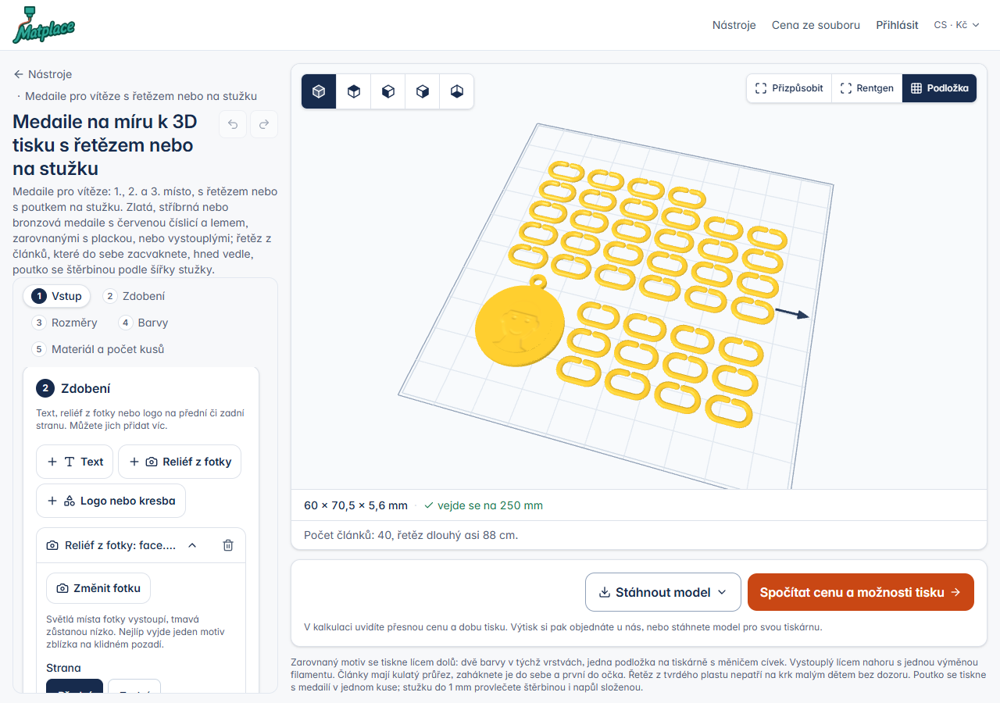 | 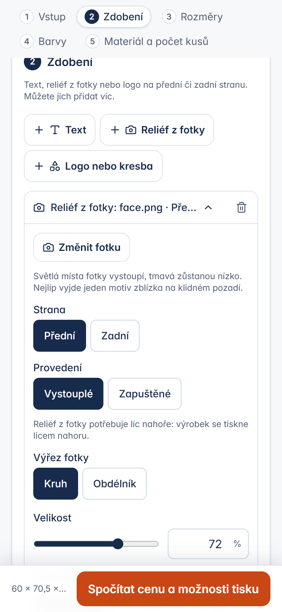 | 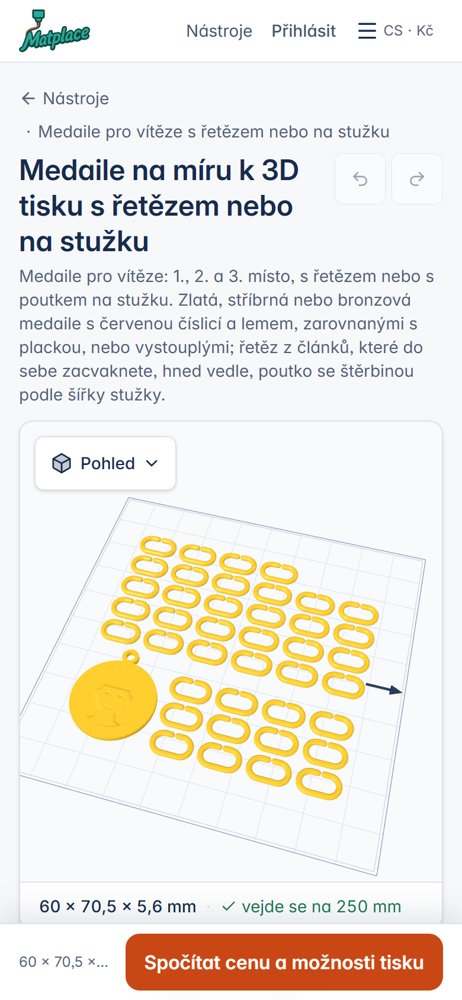 |
| klíčenka | 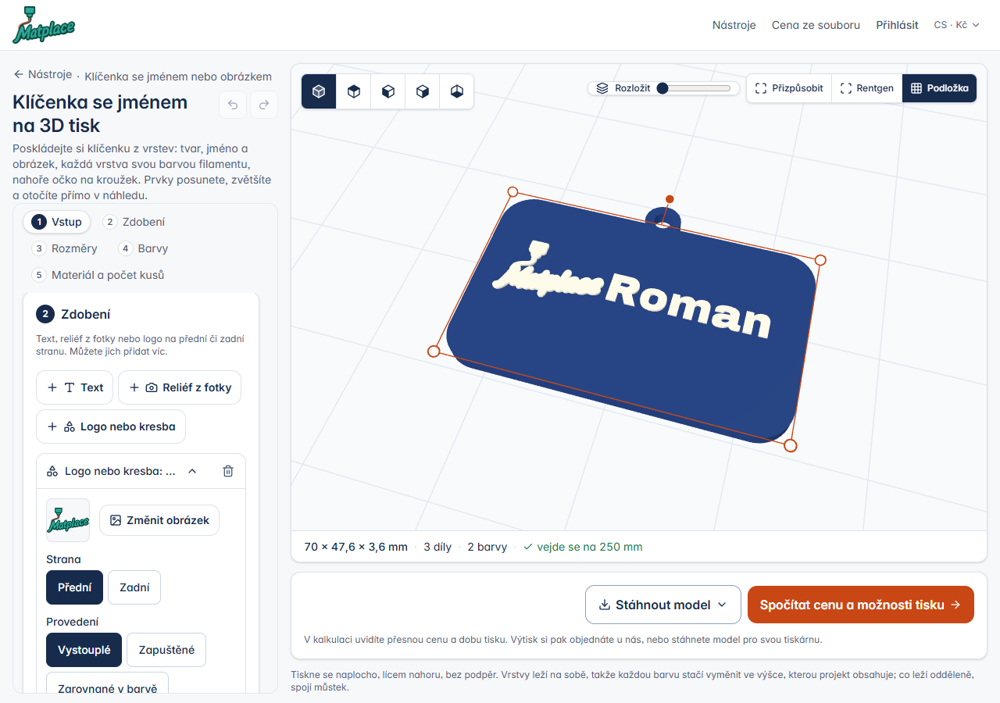 | 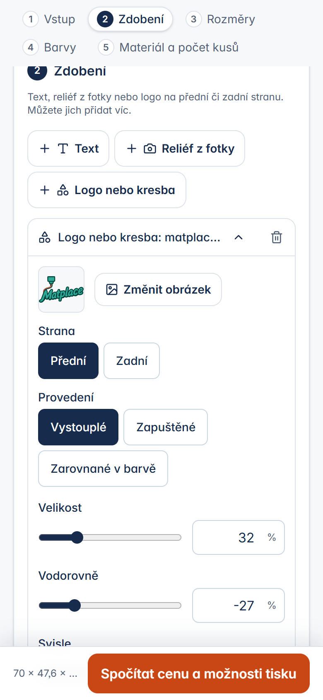 | 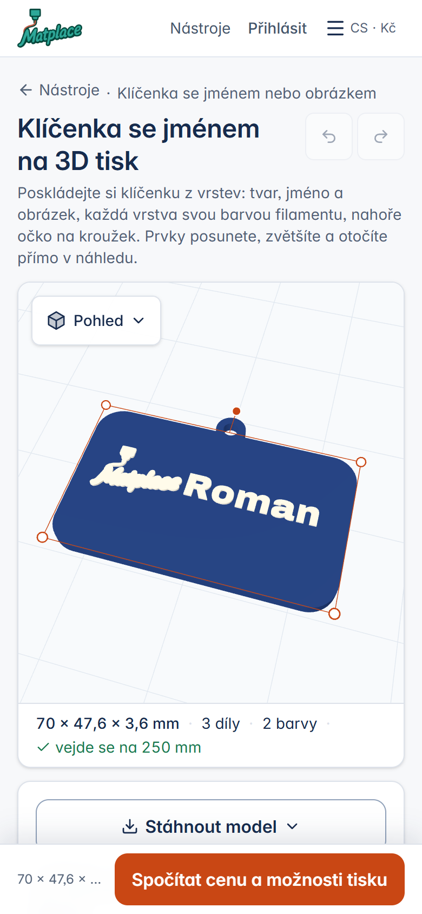 |
| ozdoba | 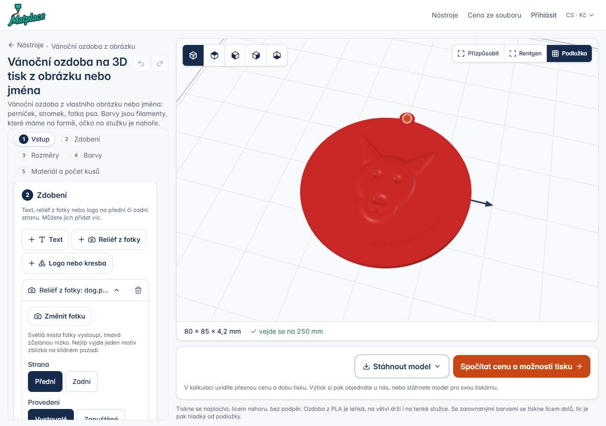 | 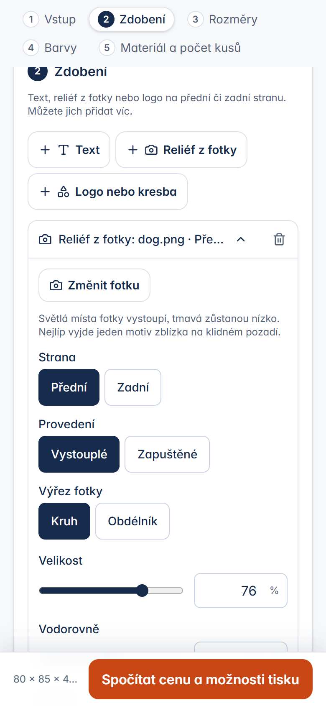 | 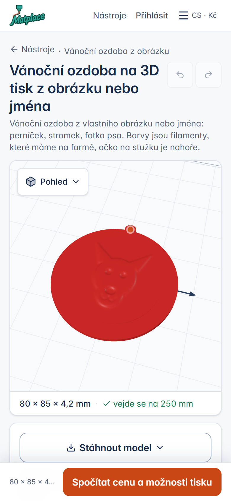 |
| podtácek | 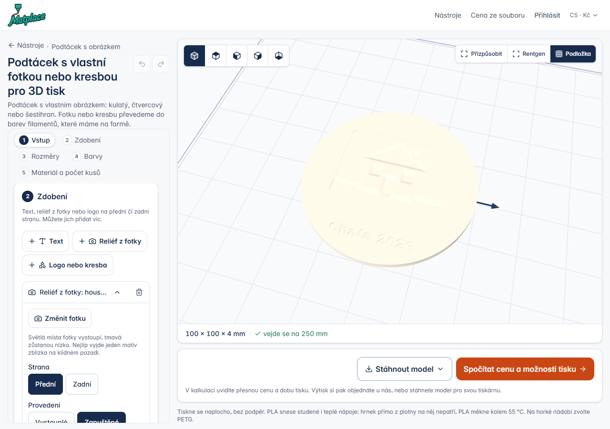 | 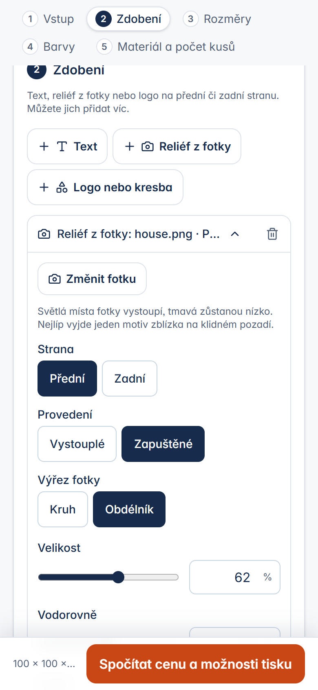 | 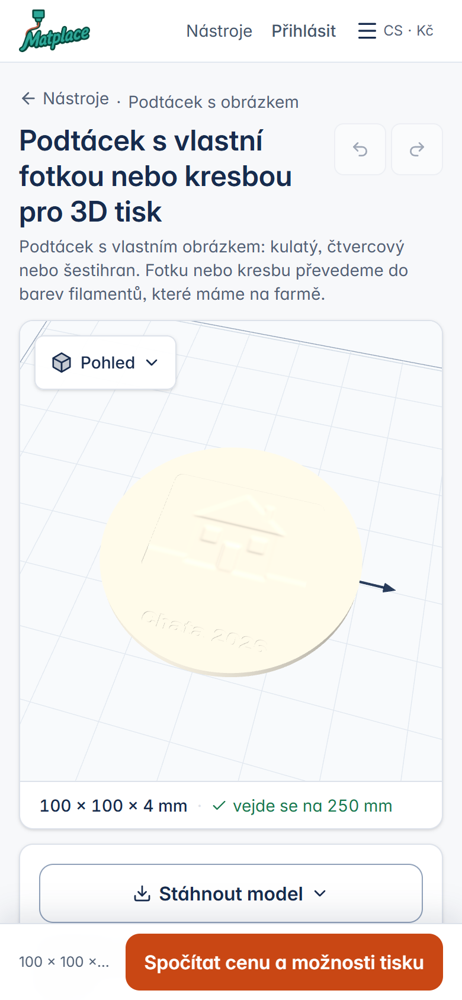 |

**Zadní strana je v náhledu vidět špatně.** Pohled Zespodu ji ukáže skrz mřížku podložky a mělké zapuštění 0,4 mm
se ve stínování skoro ztrácí (zkoušeno na klíčence, ozdobě a podtácku; snímky jsem proto do dokumentace nedal).
Panel říká, co na zadní straně je a jak vysoká jsou písmena, ale obrázek to není. Tlačítko „otočit výrobek“ ve
vieweru je další práce (§9).

## 5. Tisknutelnost a kontrolní řezy

Pravidla v `decor.py` pro trysku 0,4 mm a vrstvu 0,2 mm:

- **Nejmenší písmo**: velká písmena pod 3,0 mm (zapuštěná pod 3,5 mm) dají varování `decor_text_small`. Čáry užší
  než dvě šířky trysky na více než 35 % plochy dají `decor_thin` (stejná míra jako `thin_lines` nástrojů).
- **Nejmenší hloubka**: text a logo 0,4 mm (dvě vrstvy), výchozí 0,6. Reliéf z fotky 0,6 mm, výchozí 1,2 mm
  (šest vrstev), nejvýš 3 mm.
- **Zapuštění do strany na podložce nejvýš 0,4 mm.** Při 0,6 mm (tři vrstvy) si slicer se zapnutými podpěrami
  řekl o podpěry pod písmeny na rubu medaile 60 mm i ozdoby 80 mm. Při 0,4 mm ne, ani u písmen přes 80 % šířky.
- Zapuštění nesmí nechat pod sebou méně než dvě vrstvy desky (`decor_too_deep`), zapuštěný reliéf tři.
- Reliéf je výškové pole bez převisů, podpěry nevolá.

**Řezy**: Orca 2.5.0 CLI (`…\session2-orca25\orca250\orca-slicer.exe`), profily farmy `machine.json` (Kobra S1,
tryska 0,4), `process_standard.json` s **zapnutými podpěrami** `tree(auto)` a prahem 30°, `filament_pla.json`.
Jeden filament, model z `param_tool.py` s hodnotami, které ukládá stránka. Zkušební obrázky jsou nakreslené
skriptem (stínovaná kreslená hlava, psí hlava, domek), ne fotografie.

| návrh | rozměr na podložce | čas | filament | vrstvy | podpěry |
|---|---|---|---|---|---|
| medaile 60 mm, tl. 4,4, 40 článků, reliéf vpředu 1,2 mm (72 %), „Jana / 2026“ vzadu zapuštěné | 195 × 176,5 × 5,6 | 1 h 24 min 58 s | 41,15 g | 28 | žádné |
| totéž bez textu vzadu | 195 × 176,5 × 5,6 | 1 h 22 min 38 s | 41,09 g | 28 | žádné |
| pro srovnání medaile 60 mm s vystouplou „1“, bez zdobení | 195 × 176,5 × 5,0 | 1 h 21 min 19 s | 41,09 g | 25 | žádné |
| medaile 40 mm bez řetězu, reliéf | 40 × 50,5 × 5,6 | 8 min 22 s | 3,90 g | 28 | žádné |
| medaile 120 mm bez řetězu, reliéf | 120 × 130,5 × 5,6 | 43 min 41 s | 30,12 g | 28 | žádné |
| klíčenka 60 mm, logo Matplace + „Roman“ vystouplé 0,6 | 66 × 30,5 × 3,6 | 7 min 38 s | 4,46 g | 18 | žádné |
| totéž + telefon vzadu zapuštěný | 66 × 30,5 × 3,6 | 9 min 0 s | 4,50 g | 18 | žádné |
| ozdoba 80 mm, reliéf psa (76 %), „Rex / Vanoce 2026“ vzadu | 80 × 85 × 4,2 | 22 min 22 s | 12,16 g | 21 | žádné |
| podtácek 100 mm, zapuštěný reliéf domku (obdélník) + zapuštěný text vpředu, drážky | 100 × 100 × 4,0 | 40 min 5 s | 20,10 g | 20 | žádné |

Před omezením na 0,4 mm: medaile s textem vzadu 0,6 mm měla v G-kódu `Support interface`, ozdoba `Support`
(1 h 25 min 11 s a 41,22 g; 22 min 30 s a 12,20 g). Řez trvá 1–4 s. Vícebarevný řez (zdobení ve vlastní barvě
v jedné podložce) jsem neřezal: jde stejnou cestou jako zarovnané barvy (`docs/P.md` §11), geometrii dílů hlídá test.

**Rychlost náhledu** (jen engine, Windows, start Pythonu v tom): klíčenka 0,3–1,3 s, ozdoba s reliéfem 1,2 s,
podtácek se třemi zdobeními 1,6 s, medaile se 40 články a reliéfem 1,8 s (bez zdobení 0,9 s). V prohlížeči od
otevření stránky s uloženým návrhem po náhled 2,8–4,5 s (headless Chrome, lokální server; medaile 4,2–4,5 s). Dlouhý krok s průběhem
tu není potřeba. Náhled s reliéfem je velký (ozdoba 7,5 MB, medaile s řetězem 15 MB): `param.ts` proto nově čte
model dřív, než si řekne o zbytek poznámek (`/api/tools/preview/<klíč>/meta`). Na místním serveru s jedním vláknem
se jinak ozdoba s reliéfem a očkem nenačetla vůbec (`ERR_CONTENT_LENGTH_MISMATCH`), na produkci by čekala na volný
proces PHP.

## 6. Co se nahradilo a co zůstalo po starém

Co má každý z nástrojů dnes vlastního a co s tím je:

| nástroj | vlastní zdobení dnes | po této větvi |
|---|---|---|
| medaile | číslo, text do dvou řádků nebo obrázek jako **motiv**: zarovnaný (lícem dolů, dvě barvy v jedné podložce) nebo vystouplý, velikost motivu, lem v barvě motivu; předvolby 1.–3. místo | zůstává. Zdobení je navíc: reliéf, text, logo, i na zadní stranu. S prázdným polem textu je medaile holá deska jen se zdobením |
| klíčenka (skladba) | vrstvy text / obrázek / tvar, každá vlastní barvou a o krok výš, tažení v náhledu | zůstává. Zdobení přidává to, co vrstvy neumí: reliéf z fotky, zapuštění, zadní stranu |
| klíčenka (formulář) | jméno do dvou řádků nebo obrázek v barvách, tvar podle obrázku / obdélník / kruh | zůstává, zdobení navíc |
| ozdoba | obrázek v barvách filamentů nebo jméno; tvar podle obrázku, kruh, hvězda | zůstává, zdobení navíc |
| podtácek | obrázek v barvách (zarovnaný lícem dolů, lem, drážky) nebo jméno | zůstává, zdobení navíc |

**Nenahradil jsem nic.** Důvod: vlastní text a obrázek těchhle nástrojů není zdobení položené na plochu, ale to,
z čeho výrobek vzniká. Jméno nebo obrázek určuje **obrys** (tvar „podle obrázku“), obrázek se čte **v barvách**
(až 8 barev, pořadí, slučování, cívka ke každé) a medaile na něm staví předvolby, lem a zarovnaný motiv lícem dolů.
Zdobení je jednobarevný obrys nebo reliéf v dané poloze. Nahrazení by změnilo vzhled uložených návrhů a zakázek,
což zadání zakazuje. Rozdíl pro zákazníka tedy zůstává: v kroku Vstup je „z čeho výrobek je“ (jméno, obrázek
v barvách), v kroku Zdobení „co je na něm navíc“.

Kde se obojí překrývá a co s tím dál (k rozhodnutí, §9): **text**. Jméno v kroku Vstup a text ve Zdobení jsou pro
laika totéž. Sjednotit to jde, až bude dílna (krok 3 koncepce) skládat výrobek z šablony a zdobení; uložené návrhy
se pak převedou při otevření (`line1/line2` → položka `text`), což je jedna funkce v `clean()`.

Staré uložené návrhy a rozpracované zakázky: bez `decor` se staví stejně jako na `main` (test porovnává objem,
díly a způsob tisku s prázdným seznamem; cesta bez zdobení engine neprochází). Adresy nástrojů se nemění.

## 7. Testy

- `tests/Feature/DecorTest.php` (9 testů, 330 asercí): čištění a meze seznamu; odmítnutí hodnot mimo meze větou
  v jazyce návštěvníka; každý z pěti kindů s každým druhem zdobení; medaile 40, 60, 120 mm s reliéfem vpředu
  a jménem vzadu (zrcadlení, hloubka 0,4, obrácení lícem nahoru); strana na podložce (zapuštění, zarovnání
  v barvě, jedna podložka, fotka odmítnuta, příliš hluboké odmítnuto); klíčenka s logem a textem ve vlastní barvě
  (díly, jedna výměna po výšce, uložení, `part_colors`, díl jako STL, smíšené barvy = jedna podložka); uložení
  a znovuotevření s fotkou návštěvníka; staré návrhy čtyř nástrojů; panel na čtyřech stránkách ve třech jazycích
  a jeho nepřítomnost jinde.
- Enginové testy jsou podle zvyklostí repozitáře PHP testy přes `POST /api/tools/param/preview` (samostatné
  testy Pythonu repozitář nemá).
- Sady nástrojů po změně (13. 11. 2026, lokálně, Store Python):
  - `ShapeToolsTest|FlushDownTest|CharmShapesTest|ComposeToolTest|ToolPageTest|LandingPagesTest|SeoTest|ToolsFlowTest|
    ParametricToolsTest|HeldShapesTest|ToolsCatalogTest|DesignTokensTest`: OK, 117 testů, 16 079 asercí (21 min; běh nad
    commitem cce7a03d, po něm se měnil už jen `decor.py`, `decor.ts` a `param.ts`).
  - `DecorTest|ToolPageTest|LandingPagesTest|SeoTest|ComposeToolTest|ToolsCatalogTest` nad konečným kódem: OK, 62 testů,
    13 806 asercí.
  - `vendor/bin/pint --dirty`, `npx tsc --noEmit -p .`, `npm run build`: prošly. Celou sadu PHPUnit jsem nepouštěl.

## 8. Úvodní strana: co změnit v `IntakeRouter` (neměnil jsem)

Soubor patří větvi `feature/home-what-to-make`. Aby přání „medaile s reliéfem z fotky“ vedlo na medaili se zdobením:

1. **Katalog `TOOLS`**, klíč `takes` (a `makes`, kde se mění, co nástroj umí):
   - `medallion`: `takes` → `a place (1st, 2nd, 3rd), a number, a motif or a short text; or a photo (a face, a pet,
     a house) that becomes a relief on the front, with a name or a year on the back`; `makes` → doplnit
     `, or with a relief of a photo on its front`.
   - `keychain`: `takes` → `a name or a short text, a logo or a small picture, or a photo that becomes a small
     relief`; `makes` → doplnit `; a logo and a text side by side, a text engraved on the back`.
   - `coaster`: `takes` → doplnit `; or a photo that becomes a relief sunk into the coaster, with a text`.
   - **`ornament` v katalogu chybí** (přání „ozdoba na stromek“ dnes bere regulární výraz u `charm`). Přidat:
     `'ornament' => ['takes' => 'a photo (a face, a pet), a drawing, a logo, or a name with a year', 'makes' => 'a
     Christmas tree ornament with an eyelet for a ribbon: a relief of the photo or the picture in filament
     colours on the front, a name and a year on the back', 'when' => 'a Christmas ornament, a bauble, a gift tag for
     the tree', 'size' => [40, 150], 'colors' => 4]` a z výrazu `charm` vyjmout `ozdob[auy]? na strom|\bornament|
     adorno (de|para el) [áa]rbol` do nového výrazu `ornament` (před `charm`).
2. **Parametr `decor`**: do popisu `params` v zadání pro model přidat `decor: "photo"` = „the photo should become
   a relief on the thing, not flat areas of colour“ a propustit ho v `params` do předání. Stránka nástroje ho čte
   (`param.ts`, `reliefWanted`): fotka předaná z úvodní strany se pak nepoužije jako obrázek v barvách, ale stane se
   zdobením `photo` vpředu, text přání (`params.text`) zdobením `text` vzadu (zapuštěný), pole jména se vyprázdní
   a tvar „podle obrázku“ se přepne na první prostý. Totéž udělá adresa s `?decor=photo` (pro ruční zkoušku
   a pro `query` v katalogu, kdyby měl nástroj reliéf dostat vždy). `intake_preload.ts` se měnit nemusí.
3. **Pravidlo v zadání pro model** „do not promise a relief of a photo on a thing whose tool takes a place, a number,
   a motif or a text“ přestane pro medaili platit, jakmile se změní její `takes`; větu o kombinacích („a medal with
   a relief from a photo“ jako příklad toho, co žádný nástroj neumí) je potřeba přepsat nebo nahradit jiným příkladem.
4. `relief` zůstává pro samostatný reliéf a litofanii; do jeho `when` doplnit `a relief on a medal, a key ring, an
   ornament or a coaster is that tool with params.decor = "photo"`.

Bez bodu 2 se fotka na medaili dál stane obrázkem v barvách a zákazník si reliéf přidá sám v kroku Zdobení.

## 9. Co není ověřené a otevřené otázky

Neověřeno:

- **Skutečný tisk** čehokoli z toho. Hlavně: čitelnost reliéfu 1,2 mm na medaili 40–60 mm, zapuštěný text 0,4 mm
  na rubu z texturovaného plechu, vystouplá písmena 3–4 mm, zarovnané zdobení v barvě v první vrstvě.
- **Skutečné fotografie.** Zkoušel jsem jen kresby nakreslené skriptem a logo. Fotka obličeje s rušným pozadím dá
  reliéf, ve kterém pozadí vystupuje stejně jako obličej; výchozí vyhlazení a kontrast jsou odhad. Odstranění
  pozadí (`rembg`, které používá papel picado) zdobení nevolá.
- **Vícebarevný řez** návrhu se zdobením ve vlastní barvě a zakázka na farmě s díly `decor_<n>` (farmu jsem
  neměnil; díly a barvy jdou stejnými poli jako `color_<n>`, test hlídá `partsOf`, `part_colors` a STL dílu).
- **Předání z úvodní strany** (`params.decor`): kód na stránce je, celou cestu s routerem jsem zkoušet nemohl.
- **Prohlížeč**: panel jsem proklikal skriptem v headless Chrome (otevření uloženého návrhu, rozbalení zdobení,
  snímky). Přidání zdobení prstem na skutečném telefonu, nahrání fotky z foťáku a okno Barva z panelu jsem
  neviděl. Tažení zdobení v náhledu není.
- Kalkulace a objednávka: jdou z výsledného modelu jako dřív (`create()` se nemění v tom, co ukládá o souboru),
  cenu návrhu se zdobením jsem v kalkulaci nepočítal.

Otázky pro Romana:

1. **Holá medaile lícem dolů.** Medaile otvírá se zarovnaným motivem, tedy lícem dolů. Text přidaný na přední
   stranu je pak zapuštěný (nebo zarovnaný v barvě), vystouplý až po přepnutí Motiv → Vystouplý. Má se medaile bez
   čísla, jen se zdobením, tisknout rovnou lícem nahoru?
2. **Text ve Vstupu a text ve Zdobení** jsou dvě místa pro totéž. Sjednotit teď (převést jméno nástroje na
   zdobení a změnit vzhled uložených návrhů), nebo až s dílnou?
3. **Reliéf: světlé nahoře** je výchozí (stejně jako `/tools/relief`). U tmavého psa na světlém pozadí vystoupí
   pozadí; panel má „Obrátit světlé a tmavé“. Má se pozadí fotky odstraňovat automaticky (`rembg` na serveru)?
4. **Zdobení ve vlastní barvě** vedle něčeho jiného ve stejné výšce znamená jednu podložku na tiskárně s měničem
   a věž (o 16 min a 1,4 g víc u medaile, `docs/P.md` §8b). Nechat to tak, nebo zdobení v barvě nabízet jen tam, kde
   vyjde výměna po výšce?
5. **Ozdoba na úvodní straně**: `ornament` jako vlastní klíč katalogu (§8), nebo dál `charm`?
6. **Tažení zdobení v náhledu** prstem (jako vrstvy ve skladbě) a **otočení výrobku rubem nahoru** v náhledu jsou
   další práce ve `viewer.ts`. Chceš je do Vánoc?

## 10. Nasazení

- **Migrace: žádná.** `decor` je v JSON sloupci `tool_params`.
- **Knihovny enginu: žádné nové.** `decor.py` používá `manifold3d`, `numpy`, `scipy`, `Pillow` a `fontTools`,
  které produkce má pro `shape_kinds.py`, `shape2d.py` a `relief_tool.py`.
- Nové soubory: `engines/python/decor.py`, `resources/js/calc/decor.ts`, `lang/src/dilna_zdobeni.json`,
  `tests/Feature/DecorTest.php`, `docs/AQ.md`, `docs/img/decor-*.png`. Změněné: `param_tool.py`, `shape_kinds.py`,
  `compose_kind.py`, `ParametricGenerator.php`, `ToolsApiController.php`, `param.ts`, `tools/param.blade.php`,
  `lang/{cs,en,es}.json`.
- Běžný postup: `npm ci && npm run build`, `php artisan optimize`, restart workerů. Žádný nový klíč v `.env`.
