# AR: Jedna dílna, krok 1 – společné zdobení (text, reliéf z fotky, logo)

Větev `feature/dilna-zdobeni` z `origin/main` 328f7b25, 12.–13. 11. 2026. Zadání `docs/prompts/dilna-krok1-zdobeni.md`,
koncepce `koncepce-jedna-dilna.md` (mimo repozitář). Při slévání do `release/2026-11-14` přesunuto z `docs/AQ.md` (to je přehled správy farmy) sem.

## 1. Co vzniklo

Jedno **zdobení**, které se položí na přední nebo zadní stranu čtyř výrobků se stejným ovládáním:

| výrobek | adresa | kind | text | reliéf z fotky | logo / kresba |
|---|---|---|---|---|---|
| medaile (řetěz i stužka) | `/tools/medallion` | `medallion` | ano | ano | ano |
| klíčenka | `/tools/keychain` (skladba vrstev `compose`) a `/tools/keychain?form=1` (`keychain`) | `compose`, `keychain` | ano | ano | ano |
| vánoční ozdoba | `/tools/ornament` | `ornament` | ano | ano | ano |
| podtácek | `/tools/coaster` | `coaster` | ano | ano | ano |

Všech 15 kombinací (5 kindů × 3 druhy) staví `DecorTest`. Kombinace jdou: medaile s reliéfem vpředu a jménem
s rokem vzadu, klíčenka s logem a textem, nejvýš 6 zdobení na výrobku.

**Ozdoba:** zvolil jsem nástroj `ornament` (`/tools/ornament`), ne přívěsek. Má očko na stužku, kruh a hvězdu
a průměr 40–150 mm. Úvodní strana dnes přání „ozdoba na stromek“ posílá na `charm` (viz §8).

## 2. Zdobení jako data

Seznam `decor` v parametrech návrhu (`tool_params.decor`, v požadavku `params.decor`), nejvýš 6 položek. Rozumí mu
stránka (`resources/js/calc/decor.ts`), server (`ParametricGenerator::decorRules`, `cleanDecor`) i engine
(`engines/python/decor.py`). Je to první kus „projektu“ z koncepce: oddíl **zdobení**.

```json
{"decor": [
  {"kind": "photo", "face": "front", "x": 0, "y": 0, "size": 72, "turn": 0, "mode": "raised", "depth": 1.2,
   "color": null, "image": "file:<uuid>:20", "image_name": "pes.jpg", "invert": false,
   "frame": "circle", "contrast": 100, "smooth": 0.35},
  {"kind": "text", "face": "back", "x": 0, "y": 0, "size": 55, "turn": 0, "mode": "engraved", "depth": 0.6,
   "color": null, "lines": ["Jana", "2026"], "typeface": "archivo"},
  {"kind": "logo", "face": "front", "x": -24, "y": 0, "size": 35, "turn": 0, "mode": "raised", "depth": 0.6,
   "color": {"code": "05_PLA+_cerveny", "hex": "#c8102e"}, "image": "lib:colour/matplace", "image_name": "", "invert": false}
]}
```

| klíč | hodnoty | význam |
|---|---|---|
| `kind` | `text`, `photo`, `logo` | druh; další druhy (QR, vzor) přibudou jako nová hodnota a nová větev v `decor.py` |
| `face` | `front`, `back` | plocha, na které leží |
| `x`, `y` | −50 až 50 | střed zdobení v % šířky plochy od jejího středu; doprava a nahoru kladně, jak se na plochu díváme |
| `size` | 10 až 100 | šířka zdobení v % šířky plochy |
| `turn` | −180 až 180 | otočení ve stupních, proti směru hodin |
| `mode` | `raised`, `engraved`, `flush` | vystouplé, zapuštěné, zarovnané ve vlastní barvě |
| `depth` | text a logo 0,4–1,2 (výchozí 0,6), fotka 0,6–3,0 (výchozí 1,2) | výška nebo hloubka v mm, vždy celé vrstvy 0,2 |
| `color` | `null` nebo kód barvy (uloží se `{code, hex}`) | vlastní filament; `null` = barva výrobku. Reliéf z fotky vlastní barvu nemá |
| `lines`, `typeface` | 1–3 řádky po nejvýš 30 znacích; klíč z `ParametricGenerator::FONTS` | jen `text` |
| `image`, `image_name`, `invert` | odkaz jako u obrázku nástrojů (`lib:…`, `<uuid>`, `file:<uuid>:<n>`) | `photo` a `logo` |
| `frame`, `contrast`, `smooth` | `circle` / `rect`, 50–150 %, 0–1 | jen `photo` |

Poloha a velikost jsou v procentech plochy, ne v milimetrech: zdobení tak zůstane na místě, když se změní velikost
výrobku, a stejný zápis platí pro každý tvar. Meze jsou v `ParametricGenerator::DECOR_*`. API hodnotu mimo meze
odmítne (422, „Zdobení má hodnotu mimo povolený rozsah“). `cleanDecor` nechá jen známé klíče a položku, která ještě
nic neukazuje (text bez řádku, fotka bez obrázku), vynechá. Fotka nebo logo návštěvníka se při uložení návrhu
zkopíruje k modelu jako `artwork-<20 + pořadí>.<přípona>`, odkaz `file:<uuid>:<20 + pořadí>`.

**Co engine vrací** (`notes.decor`, jedna položka na zdobení): `index`, `kind`, `face`, `mode` (jak bylo opravdu
vyrobeno), `on_bed`, `depth`, `box` (kde leží v tisku), `z` (od–do), `cap` (výška velkých písmen), u zdobení ve
vlastní barvě `part` (`decor_<n>`), `code`, `hex`. Další poznámky: `turned_up` (výrobek se kvůli fotce tiskne lícem
nahoru) a varování `decor_bed_face`, `decor_text_small`, `decor_clipped`, `decor_thin`.

## 3. Jedno místo na serveru

`engines/python/decor.py`, funkce `apply`. Volá ji `param_tool.py` po kterémkoli builderu, když návrh nese `decor`.
Builder jen řekne, co je plocha (`parts["_face"]`): obrys desky tak, jak se tiskne, tloušťka, střed a šířka plochy
bez očka, který díl je deska a jestli líc leží na podložce. Dnes to říkají `shape_kinds.build` (medaile, klíčenka,
ozdoba, podtácek: `DECORATED`) a `compose_kind.compose` (spodní vrstva skladby). Další tvar přidá jeden slovník.

Co engine dělá:

- **Text**: obrys z `shape2d.text` (stejná písma jako nástroje), šířka podle `size`.
- **Logo nebo kresba**: obrys z `shape2d.load` (SVG i obrázek, stejné čtení jako nástroj logo a převod SVG).
- **Reliéf z fotky**: výšková mapa z `relief_tool.heightmap` a síť z `relief_tool.plate_mesh` (to, co umí
  `/tools/relief`), světlé je vysoko. Fotka se ořízne na kruh nebo obdélník 4 : 3, mřížka 0,2 mm (nejvýš 300 buněk
  na šířku), vyhlazení σ = 0,25 mm + 0,9 mm × `smooth` (výchozí 0,57 mm), výšky roztažené na celý rozsah, nejnižší
  bod jedna vrstva 0,2 mm. Zapuštěný reliéf leží v kapse hluboké `depth`, vršek výrobku zůstane rovný.
- **Strana na podložce** (zadní u výrobku lícem nahoru, přední u zarovnaných barev lícem dolů): zdobení je
  zrcadlené, aby po otočení četlo správně. Nic z ní nemůže vystupovat: vystouplé se změní na zapuštěné, s vlastní
  barvou na zarovnané (`decor_bed_face`). Zapuštění je tam nejvýš 0,4 mm (viz §5). Reliéf z fotky tam nejde
  (`decor_photo_bed`).
- **Fotka vpředu obrací tisk lícem nahoru.** Medaile se zarovnaným motivem a ostatní se zarovnanými barvami se
  jinak tisknou lícem dolů (`docs/P.md` §8b, §11). S reliéfem vpředu se postaví lícem nahoru: motiv medaile vystoupí,
  zarovnané barvy ostatních zůstanou zapuštěné ve vršku (`notes.turned_up`, stránka to řekne u zdobení).
- **Barvy**: zdobení bez barvy je součást desky. S barvou je díl `decor_<n>`. Jak se návrh vytiskne, se po
  zdobení počítá znovu z dílů: které filamenty drží které pásmo vrstev. Jeden filament v každém pásmu = výměny po
  výšce (`color_changes`), dva v jednom pásmu = `multi_material` a `one_plate_required` (jedna podložka na tiskárně
  s měničem; díly pak leží tam, kde je má celek). Nejvýš čtyři filamenty platí dál.
- **Holá deska**: bez jména a obrázku nástroje, jen se zdobením, vznikne deska v prvním prostém tvaru nástroje
  (kruh; u klíčenky zaoblený obdélník s výškou 0,45 šířky + okraj). Tvar „podle obrázku“ bez obrázku nejde
  (`decor_needs_body`, server ho sám přepne na první prostý tvar).

Návrh bez `decor` engine nemění: `decor.apply` se nezavolá, `_face` se zahodí. Jediná změna v cestě bez zdobení je
podmínka `and count` u zesílení medaile, která u starých návrhů vždy platí.

## 4. Jedna součást rozhraní

Panel **Zdobení** je druhý krok stránky (Vstup → Zdobení → Rozměry → Barvy → Materiál), stejný ve všech čtyřech
nástrojích: `resources/js/calc/decor.ts` (`bootDecor`), v šabloně jen `<div id="decor-panel">` v
`tools/param.blade.php`. Texty `lang/src/dilna_zdobeni.json` (cs, en, es).

- Tři tlačítka: **Text**, **Reliéf z fotky**, **Logo nebo kresba**. Každé zdobení je řádek, klepnutím se otevře.
- V otevřeném vždy stejné pořadí: obsah (řádky a písmo, nebo obrázek) → Strana → Provedení → (Výřez fotky) →
  Velikost → Vodorovně → Svisle → Otočení → Výška nebo hloubka → (Kontrast, Vyhlazení) → (Obrátit světlé a tmavé)
  → Barva.
- Fotka se nahrává rovnou z telefonu (galerie nebo foťák), logo přes okno Obrázek (nahrát, knihovna, moje obrázky).
- Barva otevírá okno Barva stránky. „Zarovnané v barvě“ bez barvy se zapustí a panel to řekne.
- Náhled se překreslí po změně bez nové stránky (stejná cesta jako ostatní pole: 350 ms a `POST
  /api/tools/param/preview`). Zpět/vpřed a „Obnovit poslední nastavení“ zdobení nesou.
- Pod zdobením panel říká, co engine udělal jinak: „Tahle strana leží při tisku na podložce…“, „Reliéf z fotky
  potřebuje líc nahoře…“, „Velká písmena jsou vysoká 9,4 mm.“ Varování zdobení se píší do kroku Zdobení.
- Zadní stranu ukáže pohled **Zespodu** v liště náhledu, ale špatně (viz níže); u výrobku lícem dolů je náhled
  otočený lícem nahoru jako dřív.

Na 390 px: tlačítka, přepínače a pole panelu mají výšku aspoň 40 px (přepínače a tlačítka přidání 44 px), žádný
vodorovný posun (měřeno skriptem na všech čtyřech stránkách v obou šířkách). Tažení zdobení prstem v náhledu není: poloha se nastavuje posuvníky (viz §9).

Snímky (headless Chrome, lokální data; uložený návrh otevřený znovu přes `?from=`):

| výrobek | 1280 px | 390 px panel | 390 px náhled |
|---|---|---|---|
| medaile | 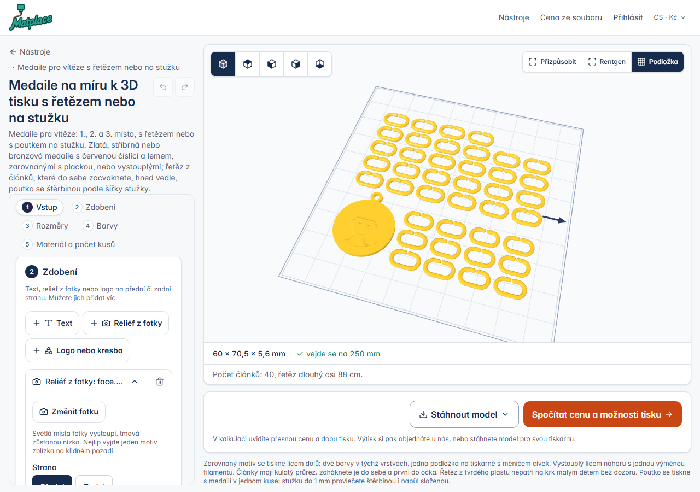 | 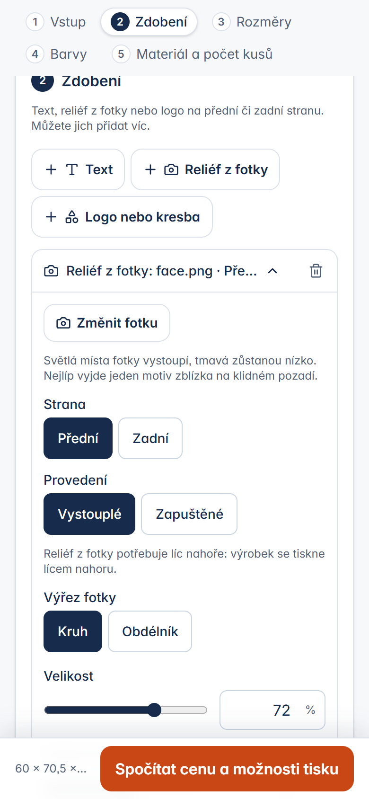 | 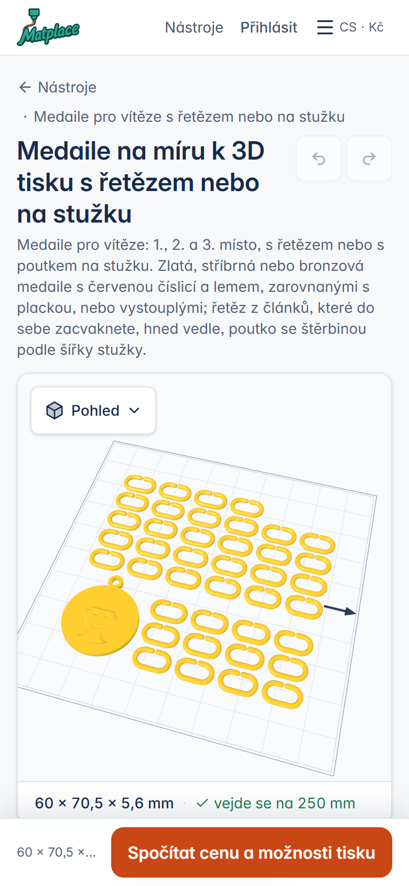 |
| klíčenka | 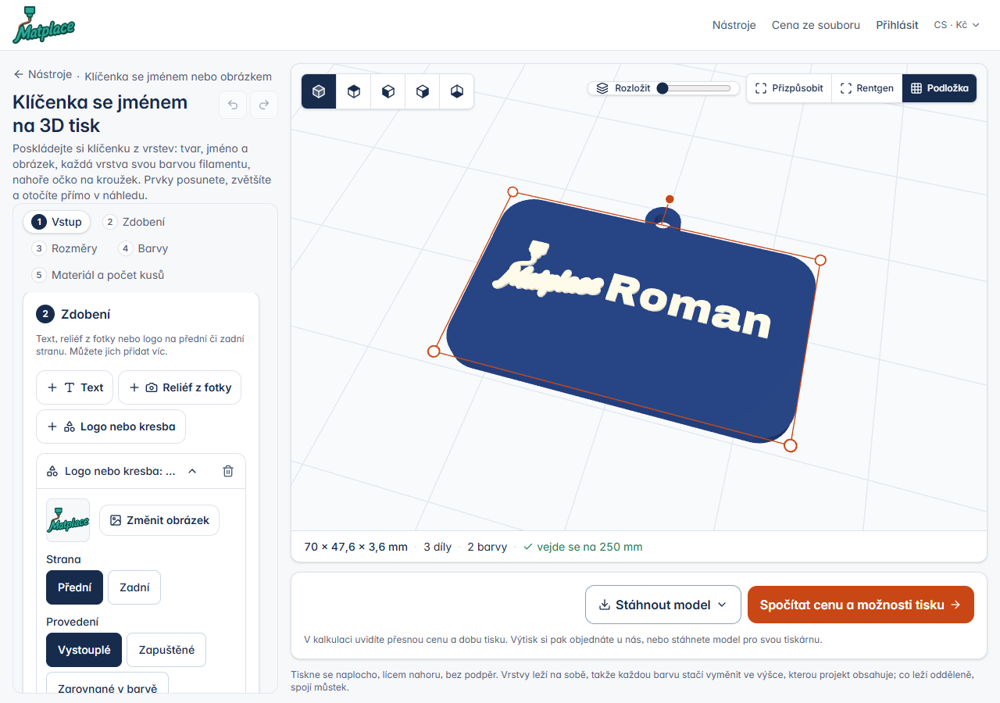 | 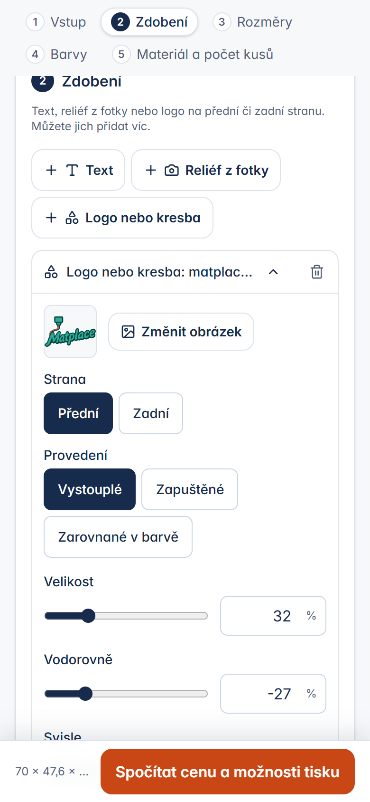 | 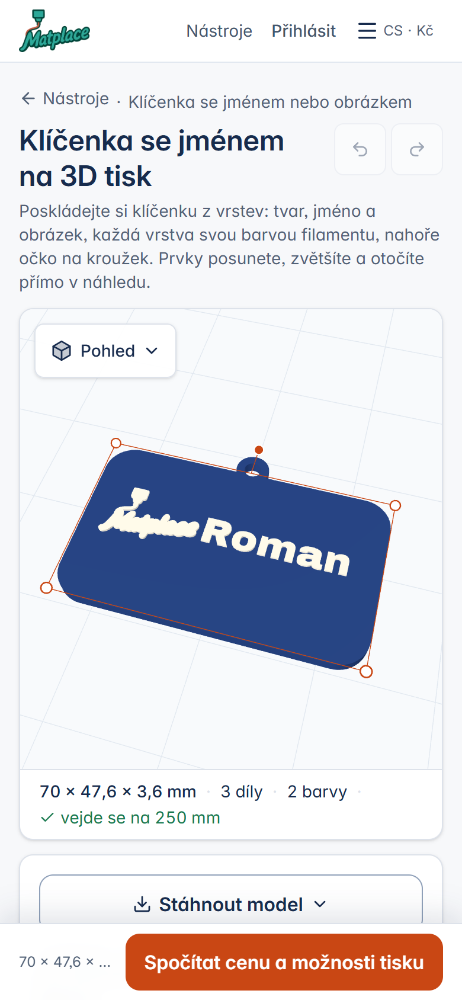 |
| ozdoba | 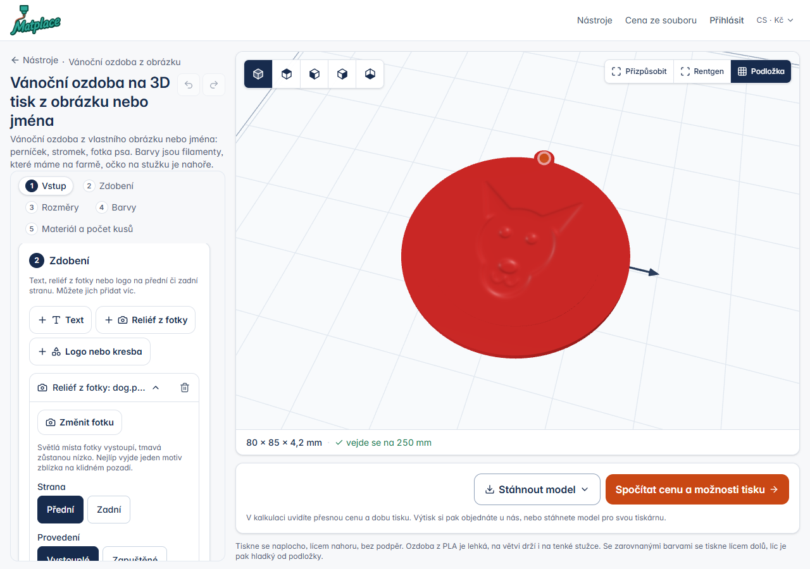 | 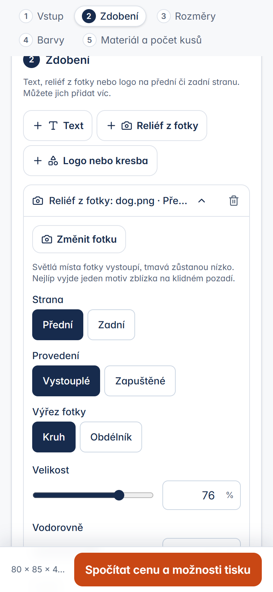 | 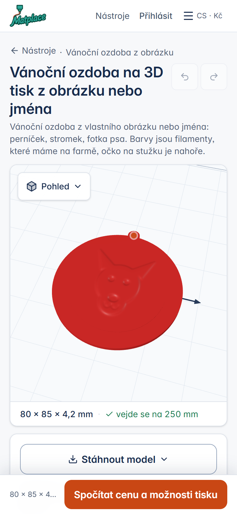 |
| podtácek | 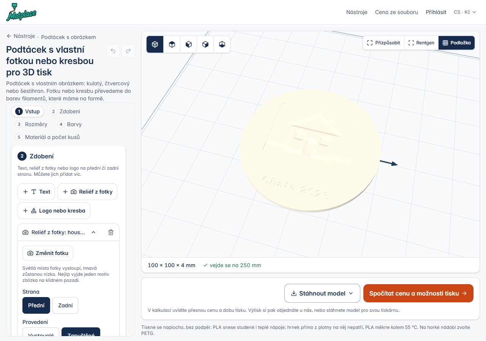 | 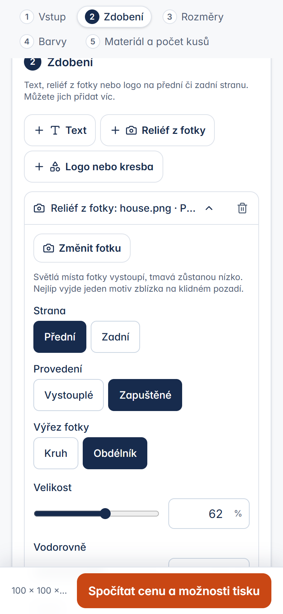 | 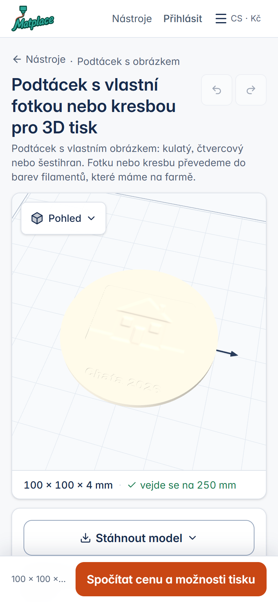 |

**Zadní strana je v náhledu vidět špatně.** Pohled Zespodu ji ukáže skrz mřížku podložky a mělké zapuštění 0,4 mm
se ve stínování skoro ztrácí (zkoušeno na klíčence, ozdobě a podtácku; snímky jsem proto do dokumentace nedal).
Panel říká, co na zadní straně je a jak vysoká jsou písmena, ale obrázek to není. Tlačítko „otočit výrobek“ ve
vieweru je další práce (§9).

## 5. Tisknutelnost a kontrolní řezy

Pravidla v `decor.py` pro trysku 0,4 mm a vrstvu 0,2 mm:

- **Nejmenší písmo**: velká písmena pod 3,0 mm (zapuštěná pod 3,5 mm) dají varování `decor_text_small`. Čáry užší
  než dvě šířky trysky na více než 35 % plochy dají `decor_thin` (stejná míra jako `thin_lines` nástrojů).
- **Nejmenší hloubka**: text a logo 0,4 mm (dvě vrstvy), výchozí 0,6. Reliéf z fotky 0,6 mm, výchozí 1,2 mm
  (šest vrstev), nejvýš 3 mm.
- **Zapuštění do strany na podložce nejvýš 0,4 mm.** Při 0,6 mm (tři vrstvy) si slicer se zapnutými podpěrami
  řekl o podpěry pod písmeny na rubu medaile 60 mm i ozdoby 80 mm. Při 0,4 mm ne, ani u písmen přes 80 % šířky.
- Zapuštění nesmí nechat pod sebou méně než dvě vrstvy desky (`decor_too_deep`), zapuštěný reliéf tři.
- Reliéf je výškové pole bez převisů, podpěry nevolá.

**Řezy**: Orca 2.5.0 CLI (`…\session2-orca25\orca250\orca-slicer.exe`), profily farmy `machine.json` (Kobra S1,
tryska 0,4), `process_standard.json` s **zapnutými podpěrami** `tree(auto)` a prahem 30°, `filament_pla.json`.
Jeden filament, model z `param_tool.py` s hodnotami, které ukládá stránka. Zkušební obrázky jsou nakreslené
skriptem (stínovaná kreslená hlava, psí hlava, domek), ne fotografie.

| návrh | rozměr na podložce | čas | filament | vrstvy | podpěry |
|---|---|---|---|---|---|
| medaile 60 mm, tl. 4,4, 40 článků, reliéf vpředu 1,2 mm (72 %), „Jana / 2026“ vzadu zapuštěné | 195 × 176,5 × 5,6 | 1 h 24 min 58 s | 41,15 g | 28 | žádné |
| totéž bez textu vzadu | 195 × 176,5 × 5,6 | 1 h 22 min 38 s | 41,09 g | 28 | žádné |
| pro srovnání medaile 60 mm s vystouplou „1“, bez zdobení | 195 × 176,5 × 5,0 | 1 h 21 min 19 s | 41,09 g | 25 | žádné |
| medaile 40 mm bez řetězu, reliéf | 40 × 50,5 × 5,6 | 8 min 22 s | 3,90 g | 28 | žádné |
| medaile 120 mm bez řetězu, reliéf | 120 × 130,5 × 5,6 | 43 min 41 s | 30,12 g | 28 | žádné |
| klíčenka 60 mm, logo Matplace + „Roman“ vystouplé 0,6 | 66 × 30,5 × 3,6 | 7 min 38 s | 4,46 g | 18 | žádné |
| totéž + telefon vzadu zapuštěný | 66 × 30,5 × 3,6 | 9 min 0 s | 4,50 g | 18 | žádné |
| ozdoba 80 mm, reliéf psa (76 %), „Rex / Vanoce 2026“ vzadu | 80 × 85 × 4,2 | 22 min 22 s | 12,16 g | 21 | žádné |
| podtácek 100 mm, zapuštěný reliéf domku (obdélník) + zapuštěný text vpředu, drážky | 100 × 100 × 4,0 | 40 min 5 s | 20,10 g | 20 | žádné |

Před omezením na 0,4 mm: medaile s textem vzadu 0,6 mm měla v G-kódu `Support interface`, ozdoba `Support`
(1 h 25 min 11 s a 41,22 g; 22 min 30 s a 12,20 g). Řez trvá 1–4 s. Vícebarevný řez (zdobení ve vlastní barvě
v jedné podložce) jsem neřezal: jde stejnou cestou jako zarovnané barvy (`docs/P.md` §11), geometrii dílů hlídá test.

**Rychlost náhledu** (jen engine, Windows, start Pythonu v tom): klíčenka 0,3–1,3 s, ozdoba s reliéfem 1,2 s,
podtácek se třemi zdobeními 1,6 s, medaile se 40 články a reliéfem 1,8 s (bez zdobení 0,9 s). V prohlížeči od
otevření stránky s uloženým návrhem po náhled 2,8–4,5 s (headless Chrome, lokální server; medaile 4,2–4,5 s). Dlouhý krok s průběhem
tu není potřeba. Náhled s reliéfem je velký (ozdoba 7,5 MB, medaile s řetězem 15 MB): `param.ts` proto nově čte
model dřív, než si řekne o zbytek poznámek (`/api/tools/preview/<klíč>/meta`). Na místním serveru s jedním vláknem
se jinak ozdoba s reliéfem a očkem nenačetla vůbec (`ERR_CONTENT_LENGTH_MISMATCH`), na produkci by čekala na volný
proces PHP.

## 6. Co se nahradilo a co zůstalo po starém

Co má každý z nástrojů dnes vlastního a co s tím je:

| nástroj | vlastní zdobení dnes | po této větvi |
|---|---|---|
| medaile | číslo, text do dvou řádků nebo obrázek jako **motiv**: zarovnaný (lícem dolů, dvě barvy v jedné podložce) nebo vystouplý, velikost motivu, lem v barvě motivu; předvolby 1.–3. místo | zůstává. Zdobení je navíc: reliéf, text, logo, i na zadní stranu. S prázdným polem textu je medaile holá deska jen se zdobením |
| klíčenka (skladba) | vrstvy text / obrázek / tvar, každá vlastní barvou a o krok výš, tažení v náhledu | zůstává. Zdobení přidává to, co vrstvy neumí: reliéf z fotky, zapuštění, zadní stranu |
| klíčenka (formulář) | jméno do dvou řádků nebo obrázek v barvách, tvar podle obrázku / obdélník / kruh | zůstává, zdobení navíc |
| ozdoba | obrázek v barvách filamentů nebo jméno; tvar podle obrázku, kruh, hvězda | zůstává, zdobení navíc |
| podtácek | obrázek v barvách (zarovnaný lícem dolů, lem, drážky) nebo jméno | zůstává, zdobení navíc |

**Nenahradil jsem nic.** Důvod: vlastní text a obrázek těchhle nástrojů není zdobení položené na plochu, ale to,
z čeho výrobek vzniká. Jméno nebo obrázek určuje **obrys** (tvar „podle obrázku“), obrázek se čte **v barvách**
(až 8 barev, pořadí, slučování, cívka ke každé) a medaile na něm staví předvolby, lem a zarovnaný motiv lícem dolů.
Zdobení je jednobarevný obrys nebo reliéf v dané poloze. Nahrazení by změnilo vzhled uložených návrhů a zakázek,
což zadání zakazuje. Rozdíl pro zákazníka tedy zůstává: v kroku Vstup je „z čeho výrobek je“ (jméno, obrázek
v barvách), v kroku Zdobení „co je na něm navíc“.

Kde se obojí překrývá a co s tím dál (k rozhodnutí, §9): **text**. Jméno v kroku Vstup a text ve Zdobení jsou pro
laika totéž. Sjednotit to jde, až bude dílna (krok 3 koncepce) skládat výrobek z šablony a zdobení; uložené návrhy
se pak převedou při otevření (`line1/line2` → položka `text`), což je jedna funkce v `clean()`.

Staré uložené návrhy a rozpracované zakázky: bez `decor` se staví stejně jako na `main` (test porovnává objem,
díly a způsob tisku s prázdným seznamem; cesta bez zdobení engine neprochází). Adresy nástrojů se nemění.

## 7. Testy

- `tests/Feature/DecorTest.php` (9 testů, 330 asercí): čištění a meze seznamu; odmítnutí hodnot mimo meze větou
  v jazyce návštěvníka; každý z pěti kindů s každým druhem zdobení; medaile 40, 60, 120 mm s reliéfem vpředu
  a jménem vzadu (zrcadlení, hloubka 0,4, obrácení lícem nahoru); strana na podložce (zapuštění, zarovnání
  v barvě, jedna podložka, fotka odmítnuta, příliš hluboké odmítnuto); klíčenka s logem a textem ve vlastní barvě
  (díly, jedna výměna po výšce, uložení, `part_colors`, díl jako STL, smíšené barvy = jedna podložka); uložení
  a znovuotevření s fotkou návštěvníka; staré návrhy čtyř nástrojů; panel na čtyřech stránkách ve třech jazycích
  a jeho nepřítomnost jinde.
- Enginové testy jsou podle zvyklostí repozitáře PHP testy přes `POST /api/tools/param/preview` (samostatné
  testy Pythonu repozitář nemá).
- Sady nástrojů po změně (13. 11. 2026, lokálně, Store Python):
  - `ShapeToolsTest|FlushDownTest|CharmShapesTest|ComposeToolTest|ToolPageTest|LandingPagesTest|SeoTest|ToolsFlowTest|
    ParametricToolsTest|HeldShapesTest|ToolsCatalogTest|DesignTokensTest`: OK, 117 testů, 16 079 asercí (21 min; běh nad
    commitem cce7a03d, po něm se měnil už jen `decor.py`, `decor.ts` a `param.ts`).
  - `DecorTest|ToolPageTest|LandingPagesTest|SeoTest|ComposeToolTest|ToolsCatalogTest` nad konečným kódem: OK, 62 testů,
    13 806 asercí.
  - `vendor/bin/pint --dirty`, `npx tsc --noEmit -p .`, `npm run build`: prošly. Celou sadu PHPUnit jsem nepouštěl.

## 8. Úvodní strana: co změnit v `IntakeRouter` (neměnil jsem)

Soubor patří větvi `feature/home-what-to-make`. Aby přání „medaile s reliéfem z fotky“ vedlo na medaili se zdobením:

1. **Katalog `TOOLS`**, klíč `takes` (a `makes`, kde se mění, co nástroj umí):
   - `medallion`: `takes` → `a place (1st, 2nd, 3rd), a number, a motif or a short text; or a photo (a face, a pet,
     a house) that becomes a relief on the front, with a name or a year on the back`; `makes` → doplnit
     `, or with a relief of a photo on its front`.
   - `keychain`: `takes` → `a name or a short text, a logo or a small picture, or a photo that becomes a small
     relief`; `makes` → doplnit `; a logo and a text side by side, a text engraved on the back`.
   - `coaster`: `takes` → doplnit `; or a photo that becomes a relief sunk into the coaster, with a text`.
   - **`ornament` v katalogu chybí** (přání „ozdoba na stromek“ dnes bere regulární výraz u `charm`). Přidat:
     `'ornament' => ['takes' => 'a photo (a face, a pet), a drawing, a logo, or a name with a year', 'makes' => 'a
     Christmas tree ornament with an eyelet for a ribbon: a relief of the photo or the picture in filament
     colours on the front, a name and a year on the back', 'when' => 'a Christmas ornament, a bauble, a gift tag for
     the tree', 'size' => [40, 150], 'colors' => 4]` a z výrazu `charm` vyjmout `ozdob[auy]? na strom|\bornament|
     adorno (de|para el) [áa]rbol` do nového výrazu `ornament` (před `charm`).
2. **Parametr `decor`**: do popisu `params` v zadání pro model přidat `decor: "photo"` = „the photo should become
   a relief on the thing, not flat areas of colour“ a propustit ho v `params` do předání. Stránka nástroje ho čte
   (`param.ts`, `reliefWanted`): fotka předaná z úvodní strany se pak nepoužije jako obrázek v barvách, ale stane se
   zdobením `photo` vpředu, text přání (`params.text`) zdobením `text` vzadu (zapuštěný), pole jména se vyprázdní
   a tvar „podle obrázku“ se přepne na první prostý. Totéž udělá adresa s `?decor=photo` (pro ruční zkoušku
   a pro `query` v katalogu, kdyby měl nástroj reliéf dostat vždy). `intake_preload.ts` se měnit nemusí.
3. **Pravidlo v zadání pro model** „do not promise a relief of a photo on a thing whose tool takes a place, a number,
   a motif or a text“ přestane pro medaili platit, jakmile se změní její `takes`; větu o kombinacích („a medal with
   a relief from a photo“ jako příklad toho, co žádný nástroj neumí) je potřeba přepsat nebo nahradit jiným příkladem.
4. `relief` zůstává pro samostatný reliéf a litofanii; do jeho `when` doplnit `a relief on a medal, a key ring, an
   ornament or a coaster is that tool with params.decor = "photo"`.

Bez bodu 2 se fotka na medaili dál stane obrázkem v barvách a zákazník si reliéf přidá sám v kroku Zdobení.

## 9. Co není ověřené a otevřené otázky

Neověřeno:

- **Skutečný tisk** čehokoli z toho. Hlavně: čitelnost reliéfu 1,2 mm na medaili 40–60 mm, zapuštěný text 0,4 mm
  na rubu z texturovaného plechu, vystouplá písmena 3–4 mm, zarovnané zdobení v barvě v první vrstvě.
- **Skutečné fotografie.** Zkoušel jsem jen kresby nakreslené skriptem a logo. Fotka obličeje s rušným pozadím dá
  reliéf, ve kterém pozadí vystupuje stejně jako obličej; výchozí vyhlazení a kontrast jsou odhad. Odstranění
  pozadí (`rembg`, které používá papel picado) zdobení nevolá.
- **Vícebarevný řez** návrhu se zdobením ve vlastní barvě a zakázka na farmě s díly `decor_<n>` (farmu jsem
  neměnil; díly a barvy jdou stejnými poli jako `color_<n>`, test hlídá `partsOf`, `part_colors` a STL dílu).
- **Předání z úvodní strany** (`params.decor`): kód na stránce je, celou cestu s routerem jsem zkoušet nemohl.
- **Prohlížeč**: panel jsem proklikal skriptem v headless Chrome (otevření uloženého návrhu, rozbalení zdobení,
  snímky). Přidání zdobení prstem na skutečném telefonu, nahrání fotky z foťáku a okno Barva z panelu jsem
  neviděl. Tažení zdobení v náhledu není.
- Kalkulace a objednávka: jdou z výsledného modelu jako dřív (`create()` se nemění v tom, co ukládá o souboru),
  cenu návrhu se zdobením jsem v kalkulaci nepočítal.

Otázky pro Romana:

1. **Holá medaile lícem dolů.** Medaile otvírá se zarovnaným motivem, tedy lícem dolů. Text přidaný na přední
   stranu je pak zapuštěný (nebo zarovnaný v barvě), vystouplý až po přepnutí Motiv → Vystouplý. Má se medaile bez
   čísla, jen se zdobením, tisknout rovnou lícem nahoru?
2. **Text ve Vstupu a text ve Zdobení** jsou dvě místa pro totéž. Sjednotit teď (převést jméno nástroje na
   zdobení a změnit vzhled uložených návrhů), nebo až s dílnou?
3. **Reliéf: světlé nahoře** je výchozí (stejně jako `/tools/relief`). U tmavého psa na světlém pozadí vystoupí
   pozadí; panel má „Obrátit světlé a tmavé“. Má se pozadí fotky odstraňovat automaticky (`rembg` na serveru)?
4. **Zdobení ve vlastní barvě** vedle něčeho jiného ve stejné výšce znamená jednu podložku na tiskárně s měničem
   a věž (o 16 min a 1,4 g víc u medaile, `docs/P.md` §8b). Nechat to tak, nebo zdobení v barvě nabízet jen tam, kde
   vyjde výměna po výšce?
5. **Ozdoba na úvodní straně**: `ornament` jako vlastní klíč katalogu (§8), nebo dál `charm`?
6. **Tažení zdobení v náhledu** prstem (jako vrstvy ve skladbě) a **otočení výrobku rubem nahoru** v náhledu jsou
   další práce ve `viewer.ts`. Chceš je do Vánoc?

## 10. Nasazení

- **Migrace: žádná.** `decor` je v JSON sloupci `tool_params`.
- **Knihovny enginu: žádné nové.** `decor.py` používá `manifold3d`, `numpy`, `scipy`, `Pillow` a `fontTools`,
  které produkce má pro `shape_kinds.py`, `shape2d.py` a `relief_tool.py`.
- Nové soubory: `engines/python/decor.py`, `resources/js/calc/decor.ts`, `lang/src/dilna_zdobeni.json`,
  `tests/Feature/DecorTest.php`, `docs/AR.md`, `docs/img/decor-*.png`. Změněné: `param_tool.py`, `shape_kinds.py`,
  `compose_kind.py`, `ParametricGenerator.php`, `ToolsApiController.php`, `param.ts`, `tools/param.blade.php`,
  `lang/{cs,en,es}.json`.
- Běžný postup: `npm ci && npm run build`, `php artisan optimize`, restart workerů. Žádný nový klíč v `.env`.

## 11. Slití do `release/2026-11-14` (13. 11. 2026)

Kapitola se přestěhovala z `docs/AQ.md` (tam je přehled správy farmy z `main`) sem; odkazy v kódu a v `docs/P.md` §12
míří na `docs/AR.md`. Při slévání řídící udělal dvě věci, které §8 a §9 nechaly otevřené:

- **§8 je hotové** (`app/Domain/Intake/IntakeRouter.php`): nové `takes`/`makes` u `medallion`, `keychain`, `coaster`;
  nový klíč `ornament` s vlastním výrazem před `charm` (slova ozdoby z výrazu `charm` jsou pryč); `relief.when` říká, že
  reliéf na medaili, klíčence, ozdobě nebo podtácku je ten nástroj s `params.decor = "photo"`; model smí vrátit
  `params.decor = "photo"` (schéma má 7 polí s `null`, limit API je 16), `decide()` ho propustí jen u nástrojů
  `IntakeRouter::DECORATED` a jen když přišla fotka; pravidlo v zadání pro model už netvrdí, že reliéf z fotky na medaili
  neumíme (příklad kombinace, kterou žádný nástroj neumí, je teď zápich do dortu s reliéfem). Zlaté případy 31 a 32
  („Chci medaili s reliéfem z fotky“) čekají `medallion`, s fotkou `params.decor = "photo"`; `matplace:intake-cases` na
  `params.decor` případ drží. Bez klíče (klíčová slova) věta říká „Fotku na něj položíme jako reliéf v jedné barvě; jak
  vyjde, uvidíte v náhledu.“ (`router.summary.tool_decor`). Vánoční příklad úvodní strany „Ozdoba na stromek se jménem“
  vede na `ornament` (`config/home.php`). Test `IntakeDecorTest`; `matplace:intake-cases --hints --keywords` 110 ze 110,
  zlaté případy klíčovými slovy 32 ze 32. **Živý model volán nebyl**: po nasazení `matplace:intake-cases --only=31,32`
  (a celý běh) pustí řídící.
- **§9 otázka 1 (odpověď „jak doporučuješ“):** medaile bez čísla a bez vlastního motivu, jen se zdobením, se staví lícem
  nahoru (`motif = raised`), dokud si návštěvník provedení motivu nevybere sám: `ParametricGenerator::clean()` a
  `shape_kinds.py`, když `motif` nepřišel, a skript stránky před náhledem (`param.ts`, `motifChosen`). Uložený návrh,
  krok zpět a „poslední nastavení“ si své provedení nesou a drží. Holá medaile s reliéfem vpředu proto už nehlásí
  `turned_up` (je lícem nahoru sama); medaile se zarovnaným motivem a reliéfem ho hlásí dál. Test
  `DecorTest::test_a_medal_with_decorations_only_prints_face_up_by_default_and_a_stored_one_keeps_its_mode`.
  V prohlížeči jsem přepnutí přepínače Motiv neviděl (jen typová kontrola a sestavení).

## 12. Druhé kolo (13. 11. 2026, větev `feature/dilna-zdobeni-2` z `origin/main` 7dc7f357)

Zadání `zadani-dilna-zdobeni-kolo2.md` (mimo repozitář): pozadí fotky, pohled s otočením a tažením, text na jednom
místě, barevné zdobení; k tomu ověřit, co krok 1 nechal neověřené. Nenasazeno, neslito.

### 12.1 Pozadí fotky pro reliéf

- **Zápis:** fotka má nový klíč `background`: `remove` | `keep` (`ParametricGenerator::DECOR_BACKGROUNDS`). **Zápis bez
  klíče znamená `keep`**: tak byly postavené všechny návrhy uložené před tímhle kolem a staví se dál stejně (test
  porovnává objem). Stránka zakládá novou fotku s `remove`; totéž fotka předaná z úvodní strany (`params.decor`).
- **Engine** (`decor.py`, `_subject` a `_relief`): motiv fotky určí `papel_portrait.subject`, tedy totéž, co už dělá papel
  picado: obrázek s vlastní průhledností je sám sobě maskou, jinak síť u2net spuštěná samotným `onnxruntime` (rembg se
  neimportuje). **Žádná nová knihovna.** Maska se pamatuje v dočasné složce podle souboru, takže posuvníky se sítě ptají
  jednou na fotku.
- **Co se z motivu udělá:** motiv se celý vejde do výřezu (okno kolem jeho obrysu, ne ořez fotky na výřez; u kruhu
  90 % šířky), výšky se roztáhnou jen přes motiv a začínají 30 % hloubky nad plochou (`SUBJECT_BASE`), takže i tmavý pes
  vystoupí jako tvar. **Kolem motivu není nic:** žádná podlaha, žádný kotouč; reliéf je oříznutý obrysem motivu
  (`shape2d.mask_outline`), drobky do 4 % největšího kusu se zahodí. Zapuštěný reliéf má kapsu tvaru motivu.
- **Když to nejde** (síť nebo model na serveru chybí, motiv síť nenašla, motiv pod 12 mm²): reliéf je z celé fotky jako
  dřív, `notes.decor[n].cutout = false`, varování `decor_no_cutout`, důvod v `notes.decor_cutout_error`. Panel to řekne
  u fotky („Na téhle fotce se motiv od pozadí oddělit nepodařilo…“).
- **Panel:** zaškrtávátko „Ponechat pozadí fotky“ (výchozí vypnuté = pozadí pryč). Po nahrání fotky řádek s točícím se
  znakem a pruhem „Odstraňujeme pozadí fotky, potrvá to pár vteřin…“, dokud náhled neodpoví.
- **Čas** (místně, Windows, Store Python, u2net na CPU): první náhled s novou fotkou 3,4–3,6 s včetně nahrání (úplně
  první po startu 9,8 s), další změny téže fotky 1,2–1,8 s (maska z mezipaměti).
- **Zkoušeno na:** dvě volné fotografie z balíku scikit-image (kočka Chelsea, šálek kávy; CC0) a kreslený pes na rušném
  pozadí (skript). Šálek a pes: motiv oddělen. Kočka přes celý snímek: oddělena, ale oříznutá okrajem fotky. Raketa na
  obloze: síť nic nenašla → celá fotka a varování. **Fotka člověka zkoušena nebyla** (žádná se souhlasem).

### 12.2 Pohled s otočením a tažení v náhledu

- **Tlačítka „Přední strana / Zadní strana“** leží v levém dolním rohu náhledu (na telefonu „Přední / Zadní“, 44 px).
  Zadní strana otočí model jako medaili v ruce, kolem svislé osy (`Viewer.setTurned`); leží rubem nahoru na mřížce,
  takže zapuštěný text je vidět shora, ne skrz podložku. Pohled se přitom přiblíží k ploše výrobku
  (`Viewer.focus`): medaile s řetězem je jinak v náhledu malá. „Přizpůsobit“ vrátí celek.
- **Otevřené zdobení má v náhledu rámeček** (ten, kterým se hýbe vrstvami skladby a portrétem papel picado): tažením
  uvnitř se posouvá, rohem zvětšuje, kolečkem nad ním otáčí. Prstem i myší; úchyty jsou pro prst dvojnásobné
  (`pointer: coarse`). Hodnoty jdou do stejných polí `x`, `y`, `size`, `turn` zápisu `decor` (posuvníky v panelu se
  hýbou s tažením), po puštění se náhled přepočítá.
- **Klepnutí na zdobení v náhledu** ho otevře (podle místa klepnutí a strany, která je vidět). Otevření zdobení
  v panelu otočí náhled na jeho stranu.
- **Hranice a kolize** (`decor.ts`, `hold` a `cornersOff`): engine posílá v `notes.decor_face` plochu, kde zdobení smí
  ležet (deska bez okraje, otvor očka jako díra; `region`), a u každého zdobení rohy jeho obrysu (`view.hull`).
  Tažení nepustí střed zdobení z plochy a nepustí přes okraj ani do očka víc rohů, než jich tam bylo na začátku;
  u hrany zdobení klouže podél ní. Meze polí (střed ±50 %, velikost 10–100 %) platí také. Co přesto přesáhne
  (zápis z adresy, posuvník), ořízne engine a ohlásí `decor_clipped` jako dřív.
- **Co engine nově vrací:** `notes.decor_face` = `centre`, `width`, `front_z`, `back_z`, `region` a u každého zdobení
  `view` = `box` (rámeček) a `hull`, vše v milimetrech náhledu (kus tištěný lícem dolů je v náhledu otočený, engine
  to přepočítá). Zadní strana má v těch milimetrech vodorovnou osu obráceně; stránka to ví (`hold`, `drag`).
- **Očko** se na zadní straně netahá (úchyt by ležel zrcadlově); vrstvy skladby také ne.

### 12.3 Text na jednom místě

**Co šlo a co ne.** Jméno nástroje (`line1`, `line2`) na zdobení převést nejde bez změny vzhledu: určuje obrys výrobku
(tvar „podle obrázku“), barví se jako barva obrázku (`color_1`, lem, zarovnání lícem dolů) a medaile na něm má předvolby
1.–3. místo. Zdobení je obrys položený na hotovou desku. Převod zápisu při načtení by uložené návrhy postavil jinak,
což zadání zakazuje. **Zápis proto zůstal, sjednocené je místo:**

- **Všechny texty se píší v kroku Vstup.** Pod jménem nástroje (a pod vrstvami skladby u klíčenky) je seznam dalších
  textů a tlačítko „Přidat další text“ (`#decor-texts`). Jsou to textová zdobení: stejné karty jako dřív v panelu
  (řádky, písmo, strana, provedení, velikost, poloha, barva).
- **Krok Zdobení** má už jen „Reliéf z fotky“ a „Logo nebo kresba“ a říká, že texty jsou ve Vstupu.
- Jeden seznam `decor`, dvě místa na stránce (`bootDecor(..., { texts })`). Bez druhého místa (nástroj, který ho
  v šabloně nemá) zůstává vše v panelu jako v kroku 1: volání z kroku 1 fungují dál.
- Uložené návrhy, rozpracované zakázky a adresy s parametry se otevřou stejně: zápis se neměnil, jen text ze
  zdobení se po otevření ukáže ve Vstupu.

**Zůstalo po starém a proč:** jméno nástroje a text zdobení jsou dál dvě věci v jednom kroku (jméno určuje tvar
a barvy, další text leží na ploše). Text jako vrstva skladby (`/tools/keychain`) zůstal vrstvou. Skutečné sloučení do
jednoho zápisu jde až s projektem dílny (krok C koncepce), kdy tvar výrobku přestane vznikat ze jména.

### 12.4 Barevné zdobení: co umí a co ukázaly řezy

- **Reliéf z fotky může mít vlastní barvu** (dřív jen text a logo): díl `decor_<n>`. Vystouplý reliéf začíná tam, kde
  končí deska, takže je to výměna filamentu po výšce (zlatá medaile, bílý reliéf: jedna výměna, bez věže).
  Zapuštěný barevný reliéf sdílí vrstvy s deskou: tiskárna s měničem.
- **Stránka říká, jak se barevné zdobení vytiskne** (krok Zdobení): výměnou po výšce (n×) / ve stejných vrstvách jako
  jiná barva, tedy měnič a věž / barev je víc, než má tiskárna cívek (`max_colors` z `ColorLimit::farm()`).
- Počet barev stroje: `notes.filaments` počítá zdobení mezi filamenty, stránka i zakázka (`spoolsForParts`,
  `too_many_colors`) s ním pracují jako dřív.

**Řezy:** Orca 2.5.0 CLI, profily farmy (`machine.json` Kobra S1 0,4 mm, `process_standard.json`, `filament_pla.json`),
`PrepareFarmOrder::ONE_PLATE_PROCESS`, projekt z `ThreeMfWriter`, díly z `ParametricGenerator::build` jako u zakázky.
Skript `scripts/decor_slice.php`. Výměny po výšce jsou z poznámek návrhu (řez je jeden filament).

| návrh | filamenty | jak | výměny | věž | čas | filament |
|---|---|---|---|---|---|---|
| medaile 60 bez řetězu, reliéf psa bez pozadí bíle, jméno vzadu zapuštěné | 2 | po výšce (4,4 mm) | 1 | ne | 16 min 9 s | 8,11 g |
| totéž se 40 články | 2 | po výšce | 1 | ne | 1 h 24 min 50 s | 41,11 g |
| medaile 60, motiv 1 zarovnaný lícem dolů + text zarovnaný třetí barvou vpředu | 3 | jedna podložka | 6 | ano | 31 min 5 s | 7,82 + 0,51 + 0,28 g |
| medaile 60, motiv 1 lícem dolů + text vystouplý bíle vzadu (při tisku nahoře) | 3 | jedna podložka | 4 | ano | 25 min 49 s | 7,79 + 0,48 + 0,23 g |
| klíčenka Jana + vystouplý text 2026 červeně | 3 | jedna podložka | 4 | ano | 20 min 53 s | 4,40 + 0,38 + 0,10 g |
| klíčenka Jana + vystouplý text v barvě desky (tak to stavěl krok 1) | 2 | jedna podložka | 3 | ano | 18 min 11 s | 4,27 + 0,38 g |
| klíčenka holá: logo červeně + text modře, oboje vystouplé | 3 | jedna podložka | 4 | ano | 20 min 20 s | 4,94 + 0,13 + 0,13 g |
| klíčenka holá: jen text červeně | 2 | po výšce (3,0 mm) | 1 | ne | 7 min 34 s | 4,49 g |
| klíčenka s logem v zarovnaných barvách lícem dolů + zarovnaný text červeně (5 barev) | 5 | jedna podložka | 12 | ano | 43 min 13 s | 5,31 + 0,37 + 0,36 + 0,29 + 0,09 g |
| totéž se 2 barvami loga, **4 kopie** na podložce | 4 | jedna podložka | 9 | ano | 1 h 7 min 17 s | 18,71 + 1,40 + 1,08 + 0,11 g |
| klíčenka holá, logo červeně + text modře, **4 kopie** | 3 | jedna podložka | 4 | ano | 42 min 3 s | 17,94 + 0,28 + 0,30 g |
| ozdoba 80: reliéf psa bíle, sám | 2 | po výšce (3,0 mm) | 1 | ne | 19 min 51 s | 12,02 g |
| totéž bez barvy / s ponechaným pozadím | 1 | jeden filament | 0 | ne | 19 min 15 s / 23 min 14 s | 11,97 / 12,36 g |
| ozdoba 80: reliéf bíle + text červeně pod ním + text vzadu zapuštěný | 3 | jedna podložka | 5 | ano | 35 min 46 s | 11,52 + 1,09 + 0,16 g |
| ozdoba, logo v zarovnaných barvách lícem dolů + text zarovnaný červeně vpředu + text vystouplý bíle vzadu | 4 | jedna podložka | 7 | ano | 31 min 53 s | 4,26 + 0,52 + 0,09 + 0,09 g |
| podtácek 100: logo zarovnané červeně + text zarovnaný modře v horní ploše | 3 | jedna podložka | 6 | ano | 45 min 52 s | 19,68 + 0,41 + 0,27 g |
| podtácek 100: zapuštěný reliéf šálku bez pozadí + text zarovnaný modře | 2 | jedna podložka | 3 | ano | 40 min 25 s | 19,87 + 0,26 g |
| podtácek s logem v zarovnaných barvách lícem dolů + zarovnaný text červeně | 5 | jedna podložka | 12 | ano | 1 h 5 min 12 s | 19,56 + 0,62 + 0,60 + 0,13 + 0,35 g |
| klíčenka z vrstev (skladba): tvar modře + logo červeně | 2 | po výšce (3,0 mm) | 1 | ne | 10 min 38 s | 6,89 g |

Podpěry nikde. Řez trvá 1–5 s. Jedna barva navíc po výšce stojí jednu výměnu a skoro nic na čase; barva ve stejných
vrstvách stojí věž a 10–25 minut (klíčenka 7 min 34 s → 20 min 20 s).

**Dvě chyby, které řezy našly, a oprava v `App\Engines\Mesh\ThreeMfWriter`** (soubor farmy; oprava kopií je
samostatný commit 973f1b16, díly nad podložkou jsou v prvním commitu větve d5d664a8):

1. **Díl, který nezačíná na podložce, slicer položil na podložku.** Každý díl byl v 3MF vlastní objekt a Orca objekty
   cizího 3MF pokládá na podložku. Vystouplé zdobení ve vlastní barvě tak spadlo do desky: `gcode path conflicts found
   between decor_1 and body`, řez bez G-kódu. Týkalo se to každého návrhu s `one_plate_required`, jehož díl začíná nad
   podložkou, tedy **i toho, co krok 1 nasadil 13. 11.**: klíčenka se jménem + vystouplý text zdobení (i v barvě desky)
   je od kroku 1 „jedna podložka“ a na farmě by skončila `one_plate_needed` po zaplacení. Krok 1 vícebarevný řez
   nedělal (§5).
2. **Kopie vícedílného kusu se tiskly jednou barvou.** Položka sestavy na každou kopii každého dílu (TODO #72):
   Orca z druhé a další kopie udělá nové objekty („split as instance“) a přiřazení filamentu u nich ztratí. Dvě
   medaile lícem dolů: motiv druhé vyšel filamentem desky (`; printing object id:3 copy 0` pod `T0`; gramy
   `7,80 + 0,29` místo `7,08 + 0,52`). Stejně v Orca 2.4 i 2.5.0. **Tohle je na produkci od 9. 11.** a zdobení se
   netýká: druhý a další kus zakázky se zarovnanými barvami vyjde jednobarevný.

Oprava: když některý díl začíná výš než nejnižší (o víc než 0,05 mm), nebo když má vícedílný kus kopie, zapíše se
**jeden objekt na kopii a díly jako jeho části** (3MF `components`, filament každé části jako `<part>` v
`model_settings.config`). Orca je čte jako objemy jednoho modelu: nechá je, kde jsou, a filament každé části dodrží
(ověřeno řezy výše; druhá medaile `7,08 + 0,52 g`). Díly na jedné podlaze bez kopií (medaile lícem dolů, 1 ks) a jeden
díl s kopiemi se zapisují **bajt po bajtu jako dřív**. Testy `ThreeMfWriterTest` (nový případ a upravené počty položek)
a `FarmOnePlateCopiesTest` (4 položky místo 8).

### 12.5 Co krok 1 nechal neověřené

| co | stav |
|---|---|
| vícebarevný řez zdobení | udělán (§12.4), našel dvě chyby |
| zakázka farmy s díly zdobení | test `DecorRound2Test::test_the_farm_prints_a_design_whose_coloured_decoration_stands_on_its_plate_on_one_plate`: návrh přes API → zakázka po dílech → jedna podložka, 3MF s jedním objektem o dvou částech, gramy na dva filamenty, cena s výměnami (falešný slicer; skutečný řez téhož je v tabulce) |
| cena | cena zakázky v testu > 0 včetně řádku výměn; čas a gramy, ze kterých se počítá, jsou v tabulce. Kalkulace s ostrým slicerem místně neběží (`ENGINE_SLICER=fake`) |
| telefon 390 px | snímky níže, tažení prstem zkoušeno dotykovými událostmi v headless Chrome; skutečný telefon ne |

### 12.6 Snímky (headless Chrome, místní data, uložené návrhy otevřené přes `?from=`)

Skript `scripts/decor_walk.mjs` (kroky z JSON, dotyk na telefonu, myš na počítači).

| výrobek | 1280 px | 390 px náhled | 390 px druhá strana / panel |
|---|---|---|---|
| medaile: reliéf psa bez pozadí bíle, jméno vzadu | 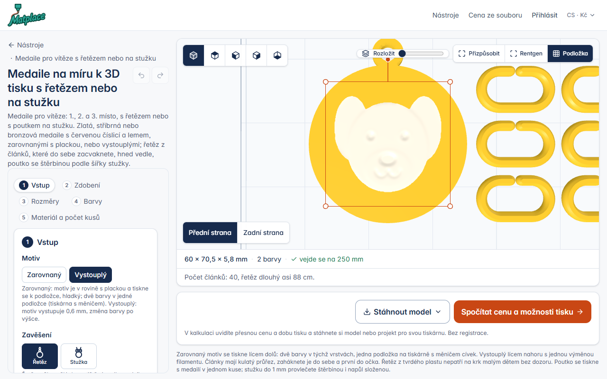 | 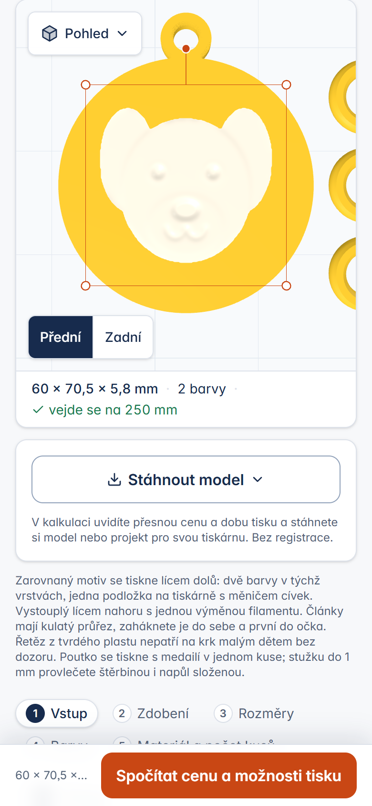 | 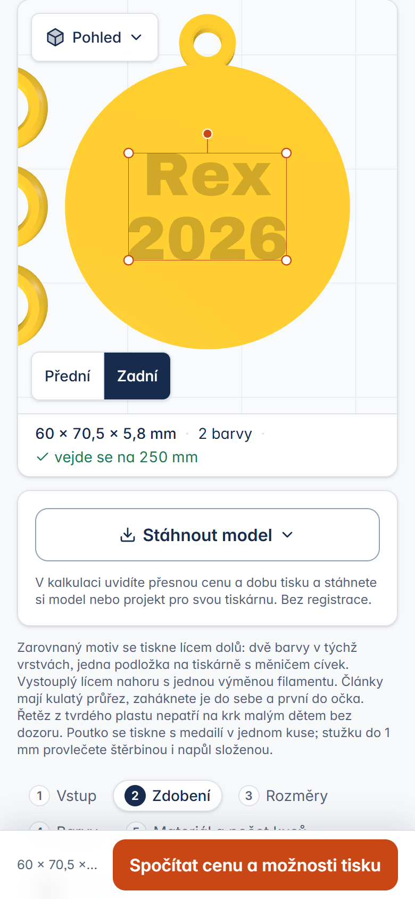 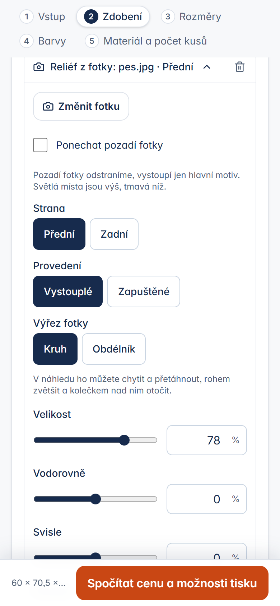 |
| klíčenka: jméno, logo červeně, telefon vzadu | 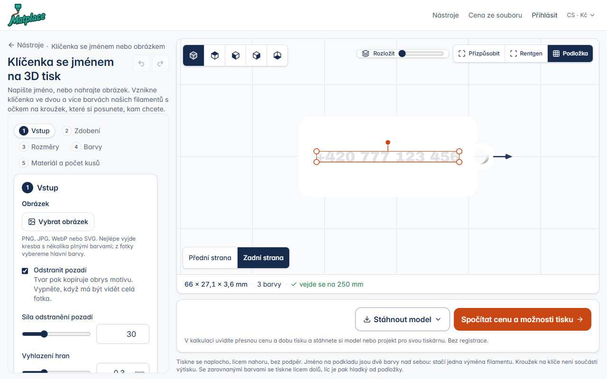 | 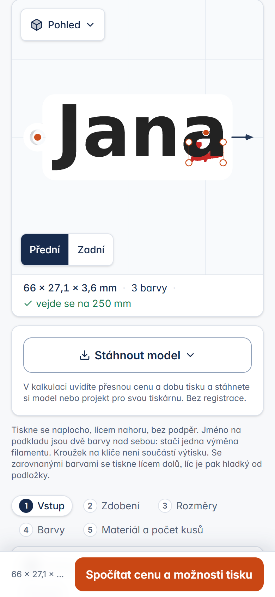 | 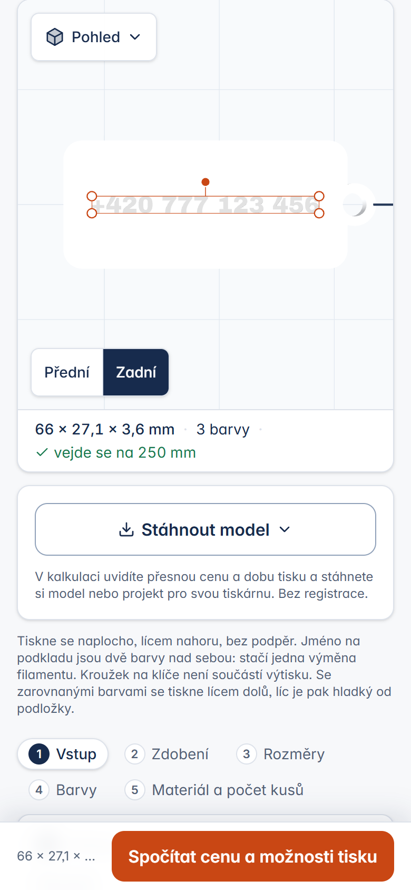 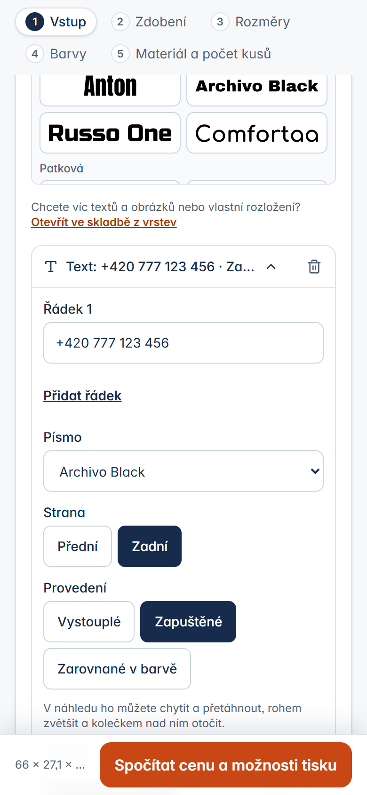 |
| ozdoba: reliéf psa a jméno bíle na červené | 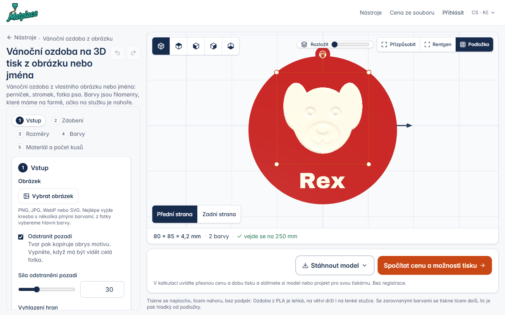 | 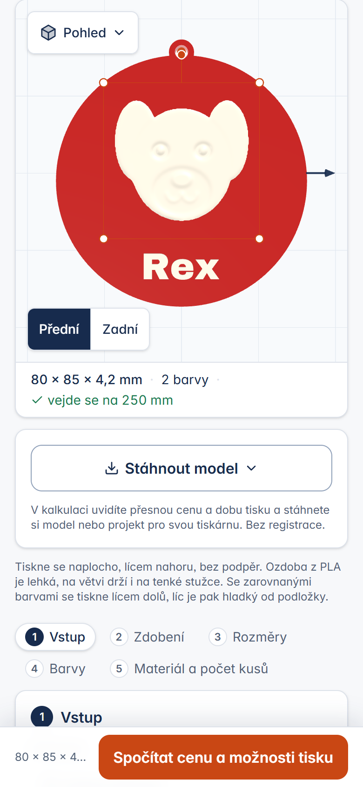 | |
| podtácek: zapuštěný reliéf šálku, text modře | 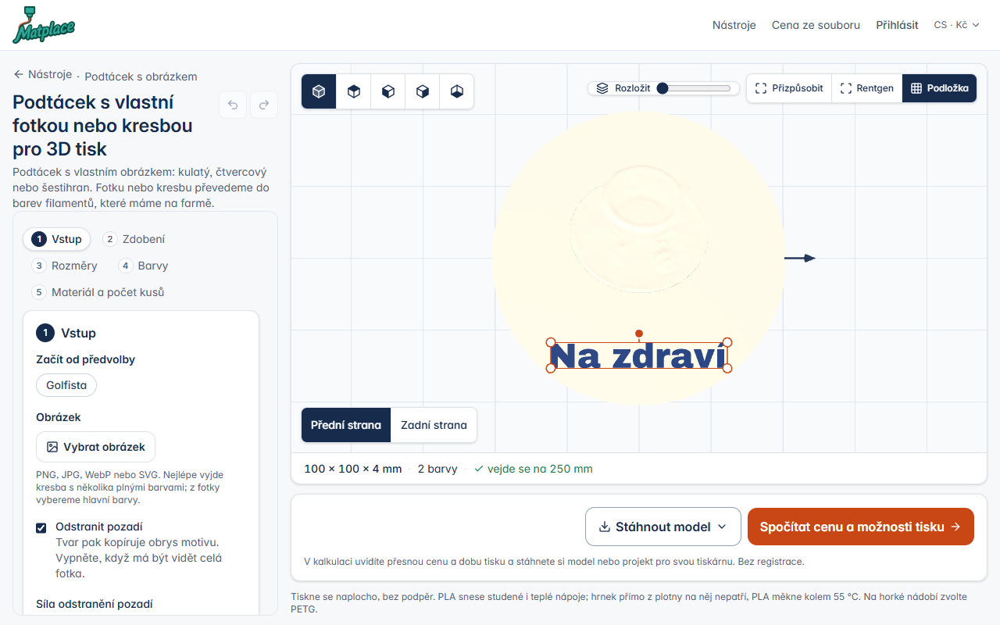 | 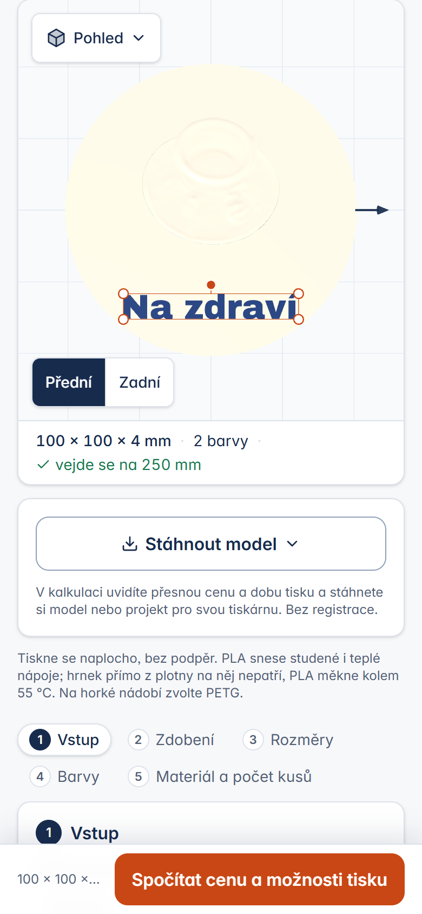 | 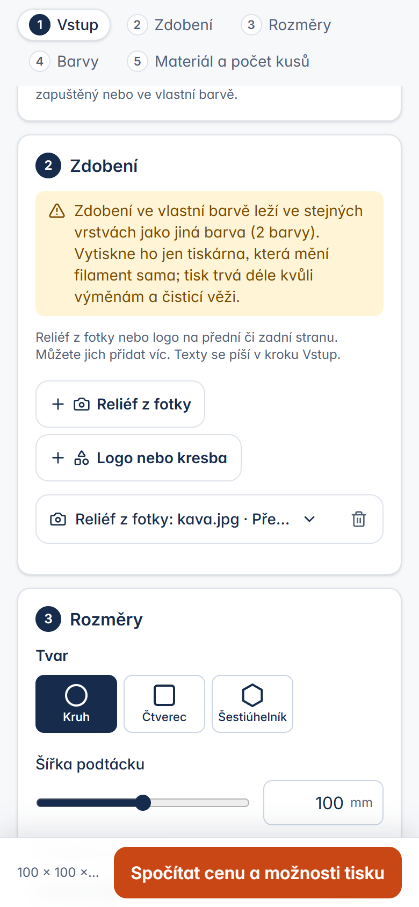 |

Zapuštěný text (dvě vrstvy) by v náhledu nebyl vidět: dno zapuštění se kreslí o odstín tmavší (`Viewer.setSunk`,
`view.floor` z enginu). Zapuštěný reliéf fotky tmavší není, čte se stínováním.

### 12.7 Testy

- `tests/Feature/DecorRound2Test.php` (6 testů, 297 asercí): zápis `background` a barva reliéfu (starý zápis = `keep`,
  neznámé slovo 422); pozadí pryč na obrázku s vlastní průhledností (méně plastu než kotouč celé fotky, obrys užší než
  výřez, reliéf začíná nad plochou), síť vypnutá → celá fotka a varování; `decor_face` a `view` u výrobku lícem nahoru
  i lícem dolů (stejný zápis leží na stejném místě plochy, zadní strana zrcadlově, dno zapuštění); barevný reliéf po
  výšce, zapuštěný na jednu podložku, uložení a díl `decor_1.stl`; místo pro texty ve Vstupu na pěti stránkách ve třech
  jazycích a slova panelu; zakázka farmy na jedné podložce s jedním objektem o dvou částech.
  Síť u2net testy nevolají (`PAPEL_REMBG=off`), zkoušela se ručně (§12.1).
- `DecorTest` (upravená jedna aserce: reliéf smí mít barvu, zápis nese `background`), `ThreeMfWriterTest` (+1 test,
  upravené počty), `FarmOnePlateCopiesTest` (4 položky místo 8).
- Sada kolem změny (`DecorTest|IntakeDecorTest|FlushDownTest|ComposeToolTest|ToolPageTest|LandingPagesTest|SeoTest|
  FarmOnePlateTest|FarmOnePlateCopiesTest|ThreeMfWriterTest|FarmToolChangerPlateTest|SliceCacheTest`): OK, 96 testů,
  14 355 asercí. `pint --dirty`, `npx tsc --noEmit -p .`, `npm run build` prošly.
- **Celá sada PHPUnit** (13. 11. 2026, 1 h 45 min, souběžně s jinými sadami): 1200 testů, 100 660 asercí, 11 přeskočených,
  3 selhání, a to ta, která padají i na `main`: `PapelPortraitTest` (šest kroků portrétu), `PrintPhotosTest` (fotka z adminu),
  `YouTubeChannelTest` (tabulka titulků).

### 12.8 Nasazení

- **Migrace: žádná.** Nové klíče (`decor[].background`, barva u fotky) jsou v JSON `tool_params`.
- **Knihovny enginu: žádná nová, ale odstranění pozadí potřebuje to, co už má papel picado:** `onnxruntime` a model
  `u2net.onnx` tam, kde ho hledá `papel_portrait._model()` (`$U2NET_HOME`, `<python>/u2net`, `~/.u2net`, i v rozložení
  `models/u2net/`; na serveru `/opt/matplace-py/u2net`, `docs/T.md` §nasazení, `docs/AL.md` §13.3). Ověření na
  serveru: `python engines/python/papel_portrait.py --probe` pod uživatelem workerů. Když chybí, nic nespadne: reliéf je
  z celé fotky a stránka to řekne. `scikit-image` (obrys motivu) a `scipy` produkce má pro `shape2d.py`.
- `npm ci && npm run build`, `php artisan optimize`, restart workerů. Žádný nový klíč v `.env`.
- **`ThreeMfWriter` mění projekt farmy** pro návrhy s dílem nad podložkou a pro kopie vícedílných kusů (§12.4).
  Rozpracované zakázky mají G-kód hotový a nemění se; nově řezané takové zakázky dostanou jiný `plate.3mf` (a jiný
  klíč v mezipaměti řezů). Před nasazením stojí za to jeden ostrý řez na serveru (Orca 2.4 produkce: stavbu
  `components` + `<part>` jsem zkoušel jen v Orca 2.5.0 na Windows; chybu s kopiemi v 2.4 i 2.5.0).
- Nové soubory: `tests/Feature/DecorRound2Test.php`, `lang/src/dilna_zdobeni_2.json`, `scripts/decor_walk.mjs`,
  `scripts/decor_slice.php`, `docs/img/decor2-*.png`. Změněné: `engines/python/decor.py`,
  `app/Domain/Tools/ParametricGenerator.php`, `app/Engines/Mesh/ThreeMfWriter.php`, `resources/js/calc/{decor,param,viewer}.ts`,
  `resources/views/tools/param.blade.php`, `lang/{cs,en,es}.json`, `tests/Feature/DecorTest.php`,
  `tests/Feature/FarmOnePlateCopiesTest.php`, `tests/Unit/ThreeMfWriterTest.php`.

### 12.9 Souběh

- `decor.ts`: `bootDecor(host, cfg, t, nf, changed)` funguje dál (šestý parametr je nepovinný); `DecorPanel` má
  metody navíc. `decor.py`: `apply`, `wanted`, `needs_front_up` beze změny podpisu; `_face` builderu se nemění.
- Zápis `decor`: nové klíče jen přibyly (`background`; `color` u fotky se dřív zahazovala). `params.decor = "photo"`
  z úvodní strany funguje dál, fotka přijde s odstraněným pozadím.
- `Viewer`: nové `setTurned`, `isTurned`, `focus`, `setSunk`, `framingNow`; `setFrame` má třetí nepovinný parametr,
  `onPiecePicked` dává navíc místo klepnutí. Stávající volání beze změny.
- Texty: jen nové klíče v `lang/src/dilna_zdobeni_2.json`; `param.decor.lead` zůstal v souboru, stránka používá
  `param.decor.lead2`. Na titulky a texty stránek nástrojů jsem nesáhl.

### 12.10 Co není ověřené a otázky

Neověřeno:

- **Skutečný tisk** čehokoli: reliéf bez pozadí (hrana motivu je stěna 0,5 mm a víc), barevný reliéf po výšce, zdobení
  ve stejných vrstvách na tiskárně s měničem (věž, proplach), čitelnost zapuštěného textu.
- **Skutečné fotografie lidí a psů.** Síť u2net zkoušena na dvou volných fotkách a kresbách. Fotka, kde motiv sahá
  k okraji snímku, se ořízne okrajem; na fotce bez zřetelného motivu síť nic nenajde a reliéf je z celé fotky.
- **Odstranění pozadí na produkci**: stejná cesta jako papel picado, na serveru jsem ji nespouštěl.
- **Skutečný telefon.** Tažení, zvětšení a otočení prstem jsem zkoušel dotykovými událostmi v headless Chrome 390 px
  (posun, zastavení u okraje, zadní strana, klepnutí na zdobení); zvětšení a otočení myší na 1280 px. Dva prsty
  (štípnutí) nejsou: velikost se mění rohem rámečku.
- **`ThreeMfWriter` na Orca 2.4 produkce** s díly jako částmi jednoho objektu (viz §12.8) a na měniči nástrojů (INDX).
  Falešný slicer testů strukturu 3MF nečte.
- **Kolize s lemem a s vlastním motivem nástroje**: tažení hlídá okraj desky a očko. Přes lem medaile a přes jméno
  nástroje zdobení přetáhnout jde; engine ho tam ořízne (vystouplé ustoupí tomu, co už stojí).
- Zakázka s barevným zdobením **po výšce** (výměna filamentu v dané výšce) jde cestou, kterou farma měla už dřív
  (`color_changes`); nový test ji neprochází, kontroluje jen uložení návrhu.

Otázky pro Romana:

1. **Kopie barevných kusů** (§12.4, chyba 2) jsou na produkci od 9. 11. špatně. Nasadit opravu `ThreeMfWriter` hned
   a zvlášť, nebo s celou větví? Zakázky s víc kusy a zarovnanými barvami z 9.–13. 11. stojí za prohlédnutí.
2. **Zdobení ve stejné výšce jako jiná barva** stojí věž a 10–25 minut. Nechat volbu zákazníkovi (stránka to teď
   říká), nebo vystouplé zdobení v barvě stavět o krok výš, aby šlo vždy výměnou po výšce (jako barvy obrázku)?
3. **Text**: stačí jedno místo na stránce (krok Vstup), nebo má jméno nástroje opravdu zmizet a tvar vznikat jinak?
   To druhé změní uložené návrhy a patří k projektu dílny.
4. **Motiv u okraje fotky** (kočka přes celý snímek) vyjde oříznutý rovnou hranou. Nabídnout u takové fotky rovnou
   „ponechat pozadí“ a výřez kruhem?
