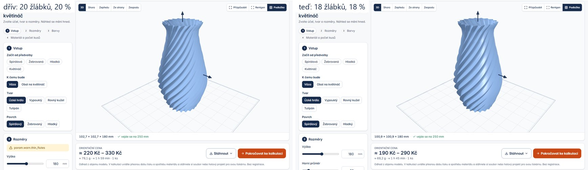

# Nástroj se neotevírá s varováním

Úkol #12 session E (`docs/prompts/opravy.md`), větev `feature/tool-fixes`, 13. 10. 2026.

**Pravidlo:** stránka parametrického nástroje s výchozími hodnotami, ani žádná její předvolba, nenese varování. První,
co návštěvník uvidí, je hotová věc, ne žlutý rámeček. Varování zůstávají pro hodnoty, které zadá sám.

Hlídá to test `test_no_tool_opens_with_a_warning_and_no_preset_brings_one` v `tests/Feature/ToolPageTest.php`: pro
každý nástroj sestaví to, oč stránka žádá první náhled (výchozí hodnoty polí, předvolba z adresy, ukázkový text,
náš obrázek), a totéž s každou předvolbou, a nechá to spočítat. Běží asi 50 s, potřebuje Python.

## Co se změnilo

| nástroj | dřív | teď | proč varoval |
|---|---|---|---|
| váza, výchozí hodnoty a předvolba Spirálová | 20 žlábků, hloubka 20 % | 18 žlábků, 18 % | stěna 1,6 mm měla napříč žlábkem 0,79 mm, hranice varování je 0,8; teď 0,92 |
| cedulka, předvolba Ozdoba s očkem | písmo 12 mm | písmo 16 mm | obrys kolem písmen byl tenčí než 0,8 mm (83 % motivu) |
| stojánek na tužky ze jména | ukázkové jméno „Jana“ | „Anna“ | psací „J“ se nedotýká „a“, písmena spojovala příčka a stránka to hlásila |

Meze polí se neměnily. Váza má stejnou výšku, průměry i stěnu, spotřeba materiálu je stejná (69 → 68 cm³).

## Co varuje dál a proč

- **Víčko, předvolba PET lahev:** „závit vytiskněte nejdřív na zkoušku“ a rada k těsnicímu kroužku. Jsou to rady
  k technice, zazní u každého závitu a kroužku bez ohledu na čísla. Test je má v seznamu `ADVICE`.
- **Logo, předvolba „jen obrys“ s výchozím textem LOGO:** „vyříznutý tvar se skládá ze 4 samostatných kousků“. Je to
  odpověď na volbu návštěvníka (samotná písmena spolu nedrží), ne vada výchozích hodnot. Stránka SVG do STL, která
  se touto předvolbou otevírá, začíná obrázkem kočky a nevaruje.

Mimo test: modulární organizér se otevírá prázdný (přihrádky kreslí návštěvník) a vložka do zásuvky čeká na fotku.
