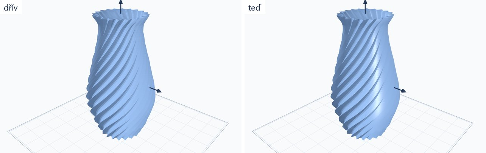
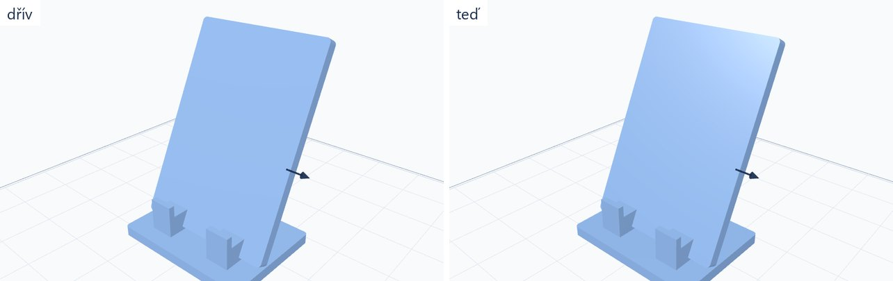
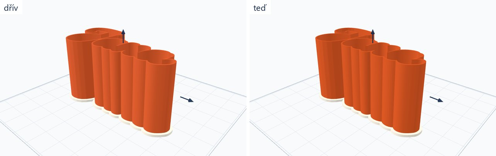
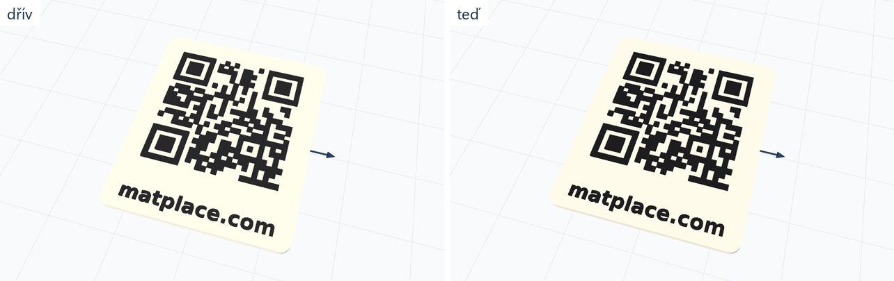
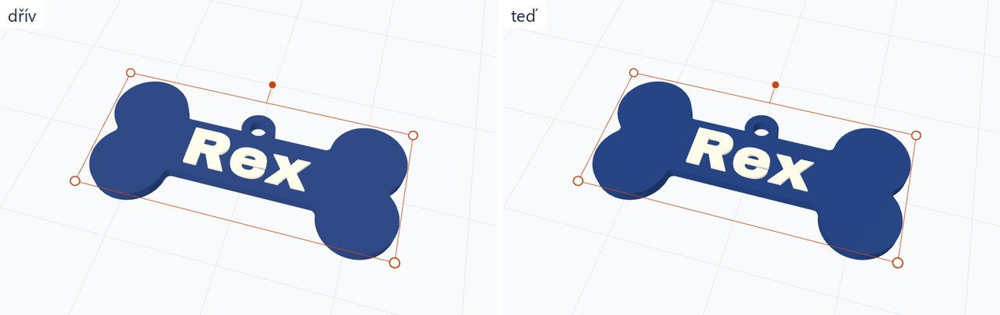
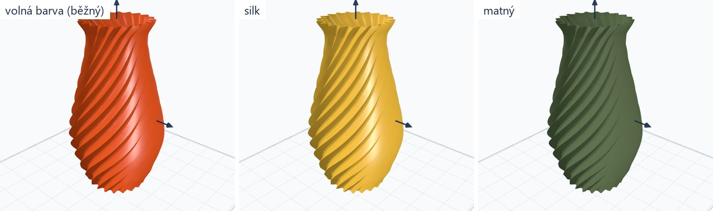

# Vzhled modelu v náhledu: hladký a lesklý podle filamentu

Úkol #10 session E (`docs/prompts/opravy.md`), větev `feature/tool-fixes`, 13. 10. 2026. Celé je to v jednom souboru:
`resources/js/calc/viewer.ts`. Platí pro všechny stránky nástrojů i pro kalkulaci, protože všechny kreslí týmž `Viewer`.

## 1. Co se změnilo

| | dřív | teď |
|---|---|---|
| stínování | každý trojúhelník zvlášť (`flatShading`), oblé stěny hranaté | hladké tam, kde je povrch hladký; hrana ostřejší než 38° zůstává hranou |
| povrch | matný (roughness 0,75) | podle druhu filamentu, viz tabulka níže |
| díly ve vlastních barvách | `plateMaterial` (matný, hranatý) | stejný lesklý vzhled jako jednobarevný model |
| busta a figurka | `sculptureMaterial` | beze změny |
| deska s barvou podle výšky (reliéf, litofanie, cedulka bez zvolených barev) | `plateMaterial` | beze změny |

Barva dílu je pořád ta zvolená: běžný filament má metalness 0, takže se barva neztmaví ani nezabarví, jen na oblých
plochách přibude odlesk lamp.

### Lesk podle druhu filamentu (`GLOSS`)

| finish | roughness | metalness | |
|---|---|---|---|
| `solid`, `luminous`, `special` a volná barva | 0,38 | 0 | jemný lesk běžného PLA/PETG |
| `silk` | 0,26 | 0,15 | výrazný odlesk |
| `glitter` | 0,32 | 0,10 | |
| `flex` | 0,58 | 0 | |
| `cf` | 0,78 | 0 | |
| `matte` | 0,82 | 0 | téměř bez odlesku |

Druh se bere z katalogu farmy: `setPalette()` si u každé cívky zapamatuje `finish` podle jejího kódu i podle hexu,
`setColor(hex)` a `setPieceColor(index, hex)` si ho podle hexu dohledají. Volající se neměnily; kdo druh zná, může ho
předat třetím (u `setColor` druhým) parametrem. Dvě cívky se stejným hexem a různým druhem od sebe podle hexu rozeznat
nejdou, platí ta první v katalogu (u nás černá: běžná před třpytivou).

Když mají díly jednoho modelu filamenty různých druhů (hedvábná krabička s matným víkem), kreslí se každý díl svým
materiálem (skupiny geometrie podle `pieces`).

## 2. Jak se počítá hladké stínování

`creaseNormals(geom, 38)`: každému rohu každého trojúhelníku sečte normály těch sousedních ploch u téhož bodu, které
se od jeho vlastní plochy liší o méně než 38°. Oblá stěna vázy je tak hladká, hrana krabičky a boky vystouplých písmen
zůstávají ostré.

Zadání počítalo s `mergeVertices`. To by ale změnilo pořadí a počet vrcholů a na pořadí trojúhelníků ze souboru stojí
díly (`setPieces`), klikání na díl, rozložený pohled, barvení po plochách i červená „přes podložku“. Proto se body
jen přiřadí k sobě (hash zaokrouhlených souřadnic v typovaných polích) a geometrie zůstává, jak ji soubor má.

Počítá se jednou pro geometrii (`geom.userData.creased`). Deska s barvou podle výšky se nepočítá vůbec, dokud její
díly nedostanou vlastní barvy.

**Výkon** (měřeno funkcí vyříznutou ze zdroje, Node, i na stránce):

| model | trojúhelníků | čas |
|---|---|---|
| váza na stránce nástroje (headless Chrome, první běh) | 44 tis. | 34 ms |
| koule | 301 tis. | 66–93 ms |
| reliéfní plocha | 301 tis. | 56–58 ms |
| koule | 500 tis. | 119–124 ms |

Reliéf a litofanie jsou desky s barvou podle výšky, takže je výpočet nestojí nic.

## 3. Prostředí pro odlesky jsme nepřidali

`RoomEnvironment` jsme zkusili (intenzita 0,45 a 0,15). Kromě odlesků přidává i rozptýlené světlo ze všech stran:
barvy zbledly, bílá deska QR cedulky vyhořela do čisté bílé a stěny krabičky splynuly, protože ztratily rozdíl mezi
osvětlenou a odvrácenou stranou. Lesk proto dělají jen lampy scény, stejně jako u busty. Rovná plocha se tak zaleskne
až při otočení modelu, oblá má odlesk pořád.

## 4. Před a po

Vlevo dřív, vpravo teď; stejné výchozí nastavení nástroje, stejný pohled.

Busta se nezměnila (její materiál i výpočet normál zůstaly), proto tu snímek nemá. U ploché QR cedulky a klíčenky je
změna malá: barvy drží, oblé boky písmen a obrysu jsou hladké, rovný vršek odlesk v tomto pohledu nemá.

## 5. Co ověřit po úpravě

- `node scripts/check_preview_colors.mjs` proti běžícímu webu: zvolená barva musí být v náhledu vidět na všech stránkách.
  13. 10. 2026 místně 55 stránek, 0 chyb. Na místním serveru (`php -S`, jedno vlákno) trvá běh asi 45 minut a nesmí
  při něm server dělat nic jiného: pět stránek napoprvé hlásilo chybějící barvu jen proto, že náhled nestihl dojít
  (samostatně, případně se `SETTLE=6000`, prošly).
- Barvy dílů, rozložený pohled, klik na díl a rentgen na nástroji s víc díly (krabička s víkem).
- Kalkulace: model se zvolenou barvou a s výměnou barvy ve výšce.
