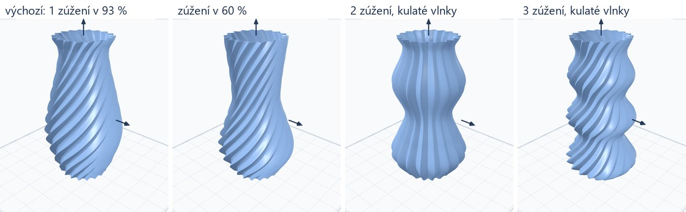

# Váza: posunutelné zúžení, víc zúžení, kulaté vlnky

Úkol #13 session E (`docs/prompts/opravy.md`), větev `feature/tool-fixes`, 13. 10. 2026. Od Romana: „u vázy bych chtěl
přidat možnost přemisťovat osu zúžení a přidat i více zúžení, vlnky ne jen ostré, ale i kulaté“.

## Co přibylo na `/tools/vase`

| pole | hodnoty | výchozí | kde se ukazuje |
|---|---|---|---|
| Počet zúžení (`waists`) | 0–3 | 1 | u tvaru „Úzké hrdlo“, mezi hlavními rozměry |
| Výška horního zúžení (`waist_at`) | 30–95 % výšky | 93 | u tvaru „Úzké hrdlo“, mezi hlavními rozměry |
| Síla zúžení (`waist`) | 0–45 %, o kolik je pas užší než hrdlo | 18 | u tvaru „Úzké hrdlo“, pod „Tloušťka stěn a další“ |
| Vlnky (`flute_shape`) | Ostré (`sharp`) / Kulaté (`round`) | Ostré | u povrchu Spirálový a Žebrovaný, u všech čtyř tvarů |

Při dvou nebo třech zúženích se nastavuje jen to horní; ostatní se rozloží rovnoměrně pod něj (při 93 % a dvou
zúženích leží v 46,5 % a 93 % výšky). Mezi zúženími se váza vyboulí, každé vyšší břicho o něco méně.

Pas má jen tvar „Úzké hrdlo“. Vypouklý, Rovný kužel a Tulipán žádný nemají, pole se u nich neukazují a engine je
u nich nečte.

## Co zůstalo stejné

Jedno zúžení v 93 % se silou 18 % a ostré vlnky je váza, jaká byla: engine pro tuhle trojici jde původní cestou
(`_through`), jinak novou (`_waisted`). Uložený návrh nová pole nemá, dostane výchozí hodnoty a vyjde stejně.

Ověřeno otiskem souboru (sha1 STL před úpravou enginu a po ní), 18 váz, všechny shodné: výchozí, čtyři předvolby,
starší návrh s 20 žlábky ve všech čtyřech tvarech a třech površích, květináč s podmiskou. Například:

| váza | sha1 před i po |
|---|---|
| výchozí (= předvolba Spirálová) | `0c244191f0dd33b558e66a2a75eca0c69b49d998` |
| předvolba Žebrovaná | `dbb1f180127f7748686cccbb36344911b711fc98` |
| předvolba Hladká | `1ec928721b74ad4e4f75fee6efed557a367f9fca` |
| předvolba Květináč | `f8ff22b94245c7a1cb7eb317bbfc2dfdd68945d8` |
| starší návrh, úzké hrdlo, spirála, 20 žlábků | `95475ea02aa52e8b121e95a662745fd5760e7738` |

Otisk v testu není, závisí na verzi knihovny manifold. Test (`CreativeToolsTest`) drží počet trojúhelníků, objem
a šířku výchozí vázy a staršího návrhu.

## Jak je profil udělaný

- Křivka prochází body (dno, břicho, rameno, pas, hrdlo) hladce a nikdy je nepřestřelí (`_monotone`, Fritsch–Carlson):
  pas je přesně tak úzký a přesně tam, kde má být, břicho přesně tak široké.
- Stěna se nikde nenaklání víc, než tiskárna položí bez podpěr. Kde na vyboulení nebo na rozšíření hrdla není dost
  výšky (malá váza, tři zúžení, pas těsně pod okrajem), vyjde mělčí; `VASE_LEAN = 1,4` znamená nejvýš 1 mm poloměru
  na 1,4 mm výšky v průměru mezi dvěma body, v nejstrmějším místě asi 44° od svislice. Test hlídá 50°.
- Proto „Síla zúžení“ nad určitou hodnotu nic nemění, když je pas těsně pod okrajem: hrdlo by se nestihlo rozšířit zpět.
  S pasem níž je účinná celá.
- Kulaté vlnky jsou čistá vlna (hřeben i žlábek oblé), ostré mají úzký hřeben nad širokým žlábkem. Tenkou stěnu mezi
  žlábky hlídá stejný výpočet jako dřív; výchozích 18 žlábků a 18 % dává u kulatých 0,95 mm, u ostrých 0,92 mm.

## Příklad a texty

Čtvrtý příklad na stránce nástroje: dvě zúžení, kulaté vlnky, žebrovaná, výška 200 mm (`config/tools.php`,
`public/img/tool-examples/vase-4.png`). První příklad byl překreslen a jeho popisek opraven na 18 žeber (po úkolu #12).
Texty polí jsou v `lang/src/vase_waists.json`, úvod a popisky příkladů v `lang/*/tools_seo/vase.php`.

## Co není

- Nic z toho nebylo vytištěno.
- Zúžení na jiném tvaru než „Úzké hrdlo“ a zvlášť nastavitelná výška každého zúžení.
